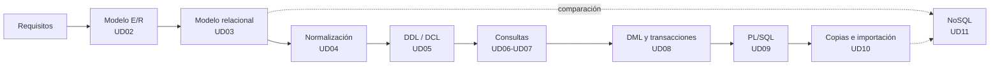

# Gestión de Bases de Datos · Módulo 0372

Apuntes del módulo profesional **0372. Gestión de bases de datos**, de **primer curso** del ciclo formativo de grado superior **Administración de Sistemas Informáticos en Red (ASIR)**. Curso **2026/27**.

| Característica | Valor |
|---|---|
| **Referencia curricular** | Real Decreto 1629/2009, de 30 de octubre (título de ASIR y enseñanzas mínimas) |
| **Duración** | 160 horas de aula (5 por semana) · el RD fija 105 horas como mínimo |
| **Resultados de aprendizaje** | 6 (RA1 a RA6) con 47 criterios de evaluación |
| **SGBD relacional** | Oracle AI Database 26ai Free (23.26) |
| **SGBD no relacional** | MongoDB Community Server 8.0 (ampliación) |
| **Proyecto común** | [EduGest: gestión de un centro educativo](/guia/proyecto-edugest) |

> [!NOTE]
> Estos apuntes **no son un manual de SQL**. Están organizados para que alcances los resultados de aprendizaje oficiales del módulo. Recorren el ciclo de vida completo de una base de datos:
> **análisis → modelo conceptual → modelo lógico → normalización → diseño físico → consultas → modificación → programación → copias de seguridad, importación y exportación.**

## El ciclo de trabajo con una base de datos

## Guía didáctica del curso 2026/27

El módulo se imparte con una carga de **160 horas de aula** (5 horas semanales, una por día lectivo) entre el **9 de septiembre de 2026** y el **24 de mayo de 2027**. Cada **resultado de aprendizaje (RA)** se corresponde con una unidad o con un bloque de unidades consecutivas, de modo que las horas de cada RA se pueden ver de un vistazo.

| RA | Resultado de aprendizaje (resumen) | Unidades | Horas |
|---|---|---|:-:|
| **RA1** | Elementos de las bases de datos y utilidad de los sistemas gestores | UD01 | 10 |
| **RA2** | Diseño de modelos lógicos normalizados a partir de diagramas E/R | UD02 · UD03 · UD04 | 38 |
| **RA3** | Diseño físico con asistentes, herramientas gráficas y DDL | UD05 | 22 |
| **RA4** | Consulta de la información con SQL | UD06 · UD07 | 32 |
| **RA5** | Modificación de la información, transacciones y guiones | UD08 · UD09 | 31 |
| **RA6** | Aseguramiento de la información: copias, importación y exportación | UD10 | 12 |
| | *Ampliación: bases de datos NoSQL (sin RA)* | UD11 | 6 |
| | *Pruebas de evaluación (3 × 3 h)* | EV1 · EV2 · EV3 | 9 |
| | **Total** | | **160** |

> [!NOTE]
> El RD 1629/2009 fija **105 horas** como enseñanzas mínimas del módulo; el currículo de la Comunitat Valenciana lo amplía hasta **160 horas** (5 por semana en 1º ASIR). Todos los criterios de evaluación se cubren en las unidades. El reparto de horas es orientativo y puede ajustarse a cada grupo.



### Reparto de horas por evaluación

| Evaluación | Unidad | Horas | Del | Al | RA |
|---|---|:-:|---|---|---|
| **1ª** (65 h) | UD01 · Sistemas de almacenamiento y SGBD | 10 | 09/09/2026 | 22/09/2026 | RA1 |
|  | UD02 · Modelo Entidad/Relación | 16 | 23/09/2026 | 16/10/2026 | RA2 |
|  | UD03 · Modelo relacional | 12 | 19/10/2026 | 03/11/2026 | RA2 |
|  | UD04 · Normalización | 10 | 04/11/2026 | 17/11/2026 | RA2 |
|  | UD05 · Definición y control de datos | 22 | 18/11/2026 | 08/01/2027 | RA3 |
|  | Prueba y revisión de la 1ª evaluación | 3 | 09/12/2026 | 11/12/2026 | |
| **2ª** (43 h) | UD06 · Consultas sobre una tabla | 14 | 11/01/2027 | 28/01/2027 | RA4 |
|  | UD07 · Consultas avanzadas | 18 | 29/01/2027 | 23/02/2027 | RA4 |
|  | Prueba y revisión de la 2ª evaluación | 3 | 24/02/2027 | 26/02/2027 | |
| **3ª** (52 h) | UD08 · DML, transacciones y concurrencia | 16 | 01/03/2027 | 23/03/2027 | RA5 |
|  | UD09 · Programación con PL/SQL | 15 | 24/03/2027 | 23/04/2027 | RA5 |
|  | Prueba y revisión de la 3ª evaluación y final | 3 | 26/04/2027 | 28/04/2027 | |
|  | UD10 · Seguridad de los datos: copias, importación y exportación | 12 | 29/04/2027 | 14/05/2027 | RA6 |
|  | UD11 · Bases de datos NoSQL (ampliación) | 6 | 17/05/2027 | 24/05/2027 | Ampliación |
| | **Total** | **160** | | | |

### Criterios de la planificación

- **Un RA, un bloque de unidades.** Cada resultado de aprendizaje tiene su propia unidad (o grupo de unidades), de modo que cada RA puede evaluarse al terminar su bloque. El peso de las horas sigue el del currículo: el diseño lógico (RA2), las consultas (RA4) y la modificación de datos (RA5) concentran la mayor parte de la carga.
- **Evaluaciones.** La 1ª evaluación cierra el RA1 y el RA2 y avanza el RA3; la 2ª termina el RA3 y el RA4; la 3ª, el RA5. El RA6 (UD10) y la ampliación NoSQL (UD11) se imparten tras la prueba de la 3ª evaluación, hasta el final de las clases del módulo.
- **Teoría y práctica en la misma unidad.** Cada unidad indica en su página de teoría una *temporalización* con el reparto de sesiones entre teoría (T) y práctica (P). La suma de horas de cada unidad coincide con la de esta tabla.
- **Práctica guiada en el aula, práctica autónoma fuera de ella.** Las prácticas guiadas y la tarea del proyecto EduGest se hacen en clase. Las prácticas autónomas, los retos y las ampliaciones son trabajo personal, y las dudas se trabajan en las sesiones de práctica.
- **Pruebas de evaluación.** Cada evaluación reserva 3 horas a la prueba y a su revisión.
- **Un día lectivo equivale a una hora.** Los festivos y los días sin docencia no cuentan. Los días que se pierdan por fiestas locales o actividades del centro se recuperan recortando las sesiones de práctica de la última unidad impartida.

> [!CAUTION]
> **Planificación provisional.** Las fechas proceden del calendario escolar provisional 2026/27 y no se han ajustado todavía al horario real de 1º ASIR. Cuando se fije el horario definitivo debe revisarse el archivo `data/planificacion.json` y la *temporalización* de cada unidad; la tabla y el calendario se actualizan solos y la compilación falla si las horas de una unidad dejan de sumar.

## Unidades didácticas

Cada unidad tiene dos páginas: **teoría** (conceptos, ejemplos y autoevaluación) y **prácticas** (prácticas guiadas, autónomas, retos y la tarea del proyecto EduGest).

  
RA1<h3>UD01 · Sistemas de almacenamiento y SGBD</h3>
Ficheros frente a bases de datos, arquitectura y funciones de un SGBD, tipos de bases de datos, distribución, Big Data y protección de datos.

<a href="ud01-introduccion/ud01-teoria/">Teoría</a> · <a href="ud01-introduccion/ud01-practicas/">Prácticas</a>

  
RA2<h3>UD02 · Modelo Entidad/Relación</h3>
Análisis de requisitos, entidades, atributos, relaciones, cardinalidades, entidades débiles y extensiones EER.

<a href="ud02-modelo-er/ud02-teoria/">Teoría</a> · <a href="ud02-modelo-er/ud02-practicas/">Prácticas</a>

  
RA2<h3>UD03 · Modelo relacional</h3>
Relaciones, claves, restricciones, integridad y transformación del modelo E/R al modelo relacional.

<a href="ud03-modelo-relacional/ud03-teoria/">Teoría</a> · <a href="ud03-modelo-relacional/ud03-practicas/">Prácticas</a>

  
RA2<h3>UD04 · Normalización</h3>
Anomalías, dependencias funcionales, 1FN, 2FN, 3FN y FNBC. Restricciones que el diseño lógico no puede expresar.

<a href="ud04-normalizacion/ud04-teoria/">Teoría</a> · <a href="ud04-normalizacion/ud04-practicas/">Prácticas</a>

  
RA3<h3>UD05 · Definición y control de datos</h3>
DDL en Oracle: tablas, tipos, restricciones, índices, vistas y secuencias, diccionario de datos. DCL: usuarios, roles y privilegios.

<a href="ud05-ddl-dcl/ud05-teoria/">Teoría</a> · <a href="ud05-ddl-dcl/ud05-practicas/">Prácticas</a>

  
RA4<h3>UD06 · Consultas sobre una tabla</h3>
SELECT, proyección, selección, ordenación, operadores, valores nulos y funciones de fila.

<a href="ud06-consultas-basicas/ud06-teoria/">Teoría</a> · <a href="ud06-consultas-basicas/ud06-practicas/">Prácticas</a>

  
RA4<h3>UD07 · Consultas avanzadas</h3>
Agrupamiento, composiciones internas y externas, subconsultas, operadores de conjuntos y optimización.

<a href="ud07-consultas-avanzadas/ud07-teoria/">Teoría</a> · <a href="ud07-consultas-avanzadas/ud07-practicas/">Prácticas</a>

  
RA5<h3>UD08 · DML, transacciones y concurrencia</h3>
INSERT, UPDATE, DELETE, MERGE, transacciones, ACID, concurrencia y bloqueos.

<a href="ud08-dml-transacciones/ud08-teoria/">Teoría</a> · <a href="ud08-dml-transacciones/ud08-practicas/">Prácticas</a>

  
RA5<h3>UD09 · Programación con PL/SQL</h3>
Guiones: bloques PL/SQL, control de flujo, procedimientos, funciones, cursores, excepciones, triggers y tareas programadas.

<a href="ud09-plsql/ud09-teoria/">Teoría</a> · <a href="ud09-plsql/ud09-practicas/">Prácticas</a>

  
RA6<h3>UD10 · Seguridad de los datos: copias, importación y exportación</h3>
Copias de seguridad y restauración, importación y exportación de datos, transferencia entre gestores y registros de error.

<a href="ud10-seguridad/ud10-teoria/">Teoría</a> · <a href="ud10-seguridad/ud10-practicas/">Prácticas</a>

  
Ampliación<h3>UD11 · Bases de datos NoSQL (ampliación)</h3>
Ampliación: tipos de bases de datos no relacionales, modelado documental y operaciones CRUD y de agregación con MongoDB.

<a href="ud11-nosql/ud11-teoria/">Teoría</a> · <a href="ud11-nosql/ud11-practicas/">Prácticas</a>

## Relación entre unidades y resultados de aprendizaje

| Unidad | RA1 | RA2 | RA3 | RA4 | RA5 | RA6 |
|---|:-:|:-:|:-:|:-:|:-:|:-:|
| UD01 Sistemas de almacenamiento y SGBD | ● |  |  |  |  |  |
| UD02 Modelo Entidad/Relación |  | ● |  |  |  |  |
| UD03 Modelo relacional |  | ● |  |  |  |  |
| UD04 Normalización |  | ● |  |  |  |  |
| UD05 Definición y control de datos |  |  | ● |  |  |  |
| UD06 Consultas sobre una tabla |  |  |  | ● |  |  |
| UD07 Consultas avanzadas |  |  |  | ● |  |  |
| UD08 DML, transacciones y concurrencia |  |  |  |  | ● |  |
| UD09 Programación con PL/SQL |  |  |  |  | ● |  |
| UD10 Seguridad de los datos: copias, importación y exportación |  |  |  |  |  | ● |
| UD11 Bases de datos NoSQL (ampliación) | | | | | | |

● resultado de aprendizaje que desarrolla la unidad. El detalle por criterio de evaluación está en [Resultados de aprendizaje y criterios de evaluación](/guia/ra-ce).

## Cómo leer estos apuntes

Los apuntes usan cuadros de colores para destacar información:

> [!TIP]
> **Consejo.** Una forma más cómoda o profesional de hacer algo.

> [!WARNING]
> **Atención.** Un error habitual o algo que puede dar problemas.

> [!IMPORTANT]
> **Clave.** Un concepto imprescindible para el resultado de aprendizaje.

> [!CAUTION]
> **Peligro.** Una operación que puede destruir o exponer datos.

{}
Las pistas y las **soluciones** de los ejercicios aparecen plegadas. Intenta resolver el ejercicio antes de abrirlas.
{}

Los fragmentos de código indican siempre el gestor al que corresponden, por ejemplo ,  o .

Consulta también la [guía del módulo](/guia): el proyecto EduGest, la instalación del entorno y las convenciones de las prácticas.

## Fuentes

- [Real Decreto 1629/2009, de 30 de octubre](https://www.boe.es/eli/es/rd/2009/10/30/1629), por el que se establece el título de Técnico Superior en Administración de Sistemas Informáticos en Red.
- [Documentación de Oracle AI Database 26ai](https://docs.oracle.com/en/database/oracle/oracle-database/26/).
- [Manual de MongoDB](https://www.mongodb.com/docs/manual/).
