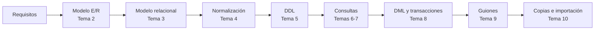

# Gestión de Bases de Datos · Módulo 0372

Apuntes del módulo profesional **0372. Gestión de bases de datos**, de **primer curso** del ciclo formativo de grado superior **Administración de Sistemas Informáticos en Red (ASIR)**. Curso **2026/27**.

| Característica | Valor |
|---|---|
| **Referencia curricular** | Real Decreto 1629/2009, de 30 de octubre (título de ASIR y enseñanzas mínimas) |
| **Duración** | 160 horas de aula (5 por semana) · el RD fija 105 horas como mínimo |
| **Resultados de aprendizaje** | 6 (RA1 a RA6) con 47 criterios de evaluación |
| **SGBD relacional** | Oracle AI Database 26ai Free (23.26) |
| **Proyecto común** | [EduGest: gestión de un centro educativo](/guia/proyecto-edugest) |

> [!NOTE]
> Estos apuntes **no son un manual de SQL**. Están organizados para que alcances los resultados de aprendizaje oficiales del módulo. Recorren el ciclo de vida completo de una base de datos:
> **análisis → modelo conceptual → modelo lógico → normalización → diseño físico → consultas → modificación → programación → copias de seguridad, importación y exportación.**

## El ciclo de trabajo con una base de datos

## Guía didáctica del curso 2026/27

El módulo se imparte con una carga de **160 horas de aula** (5 horas semanales, una por día lectivo) entre el **9 de septiembre de 2026** y el **24 de mayo de 2027**. Cada **resultado de aprendizaje (RA)** se corresponde con **una unidad didáctica** (UD01 a UD06), dividida en uno o varios *temas* numerados del 1 al 10.

| RA | Resultado de aprendizaje (resumen) | Unidades | Horas |
|---|---|---|:-:|
| **RA1** | Elementos de las bases de datos y utilidad de los sistemas gestores | UD01 (tema 1) | 8 |
| **RA2** | Diseño de modelos lógicos normalizados a partir de diagramas E/R | UD02 (temas 2, 3 y 4) | 32 |
| **RA3** | Diseño físico con asistentes, herramientas gráficas y DDL | UD03 (tema 5) | 24 |
| **RA4** | Consulta de la información con SQL | UD04 (temas 6 y 7) | 26 |
| **RA5** | Modificación de la información, transacciones y guiones | UD05 (temas 8 y 9) | 52 |
| **RA6** | Aseguramiento de la información: copias, importación y exportación | UD06 (tema 10) | 9 |
| | *Pruebas de evaluación (3 × 3 h)* | EV1 · EV2 · EV3 | 9 |
| | **Total** | | **160** |

> [!NOTE]
> El RD 1629/2009 fija **105 horas** como enseñanzas mínimas del módulo; el currículo de la Comunitat Valenciana lo amplía hasta **160 horas** (5 por semana en 1º ASIR). Todos los criterios de evaluación se cubren en las unidades. El reparto de horas es orientativo y puede ajustarse a cada grupo.



### Reparto de horas por evaluación

| Evaluación | Unidad | Tema | Horas | Del | Al |
|---|---|---|:-:|---|---|
| **1ª** (67 h) | **UD01** · Sistemas de almacenamiento y SGBD (RA1) | Tema 1 · Sistemas de almacenamiento y SGBD | 8 | 09/09/2026 | 18/09/2026 |
|  | **UD02** · Diseño lógico (RA2) | Tema 2 · Modelo Entidad/Relación | 12 | 21/09/2026 | 06/10/2026 |
|  |  | Tema 3 · Modelo relacional | 12 | 07/10/2026 | 26/10/2026 |
|  |  | Tema 4 · Normalización | 8 | 27/10/2026 | 05/11/2026 |
|  | **UD03** · Diseño físico (RA3) | Tema 5 · Definición de datos (DDL) | 24 | 06/11/2026 | 10/12/2026 |
|  | | Prueba y revisión de la 1ª evaluación | 3 | 11/12/2026 | 15/12/2026 |
| **2ª** (29 h) | **UD04** · Consultas (RA4) | Tema 6 · Consultas sobre una tabla | 10 | 16/12/2026 | 14/01/2027 |
|  |  | Tema 7 · Consultas de resumen, composiciones y subconsultas | 16 | 15/01/2027 | 05/02/2027 |
|  | | Prueba y revisión de la 2ª evaluación | 3 | 08/02/2027 | 10/02/2027 |
| **3ª** (64 h) | **UD05** · Modificación de la información (RA5) | Tema 8 · Modificación de datos, transacciones y concurrencia | 36 | 11/02/2027 | 14/04/2027 |
|  |  | Tema 9 · Guiones de sentencias | 16 | 15/04/2027 | 06/05/2027 |
|  | **UD06** · Aseguramiento de la información (RA6) | Tema 10 · Seguridad de los datos: copias, importación y exportación | 9 | 07/05/2027 | 19/05/2027 |
|  | | Prueba y revisión de la 3ª evaluación y final | 3 | 20/05/2027 | 24/05/2027 |
| | | **Total** | **160** | | |

### Criterios de la planificación

- **Una unidad por RA.** Cada resultado de aprendizaje tiene su propia unidad, de modo que cada RA puede evaluarse al terminar su unidad. El peso de las horas sigue el del currículo: el diseño lógico (RA2), las consultas (RA4) y la modificación de datos (RA5) concentran la mayor parte de la carga.
- **Evaluaciones.** La 1ª evaluación cierra los RA1, RA2 y RA3; la 2ª, el RA4; la 3ª, los RA5 y RA6. El RA5 pesa más que el resto por el número de criterios de evaluación que agrupa (DML, transacciones, bloqueos, integridad y guiones).
- **Teoría y práctica en la misma unidad.** Cada tema indica en su página de teoría una *temporalización* con el reparto de sesiones entre teoría (T) y práctica (P). La suma de horas de cada tema coincide con la de esta tabla.
- **Práctica guiada en el aula, práctica autónoma fuera de ella.** Las prácticas guiadas y la tarea del proyecto EduGest se hacen en clase. Las prácticas autónomas, los retos y las ampliaciones son trabajo personal, y las dudas se trabajan en las sesiones de práctica.
- **Pruebas de evaluación.** Cada evaluación reserva 3 horas a la prueba y a su revisión.
- **Un día lectivo equivale a una hora.** Los festivos y los días sin docencia no cuentan. Los días que se pierdan por fiestas locales o actividades del centro se recuperan recortando las sesiones de práctica de la última unidad impartida.

> [!CAUTION]
> **Planificación provisional.** Las fechas proceden del calendario escolar provisional 2026/27 y no se han ajustado todavía al horario real de 1º ASIR. Cuando se fije el horario definitivo debe revisarse el archivo `data/planificacion.json` y la *temporalización* de cada tema; la tabla y el calendario se actualizan solos y la compilación falla si las horas de un tema dejan de sumar.

## Unidades didácticas

Cada tema tiene dos páginas: **teoría** (conceptos, ejemplos y autoevaluación) y **prácticas** (prácticas guiadas, autónomas, retos y la tarea del proyecto EduGest).

  
RA1<h3>UD01 · Sistemas de almacenamiento y SGBD</h3>
Ficheros frente a bases de datos, arquitectura y funciones de un SGBD, y clasificación de los sistemas gestores.

<a href="ud01-introduccion/">Ver la unidad</a>

  
RA2<h3>UD02 · Diseño lógico</h3>
Temas 2 a 4: modelo Entidad/Relación (EER), modelo relacional y normalización hasta FNBC.

<a href="ud02-diseno-logico/">Ver la unidad</a>

  
RA3<h3>UD03 · Diseño físico</h3>
Tema 5: DDL en Oracle (tablas, tipos, restricciones, secuencias, índices) y diccionario de datos.

<a href="ud03-diseno-fisico/">Ver la unidad</a>

  
RA4<h3>UD04 · Consultas</h3>
Temas 6 y 7: SELECT, funciones de fila, agrupamiento, composiciones, subconsultas y plan de ejecución.

<a href="ud04-consultas/">Ver la unidad</a>

  
RA5<h3>UD05 · Modificación de la información</h3>
Temas 8 y 9: INSERT, UPDATE, DELETE, MERGE, transacciones, bloqueos, integridad y guiones de sentencias.

<a href="ud05-modificacion/">Ver la unidad</a>

  
RA6<h3>UD06 · Aseguramiento de la información</h3>
Tema 10: copias de seguridad, importación y exportación de datos y transferencia entre gestores.

<a href="ud06-aseguramiento/">Ver la unidad</a>

## Cómo leer estos apuntes

Los apuntes usan cuadros de colores para destacar información:

> [!TIP]
> **Consejo.** Una forma más cómoda o profesional de hacer algo.

> [!WARNING]
> **Atención.** Un error habitual o algo que puede dar problemas.

> [!IMPORTANT]
> **Clave.** Un concepto imprescindible para el resultado de aprendizaje.

> [!CAUTION]
> **Peligro.** Una operación que puede destruir o exponer datos.

{}
Las pistas y las **soluciones** de los ejercicios aparecen plegadas. Intenta resolver el ejercicio antes de abrirlas.
{}

Los fragmentos de código indican siempre el gestor al que corresponden, por ejemplo ,  o .

Consulta también la [guía del módulo](/guia): el proyecto EduGest, la instalación del entorno y las convenciones de las prácticas.

## Fuentes

- [Real Decreto 1629/2009, de 30 de octubre](https://www.boe.es/eli/es/rd/2009/10/30/1629), por el que se establece el título de Técnico Superior en Administración de Sistemas Informáticos en Red.
- [Documentación de Oracle AI Database 26ai](https://docs.oracle.com/en/database/oracle/oracle-database/26/).
- [Documentación de PostgreSQL](https://www.postgresql.org/docs/).
