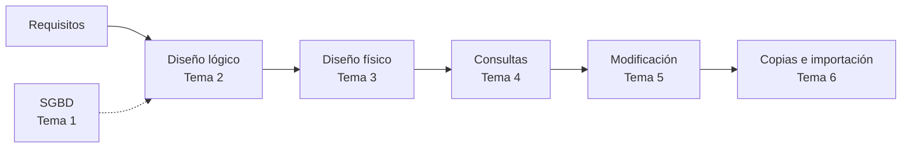

# Gestión de Bases de Datos · Módulo 0372

Apuntes del módulo profesional **0372. Gestión de bases de datos**, de **primer curso** del ciclo formativo de grado superior **Administración de Sistemas Informáticos en Red (ASIR)**. Curso **2026/27**.

| Característica | Valor |
|---|---|
| **Referencia curricular** | Real Decreto 1629/2009, de 30 de octubre (título de ASIR y enseñanzas mínimas) |
| **Duración** | 160 horas de aula (5 por semana) · el RD fija 105 horas como mínimo |
| **Resultados de aprendizaje** | 6 (RA1 a RA6) con 47 criterios de evaluación |
| **SGBD relacional** | Oracle AI Database 26ai Free (23.26) |
| **Proyecto común** | [EduGest: gestión de un centro educativo](/guia/proyecto-edugest) |

> [!NOTE]
> Estos apuntes **no son un manual de SQL**. Están organizados para que alcances los resultados de aprendizaje oficiales del módulo. Recorren el ciclo de vida completo de una base de datos:
> **análisis → modelo conceptual → modelo lógico → normalización → diseño físico → consultas → modificación → guiones → copias de seguridad, importación y exportación.**

## El ciclo de trabajo con una base de datos

## Guía didáctica del curso 2026/27

El módulo se imparte con una carga de **160 horas de aula** (5 horas semanales, una por día lectivo) entre el **9 de septiembre de 2026** y el **24 de mayo de 2027**. Se organiza en **6 temas, uno por cada resultado de aprendizaje (RA)**: el tema 1 desarrolla el RA1, el tema 2 el RA2, y así hasta el tema 6 y el RA6.

| Tema | RA | Resultado de aprendizaje (resumen) | Horas | Del | Al |
|---|---|---|:-:|---|---|
| [Tema 1](/tema1-introduccion) · Sistemas de almacenamiento y SGBD | **RA1** | Elementos de las bases de datos y utilidad de los sistemas gestores | 19 | 09/09/2026 | 05/10/2026 |
| [Tema 2](/tema2-diseno-logico) · Diseño lógico de bases de datos | **RA2** | Diseño de modelos lógicos normalizados a partir de diagramas E/R | 29 | 06/10/2026 | 17/11/2026 |
| [Tema 3](/tema3-diseno-fisico) · Diseño físico (DDL) | **RA3** | Diseño físico con asistentes, herramientas gráficas y DDL | 29 | 18/11/2026 | 19/01/2027 |
| | | *Prueba y revisión de la 1ª evaluación* | 3 | 11/12/2026 | 15/12/2026 |
| [Tema 4](/tema4-consultas) · Consultas | **RA4** | Consulta de la información con SQL | 23 | 20/01/2027 | 24/02/2027 |
| | | *Prueba y revisión de la 2ª evaluación* | 3 | 08/02/2027 | 10/02/2027 |
| [Tema 5](/tema5-modificacion) · Modificación de la información | **RA5** | Modificación de la información, transacciones y guiones | 26 | 25/02/2027 | 14/04/2027 |
| [Tema 6](/tema6-aseguramiento) · Aseguramiento de la información | **RA6** | Copias de seguridad, importación, exportación y transferencia de datos | 25 | 15/04/2027 | 19/05/2027 |
| | | *Prueba y revisión de la 3ª evaluación y final* | 3 | 20/05/2027 | 24/05/2027 |
| | | **Total** | **160** | | |

> [!NOTE]
> El RD 1629/2009 fija **105 horas** como enseñanzas mínimas del módulo; el currículo de la Comunitat Valenciana lo amplía hasta **160 horas** (5 por semana en 1º ASIR). Todos los criterios de evaluación se cubren en los temas. El reparto de horas es orientativo y puede ajustarse a cada grupo.



### Criterios de la planificación

- **Un tema por RA.** Cada resultado de aprendizaje tiene su propio tema, de modo que cada RA se evalúa al terminar su tema. Las horas de cada tema son proporcionales al número de criterios de evaluación de su RA (151 horas de clase para 47 CE, unas 3,2 horas por criterio).
- **Evaluaciones.** Al llegar a la 1ª evaluación se han terminado los RA1 y RA2; en la 2ª, RA3; en la 3ª, RA4, RA5 y RA6. Cada RA se evalúa al terminar su tema.
- **Teoría y práctica en el mismo tema.** Cada página de teoría incluye una *temporalización* con el reparto de sesiones entre teoría (T) y práctica (P). En los temas con varias partes, la suma de sus partes coincide con las horas del tema.
- **Práctica guiada en el aula, práctica autónoma fuera de ella.** Las prácticas guiadas y la tarea del proyecto EduGest se hacen en clase. Las prácticas autónomas y los retos son trabajo personal, y las dudas se trabajan en las sesiones de práctica.
- **Pruebas de evaluación.** Cada evaluación reserva 3 horas a la prueba y a su revisión.
- **Un día lectivo equivale a una hora.** Los festivos y los días sin docencia no cuentan. Los días que se pierdan se recuperan recortando las sesiones de práctica del último tema impartido.

> [!CAUTION]
> **Planificación provisional.** Las fechas proceden del calendario escolar provisional 2026/27 y no se han ajustado todavía al horario real de 1º ASIR. Cuando se fije el horario definitivo debe revisarse el archivo `data/planificacion.json` y la *temporalización* de cada tema; la tabla y el calendario se actualizan solos y la compilación falla si las horas de un tema dejan de sumar.

## Temas

Cada tema tiene páginas de **teoría** (conceptos, ejemplos y autoevaluación) y de **prácticas** (prácticas guiadas, autónomas, retos y la tarea del proyecto EduGest), numeradas con el número del tema (práctica 4.3 = tema 4).

  
RA1<h3>Tema 1 · Sistemas de almacenamiento y SGBD</h3>
Ficheros frente a bases de datos, arquitectura y funciones de un SGBD, y clasificación de los sistemas gestores.

<a href="tema1-introduccion/">Ver el tema</a>

  
RA2<h3>Tema 2 · Diseño lógico de bases de datos</h3>
Modelo Entidad/Relación, modelo relacional y normalización.

<a href="tema2-diseno-logico/">Ver el tema</a>

  
RA3<h3>Tema 3 · Diseño físico (DDL)</h3>
DDL en Oracle: tablas, tipos, restricciones, secuencias, índices y diccionario de datos.

<a href="tema3-diseno-fisico/">Ver el tema</a>

  
RA4<h3>Tema 4 · Consultas</h3>
SELECT, funciones de fila, agrupamiento, composiciones, subconsultas y plan de ejecución.

<a href="tema4-consultas/">Ver el tema</a>

  
RA5<h3>Tema 5 · Modificación de la información</h3>
INSERT, UPDATE, DELETE, MERGE, transacciones, bloqueos, integridad y guiones de sentencias.

<a href="tema5-modificacion/">Ver el tema</a>

  
RA6<h3>Tema 6 · Aseguramiento de la información</h3>
Copias de seguridad, importación y exportación de datos y transferencia entre gestores.

<a href="tema6-aseguramiento/">Ver el tema</a>

## Cómo leer estos apuntes

Los apuntes usan cuadros de colores para destacar información:

> [!TIP]
> **Consejo.** Una forma más cómoda o profesional de hacer algo.

> [!WARNING]
> **Atención.** Un error habitual o algo que puede dar problemas.

> [!IMPORTANT]
> **Clave.** Un concepto imprescindible para el resultado de aprendizaje.

> [!CAUTION]
> **Peligro.** Una operación que puede destruir o exponer datos.

{}
Las pistas y las **soluciones** de los ejercicios aparecen plegadas. Intenta resolver el ejercicio antes de abrirlas.
{}

Los fragmentos de código indican siempre el gestor al que corresponden, por ejemplo ,  o .

Consulta también la [guía del módulo](/guia): el proyecto EduGest, la instalación del entorno y las convenciones de las prácticas.

## Fuentes

- [Real Decreto 1629/2009, de 30 de octubre](https://www.boe.es/eli/es/rd/2009/10/30/1629), por el que se establece el título de Técnico Superior en Administración de Sistemas Informáticos en Red.
- [Documentación de Oracle AI Database 26ai](https://docs.oracle.com/en/database/oracle/oracle-database/26/).
- [Documentación de PostgreSQL](https://www.postgresql.org/docs/).
