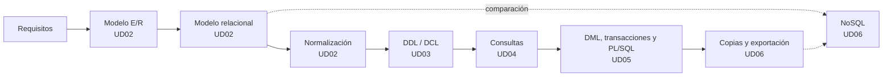

# Gestión de Bases de Datos · Módulo 0372

Apuntes del módulo profesional **0372. Gestión de bases de datos**, de **primer curso** del ciclo formativo de grado superior **Administración de Sistemas Informáticos en Red (ASIR)**. Curso **2026/27**.

| Característica | Valor |
|---|---|
| **Referencia curricular** | Real Decreto 1629/2009, de 30 de octubre (título de ASIR y enseñanzas mínimas) |
| **Duración** | 160 horas de aula (5 por semana; planificación provisional, pendiente de ajustar al horario de 1º ASIR) |
| **Resultados de aprendizaje** | 6 (RA1 a RA6) con 47 criterios de evaluación |
| **SGBD relacional** | Oracle AI Database 26ai Free (23.26) |
| **SGBD no relacional** | MongoDB Community Server 8.0 |
| **Proyecto común** | [EduGest: gestión de un centro educativo](/guia/proyecto-edugest) |

> [!NOTE]
> Estos apuntes **no son un manual de SQL**. Están organizados para que alcances los resultados de aprendizaje oficiales del módulo. Recorren el ciclo de vida completo de una base de datos:
> **análisis → modelo conceptual → modelo lógico → normalización → diseño físico → implementación → consultas → modificación → programación → copias de seguridad, importación y exportación.**

## El ciclo de trabajo con una base de datos

## Guía didáctica del curso 2026/27

La planificación prevé **160 horas de aula** repartidas entre el **9 de septiembre de 2026** y el **24 de mayo de 2027**. Es una planificación **provisional**, que debe ajustarse al horario real de 1º ASIR.

> [!NOTE]
> Todos los criterios de evaluación del RD 1629/2009 se cubren en las unidades. El reparto de horas es orientativo y puede ajustarse a cada grupo.



### Reparto de horas por evaluación

| Evaluación | Unidad | Horas | Del | Al | RA principal |
|---|---|:-:|---|---|---|
| **1ª** (65 h) | UD01 · Sistemas de almacenamiento y SGBD | 8 | 09/09/2026 | 18/09/2026 | RA1 |
|  | UD02 · Diseño lógico: E/R, relacional y normalización | 40 | 21/09/2026 | 17/11/2026 | RA2 |
|  | UD03 · DDL y DCL (parte 1) | 17 | 18/11/2026 | 11/12/2026 | RA3 |
| **2ª** (43 h) | UD03 · DDL y DCL (parte 2) | 13 | 14/12/2026 | 15/01/2027 | RA3 |
|  | UD04 · Consultas (parte 1) | 30 | 18/01/2027 | 26/02/2027 | RA4 |
| **3ª** (52 h) | UD04 · Consultas (parte 2) | 10 | 01/03/2027 | 12/03/2027 | RA4 |
|  | UD05 · Manipulación de datos, transacciones y PL/SQL | 24 | 15/03/2027 | 28/04/2027 | RA5 |
|  | UD06 · Aseguramiento de la información y NoSQL | 18 | 29/04/2027 | 24/05/2027 | RA6 |
| | **Total** | **160** | | | |

### Criterios de la planificación

- **Horas del módulo.** El currículo del módulo fija **160 horas** (5 por semana en 1º ASIR). La planificación las reparte en seis unidades, una por resultado de aprendizaje, y las pruebas de evaluación cuentan dentro de la unidad que se esté impartiendo.
- **Prioridades.** El mayor peso está en el diseño lógico (UD02, 40 horas), las consultas (UD04, 40 horas) y el DDL (UD03, 30 horas). La modificación de datos, las transacciones y PL/SQL (UD05, 24 horas) y el aseguramiento y NoSQL (UD06, 18 horas) se reducen a lo esencial; sus apuntes se mantienen completos como material de estudio y de ampliación.
- **Teoría y práctica en la misma unidad.** Cada unidad indica en su página de teoría una *temporalización* con el reparto de sesiones entre teoría (T), práctica (P) y pruebas de evaluación (E). La suma de horas de cada unidad coincide con la de esta tabla.
- **Práctica guiada en el aula, práctica autónoma fuera de ella.** Las prácticas guiadas y la tarea del proyecto EduGest se hacen en clase. Las prácticas autónomas, los retos y las ampliaciones son trabajo personal, y las dudas se trabajan en las sesiones de práctica.
- **Pruebas de evaluación.** Cada evaluación reserva 3 horas a la prueba y a su revisión, en la semana indicada por el centro para los ciclos de grado superior.
- **Un día lectivo equivale a una hora.** Los festivos y los días sin docencia no cuentan. No hay semana de refuerzo: los días que se pierdan por fiestas locales o actividades del centro se recuperan recortando las sesiones de práctica de la última unidad impartida.

> [!CAUTION]
> **Planificación provisional.** Las fechas se han calculado con el calendario escolar de la Comunitat Valenciana y 5 horas semanales, y no se han ajustado todavía al horario real de 1º ASIR. Cuando se fije el horario definitivo debe revisarse el archivo `data/planificacion.json` y la *temporalización* de cada unidad; la tabla y el calendario se actualizan solos y la compilación falla si las horas de una unidad dejan de sumar.

## Unidades didácticas

Cada unidad tiene páginas de **teoría** (conceptos, ejemplos y autoevaluación) y de **prácticas** (prácticas guiadas, autónomas, retos y la tarea del proyecto EduGest).

  
RA1<h3>UD01 · Sistemas de almacenamiento y SGBD</h3>
Ficheros frente a bases de datos, arquitectura y funciones de un SGBD, tipos de bases de datos, distribución, Big Data y protección de datos.

<a href="ud01-introduccion/ud01-teoria/">Teoría</a> · <a href="ud01-introduccion/ud01-practicas/">Prácticas</a>

  
RA2<h3>UD02 · Diseño lógico: E/R, relacional y normalización</h3>
Del análisis de requisitos al modelo Entidad/Relación, su transformación al modelo relacional y la normalización hasta 3FN y FNBC.

<a href="ud02-diseno-logico/ud02-teoria-er/">Teoría E/R</a> · <a href="ud02-diseno-logico/ud02-practicas-er/">Prácticas E/R</a> · <a href="ud02-diseno-logico/ud02-teoria-relacional/">Teoría relacional</a> · <a href="ud02-diseno-logico/ud02-practicas-relacional/">Prácticas relacional</a> · <a href="ud02-diseno-logico/ud02-teoria-normalizacion/">Teoría normalización</a> · <a href="ud02-diseno-logico/ud02-practicas-normalizacion/">Prácticas normalización</a>

  
RA3<h3>UD03 · DDL y DCL: definición y control de datos</h3>
En Oracle: tablas, tipos, restricciones, índices, vistas y secuencias; y usuarios, roles y privilegios.

<a href="ud03-ddl-dcl/ud03-teoria/">Teoría</a> · <a href="ud03-ddl-dcl/ud03-practicas/">Prácticas</a>

  
RA4<h3>UD04 · Consultas</h3>
SELECT, nulos, funciones, composiciones, agrupamientos, subconsultas y optimización. Dos partes: una tabla y varias tablas.

<a href="ud04-consultas/ud04-teoria/">Teoría I</a> · <a href="ud04-consultas/ud04-practicas/">Prácticas I</a> · <a href="ud04-consultas/ud04-teoria-avanzada/">Teoría II</a> · <a href="ud04-consultas/ud04-practicas-avanzadas/">Prácticas II</a>

  
RA5<h3>UD05 · Manipulación de datos, transacciones y PL/SQL</h3>
INSERT, UPDATE, DELETE, MERGE, transacciones, concurrencia y programación en el servidor: procedimientos, funciones, cursores, excepciones y disparadores.

<a href="ud05-dml-plsql/ud05-teoria/">Teoría DML</a> · <a href="ud05-dml-plsql/ud05-practicas/">Prácticas DML</a> · <a href="ud05-dml-plsql/ud05-teoria-plsql/">Teoría PL/SQL</a> · <a href="ud05-dml-plsql/ud05-practicas-plsql/">Prácticas PL/SQL</a>

  
RA6<h3>UD06 · Aseguramiento de la información y NoSQL</h3>
Copias de seguridad, restauración, importación y exportación entre gestores, y bases de datos NoSQL con MongoDB.

<a href="ud06-aseguramiento/ud06-teoria/">Teoría copias</a> · <a href="ud06-aseguramiento/ud06-practicas/">Prácticas copias</a> · <a href="ud06-aseguramiento/ud06-teoria-nosql/">Teoría NoSQL</a> · <a href="ud06-aseguramiento/ud06-practicas-nosql/">Prácticas NoSQL</a>

## Relación entre unidades y resultados de aprendizaje

| Unidad | RA1 | RA2 | RA3 | RA4 | RA5 | RA6 |
|---|:-:|:-:|:-:|:-:|:-:|:-:|
| UD01 Sistemas de almacenamiento y SGBD | ● |  |  |  |  |  |
| UD02 Diseño lógico: E/R, relacional y normalización |  | ● | ○ |  |  |  |
| UD03 DDL y DCL |  | ○ | ● |  |  |  |
| UD04 Consultas |  |  |  | ● | ○ |  |
| UD05 Manipulación de datos, transacciones y PL/SQL |  | ○ |  |  | ● | ○ |
| UD06 Aseguramiento de la información y NoSQL | ○ |  |  |  |  | ● |

● contribución principal · ○ contribución secundaria. El detalle por criterio de evaluación está en [Resultados de aprendizaje y criterios de evaluación](/guia/ra-ce).

## Cómo leer estos apuntes

Los apuntes usan cuadros de colores para destacar información:

> [!TIP]
> **Consejo.** Una forma más cómoda o profesional de hacer algo.

> [!WARNING]
> **Atención.** Un error habitual o algo que puede dar problemas.

> [!IMPORTANT]
> **Clave.** Un concepto imprescindible para el resultado de aprendizaje.

> [!CAUTION]
> **Peligro.** Una operación que puede destruir o exponer datos.

{}
Las pistas y las **soluciones** de los ejercicios aparecen plegadas. Intenta resolver el ejercicio antes de abrirlas.
{}

Los fragmentos de código indican siempre el gestor al que corresponden, por ejemplo ,  o .

Consulta también la [guía del módulo](/guia): el proyecto EduGest, la instalación del entorno y las convenciones de las prácticas.

## Fuentes

- [Real Decreto 1629/2009, de 30 de octubre](https://www.boe.es/eli/es/rd/2009/10/30/1629). Texto consolidado en el BOE.
- [Documentación de Oracle AI Database 26ai](https://docs.oracle.com/en/database/oracle/oracle-database/26/).
- [Manual de MongoDB](https://www.mongodb.com/docs/manual/).
