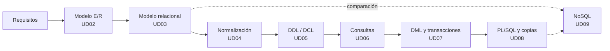

# Gestión de Bases de Datos · Módulo 0372

Apuntes del módulo profesional **0372. Gestión de bases de datos**, de **primer curso** del ciclo formativo de grado superior **Administración de Sistemas Informáticos en Red (ASIR)**. Curso **2026/27**.

| Característica | Valor |
|---|---|
| **Referencia curricular** | Real Decreto 1629/2009, de 30 de octubre (título de ASIR y enseñanzas mínimas) |
| **Duración** | 166 horas de aula previstas (planificación provisional, pendiente de ajustar al horario de 1º ASIR) |
| **Resultados de aprendizaje** | 6 (RA1 a RA6) con 47 criterios de evaluación |
| **SGBD relacional** | Oracle AI Database 26ai Free (23.26) |
| **SGBD no relacional** | MongoDB Community Server 8.0 |
| **Proyecto común** | [EduGest: gestión de un centro educativo](/guia/proyecto-edugest) |

> [!NOTE]
> Estos apuntes **no son un manual de SQL**. Están organizados para que alcances los resultados de aprendizaje oficiales del módulo. Recorren el ciclo de vida completo de una base de datos:
> **análisis → modelo conceptual → modelo lógico → normalización → diseño físico → implementación → consultas → modificación → programación → copias de seguridad, importación y exportación.**

## El ciclo de trabajo con una base de datos

## Guía didáctica del curso 2026/27

La planificación prevé **166 horas de aula** repartidas entre el **9 de septiembre de 2026** y junio de 2027. Es una planificación **provisional**, heredada del módulo de Bases de datos de DAM/DAW, que debe ajustarse al horario real de 1º ASIR.

> [!NOTE]
> Todos los criterios de evaluación del RD 1629/2009 se cubren en las unidades. El reparto de horas es orientativo y puede ajustarse a cada grupo. Las unidades de PL/SQL y NoSQL amplían el mínimo oficial.



### Reparto de horas por evaluación

| Evaluación | Unidad | Horas | Del | Al | RA principal |
|---|---|:-:|---|---|---|
| **1ª** (65 h) | UD01 · Almacenamiento de la información | 3 | 09/09/2026 | 11/09/2026 | RA1 |
|  | UD02 · Diseño conceptual (Entidad/Relación) | 26 | 14/09/2026 | 21/10/2026 | RA2 |
|  | UD03 · Modelo relacional | 20 | 22/10/2026 | 18/11/2026 | RA2 · RA3 |
|  | UD04 · Normalización | 2 | 19/11/2026 | 20/11/2026 | RA2 |
|  | UD05 · DDL: lenguaje de definición de datos (parte 1) | 14 | 23/11/2026 | 11/12/2026 | RA3 |
| **2ª** (43 h) | UD05 · DDL: lenguaje de definición de datos (parte 2) | 21 | 14/12/2026 | 27/01/2027 | RA3 |
|  | UD06 · Consultas (DML) (parte 1) | 22 | 28/01/2027 | 26/02/2027 | RA4 |
| **3ª** (36 h) | UD06 · Consultas (DML) (parte 2) | 18 | 01/03/2027 | 06/04/2027 | RA4 |
| | *Vacaciones de Pascua* | | 25/03/2027 | 05/04/2027 | |
|  | UD07 · DML, transacciones y concurrencia | 3 | 07/04/2027 | 09/04/2027 | RA5 |
|  | UD08 · Programación en PL/SQL (parte 1) | 15 | 12/04/2027 | 30/04/2027 | RA5 · RA6 |
| **Junio** (22 h) | UD08 · Programación en PL/SQL (parte 2) | 20 | 21/06/2027 | 30/06/2027 (por concretar) | RA5 · RA6 |
| | UD09 · Bases de datos no relacionales | 2 | | | RA6 |
| | **Total** | **166** | | | |

### Criterios de la planificación

- **Prioridades.** El tiempo del módulo se concentra en el diseño conceptual (UD02), el modelo relacional (UD03), el DDL (UD05), las consultas y la manipulación de datos (UD06, 40 horas de aula) y PL/SQL (UD08). Normalización (UD04), transacciones (UD07) y NoSQL (UD09) se reducen a lo esencial; sus apuntes se mantienen completos como material de estudio y de ampliación. Las pruebas de evaluación cuentan dentro de las horas de la unidad que se esté impartiendo.
- **Teoría y práctica en la misma unidad.** Cada unidad indica en su página de teoría una *temporalización* con el reparto de sesiones entre teoría (T) y práctica (P). La suma de horas de cada unidad coincide con la de esta tabla.
- **Práctica guiada en el aula, práctica autónoma fuera de ella.** Las prácticas guiadas y la tarea del proyecto EduGest se hacen en clase. Las prácticas autónomas, los retos y las ampliaciones son trabajo personal, y las dudas se trabajan en las sesiones de práctica.
- **Pruebas de evaluación.** Cada evaluación reserva 3 horas a la prueba y a su revisión, en la semana indicada por el centro para los ciclos de grado superior.
- **Un día lectivo equivale a una hora.** Los festivos y los días sin docencia no cuentan. No hay semana de refuerzo: los días que se pierdan por fiestas locales o actividades del centro se recuperan recortando las sesiones de práctica de la última unidad impartida.

> [!CAUTION]
> **Planificación provisional.** Las fechas y el reparto de horas proceden de la planificación del módulo 0484 y no se han ajustado todavía al calendario de 1º ASIR. Cuando se fije el horario definitivo debe revisarse el archivo `data/planificacion.json` y la *temporalización* de cada unidad; la tabla y el calendario se actualizan solos y la compilación falla si las horas de una unidad dejan de sumar.

## Unidades didácticas

Cada unidad tiene dos páginas: **teoría** (conceptos, ejemplos y autoevaluación) y **prácticas** (prácticas guiadas, autónomas, retos y la tarea del proyecto EduGest).

  
RA1<h3>UD01 · Sistemas de almacenamiento y SGBD</h3>
Ficheros frente a bases de datos, arquitectura y funciones de un SGBD, tipos de bases de datos, distribución, Big Data y protección de datos.

<a href="ud01-introduccion/ud01-teoria/">Teoría</a> · <a href="ud01-introduccion/ud01-practicas/">Prácticas</a>

  
RA2<h3>UD02 · Modelo Entidad/Relación</h3>
Análisis de requisitos, entidades, atributos, relaciones, cardinalidades, entidades débiles y extensiones EER.

<a href="ud02-modelo-er/ud02-teoria/">Teoría</a> · <a href="ud02-modelo-er/ud02-practicas/">Prácticas</a>

  
RA2 · RA3<h3>UD03 · Modelo relacional</h3>
Relaciones, claves, restricciones, integridad y transformación del modelo E/R al modelo relacional.

<a href="ud03-modelo-relacional/ud03-teoria/">Teoría</a> · <a href="ud03-modelo-relacional/ud03-practicas/">Prácticas</a>

  
RA2<h3>UD04 · Normalización</h3>
Anomalías, dependencias funcionales, 1FN, 2FN, 3FN y FNBC. Restricciones que el diseño lógico no puede expresar.

<a href="ud04-normalizacion/ud04-teoria/">Teoría</a> · <a href="ud04-normalizacion/ud04-practicas/">Prácticas</a>

  
RA3<h3>UD05 · DDL: definición de datos</h3>
DDL en Oracle: tablas, tipos, restricciones, índices, vistas y secuencias. DCL: usuarios, roles y privilegios.

<a href="ud05-ddl-dcl/ud05-teoria/">Teoría</a> · <a href="ud05-ddl-dcl/ud05-practicas/">Prácticas</a>

  
RA4<h3>UD06 · Consultas (DML)</h3>
SELECT, valores nulos, funciones de fila, composiciones, agrupamientos, subconsultas y optimización. Dos partes: una tabla y varias tablas.

<a href="ud06-consultas/ud06-teoria/">Teoría I</a> · <a href="ud06-consultas/ud06-practicas/">Prácticas I</a> · <a href="ud06-consultas/ud06-teoria-avanzada/">Teoría II</a> · <a href="ud06-consultas/ud06-practicas-avanzadas/">Prácticas II</a>

  
RA5<h3>UD07 · Manipulación de datos y transacciones</h3>
INSERT, UPDATE, DELETE, MERGE, transacciones, ACID, concurrencia y bloqueos.

<a href="ud07-dml-transacciones/ud07-teoria/">Teoría</a> · <a href="ud07-dml-transacciones/ud07-practicas/">Prácticas</a>

  
RA5 · RA6<h3>UD08 · Programación con PL/SQL</h3>
Bloques, variables, control de flujo, procedimientos, funciones, cursores, excepciones, triggers y tareas programadas.

<a href="ud08-plsql/ud08-teoria/">Teoría</a> · <a href="ud08-plsql/ud08-practicas/">Prácticas</a>

  
RA6<h3>UD09 · Bases de datos NoSQL</h3>
Tipos de bases de datos no relacionales, modelado documental y operaciones CRUD y de agregación con MongoDB.

<a href="ud09-nosql/ud09-teoria/">Teoría</a> · <a href="ud09-nosql/ud09-practicas/">Prácticas</a>

## Relación entre unidades y resultados de aprendizaje

| Unidad | RA1 | RA2 | RA3 | RA4 | RA5 | RA6 |
|---|:-:|:-:|:-:|:-:|:-:|:-:|
| UD01 Sistemas de almacenamiento y SGBD | ● | | | | | |
| UD02 Modelo Entidad/Relación | | ● | | | | |
| UD03 Modelo relacional | | ● | ○ | | | |
| UD04 Normalización | | ● | | | | |
| UD05 DDL: definición de datos | | ○ | ● | | | |
| UD06 Consultas (DML) | | | ○ | ● | ○ | |
| UD07 Manipulación y transacciones | | ○ | | | ● | |
| UD08 Programación PL/SQL y copias de seguridad | | ○ | | | ○ | ● |
| UD09 Bases de datos NoSQL | ○ | | | | | ○ |

● contribución principal · ○ contribución secundaria. El detalle por criterio de evaluación está en [Resultados de aprendizaje y criterios de evaluación](/guia/ra-ce).

## Cómo leer estos apuntes

Los apuntes usan cuadros de colores para destacar información:

> [!TIP]
> **Consejo.** Una forma más cómoda o profesional de hacer algo.

> [!WARNING]
> **Atención.** Un error habitual o algo que puede dar problemas.

> [!IMPORTANT]
> **Clave.** Un concepto imprescindible para el resultado de aprendizaje.

> [!CAUTION]
> **Peligro.** Una operación que puede destruir o exponer datos.

{}
Las pistas y las **soluciones** de los ejercicios aparecen plegadas. Intenta resolver el ejercicio antes de abrirlas.
{}

Los fragmentos de código indican siempre el gestor al que corresponden, por ejemplo ,  o .

Consulta también la [guía del módulo](/guia): el proyecto EduGest, la instalación del entorno y las convenciones de las prácticas.

## Fuentes

- [Real Decreto 1629/2009, de 30 de octubre](https://www.boe.es/eli/es/rd/2009/10/30/1629). Texto consolidado en el BOE.
- [Documentación de Oracle AI Database 26ai](https://docs.oracle.com/en/database/oracle/oracle-database/26/).
- [Manual de MongoDB](https://www.mongodb.com/docs/manual/).
