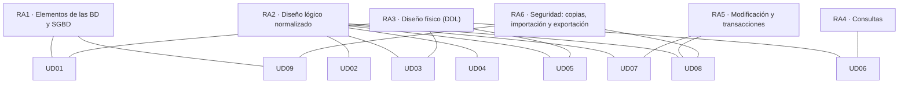

# Resultados de aprendizaje y criterios de evaluación

El módulo **0372. Gestión de bases de datos** (1º de Administración de Sistemas Informáticos en Red, ASIR) se rige por el **Real Decreto 1629/2009, de 30 de octubre**, que establece el título y sus enseñanzas mínimas. El módulo tiene **6 resultados de aprendizaje (RA)** con **47 criterios de evaluación (CE)**.

> [!IMPORTANT]
> Un **resultado de aprendizaje** describe lo que sabrás hacer al terminar el módulo. Un **criterio de evaluación** es una evidencia concreta que demuestra que lo has conseguido. Cada unidad, práctica y ejercicio de estos apuntes indica qué CE trabaja.

## Mapa de contribución

> [!NOTE]
> El orden de las unidades no coincide con el número de los RA. Primero se **diseña** (RA2), después se **implementa** (RA3) y se consulta y modifica (RA4 y RA5). El currículo describe *qué* hay que conseguir, no el orden en que se enseña. Las unidades de PL/SQL y de bases de datos NoSQL amplían el módulo más allá del mínimo oficial.

## Criterios de evaluación por resultado de aprendizaje

Texto literal de las enseñanzas mínimas. La última columna indica en qué unidades se trabaja cada criterio.

## RA1. Reconoce los elementos de las bases de datos analizando sus funciones y valorando la utilidad de los sistemas gestores.

| CE | Criterio de evaluación | Unidades |
|---|---|---|
| RA1.a | Se han analizado los distintos sistemas lógicos de almacenamiento y sus funciones. | [UD01](/ud01-introduccion) |
| RA1.b | Se han identificado los distintos tipos de bases de datos según el modelo de datos utilizado. | [UD01](/ud01-introduccion), [UD09](/ud09-nosql) |
| RA1.c | Se han identificado los distintos tipos de bases de datos en función de la ubicación de la información. | [UD01](/ud01-introduccion) |
| RA1.d | Se ha reconocido la utilidad de un sistema gestor de bases de datos. | [UD01](/ud01-introduccion) |
| RA1.e | Se ha descrito la función de cada uno de los elementos de un sistema gestor de bases de datos. | [UD01](/ud01-introduccion) |
| RA1.f | Se han clasificado los sistemas gestores de bases de datos. | [UD01](/ud01-introduccion) |

## RA2. Diseña modelos lógicos normalizados interpretando diagramas entidad/relación.

| CE | Criterio de evaluación | Unidades |
|---|---|---|
| RA2.a | Se ha identificado el significado de la simbología propia de los diagramas entidad/relación. | [UD02](/ud02-modelo-er) |
| RA2.b | Se han utilizado herramientas gráficas para representar el diseño lógico. | [UD02](/ud02-modelo-er), [UD03](/ud03-modelo-relacional), [UD05](/ud05-ddl-dcl) |
| RA2.c | Se han identificado las tablas del diseño lógico. | [UD03](/ud03-modelo-relacional), [UD04](/ud04-normalizacion) |
| RA2.d | Se han identificado los campos que forman parte de las tablas del diseño lógico. | [UD03](/ud03-modelo-relacional), [UD04](/ud04-normalizacion) |
| RA2.e | Se han identificado las relaciones entre las tablas del diseño lógico. | [UD02](/ud02-modelo-er), [UD03](/ud03-modelo-relacional) |
| RA2.f | Se han definido los campos clave. | [UD02](/ud02-modelo-er), [UD03](/ud03-modelo-relacional), [UD04](/ud04-normalizacion), [UD05](/ud05-ddl-dcl) |
| RA2.g | Se han aplicado las reglas de integridad. | [UD03](/ud03-modelo-relacional), [UD05](/ud05-ddl-dcl), [UD07](/ud07-dml-transacciones) |
| RA2.h | Se han aplicado las reglas de normalización hasta un nivel adecuado. | [UD04](/ud04-normalizacion) |
| RA2.i | Se han identificado y documentado las restricciones que no pueden plasmarse en el diseño lógico. | [UD02](/ud02-modelo-er), [UD03](/ud03-modelo-relacional), [UD04](/ud04-normalizacion), [UD08](/ud08-plsql) |

## RA3. Realiza el diseño físico de bases de datos utilizando asistentes, herramientas gráficas y el lenguaje de definición de datos.

| CE | Criterio de evaluación | Unidades |
|---|---|---|
| RA3.a | Se han definido las estructuras físicas de almacenamiento. | [UD01](/ud01-introduccion), [UD03](/ud03-modelo-relacional), [UD05](/ud05-ddl-dcl) |
| RA3.b | Se han creado tablas. | [UD05](/ud05-ddl-dcl) |
| RA3.c | Se han seleccionado los tipos de datos adecuados. | [UD05](/ud05-ddl-dcl) |
| RA3.d | Se han definido los campos clave en las tablas. | [UD03](/ud03-modelo-relacional), [UD05](/ud05-ddl-dcl) |
| RA3.e | Se han implantado todas las restricciones reflejadas en el diseño lógico. | [UD03](/ud03-modelo-relacional), [UD05](/ud05-ddl-dcl) |
| RA3.f | Se ha verificado mediante un conjunto de datos de prueba que la implementación se ajusta al modelo. | [UD05](/ud05-ddl-dcl) |
| RA3.g | Se han utilizado asistentes y herramientas gráficas. | [UD05](/ud05-ddl-dcl) |
| RA3.h | Se ha utilizado el lenguaje de definición de datos. | [UD05](/ud05-ddl-dcl), [UD06](/ud06-consultas) |
| RA3.i | Se ha definido y documentado el diccionario de datos. | [UD05](/ud05-ddl-dcl) |

## RA4. Consulta la información almacenada manejando asistentes, herramientas gráficas y el lenguaje de manipulación de datos.

| CE | Criterio de evaluación | Unidades |
|---|---|---|
| RA4.a | Se han identificado las herramientas y sentencias para realizar consultas. | [UD06](/ud06-consultas) |
| RA4.b | Se han realizado consultas simples sobre una tabla. | [UD06](/ud06-consultas) |
| RA4.c | Se han realizado consultas que generan valores de resumen. | [UD06](/ud06-consultas) |
| RA4.d | Se han realizado consultas sobre el contenido de varias tablas mediante composiciones internas. | [UD06](/ud06-consultas) |
| RA4.e | Se han realizado consultas sobre el contenido de varias tablas mediante composiciones externas. | [UD06](/ud06-consultas) |
| RA4.f | Se han realizado consultas con subconsultas. | [UD06](/ud06-consultas) |
| RA4.g | Se han valorado las ventajas e inconvenientes de las distintas opciones válidas para llevar a cabo una consulta determinada. | [UD06](/ud06-consultas) |

## RA5. Modifica la información almacenada utilizando asistentes, herramientas gráficas y el lenguaje de manipulación de datos.

| CE | Criterio de evaluación | Unidades |
|---|---|---|
| RA5.a | Se han identificado las herramientas y sentencias para modificar el contenido de la base de datos. | [UD07](/ud07-dml-transacciones) |
| RA5.b | Se han insertado, borrado y actualizado datos en las tablas. | [UD07](/ud07-dml-transacciones) |
| RA5.c | Se ha incluido en una tabla la información resultante de la ejecución de una consulta. | [UD07](/ud07-dml-transacciones) |
| RA5.d | Se han adoptado medidas para mantener la integridad y consistencia de la información. | [UD07](/ud07-dml-transacciones), [UD08](/ud08-plsql) |
| RA5.e | Se han diseñado guiones de sentencias para llevar a cabo tareas complejas. | [UD07](/ud07-dml-transacciones), [UD08](/ud08-plsql) |
| RA5.f | Se ha reconocido el funcionamiento de las transacciones. | [UD07](/ud07-dml-transacciones) |
| RA5.g | Se han anulado parcial o totalmente los cambios producidos por una transacción. | [UD07](/ud07-dml-transacciones) |
| RA5.h | Se han identificado los efectos de las distintas políticas de bloqueo de registros. | [UD07](/ud07-dml-transacciones) |

## RA6. Ejecuta tareas de aseguramiento de la información, analizándolas y aplicando mecanismos de salvaguarda y transferencia.

| CE | Criterio de evaluación | Unidades |
|---|---|---|
| RA6.a | Se han identificado herramientas gráficas y en línea de comandos para la administración de copias de seguridad. | [UD08](/ud08-plsql) |
| RA6.b | Se han realizado copias de seguridad. | [UD08](/ud08-plsql) |
| RA6.c | Se han restaurado copias de seguridad. | [UD08](/ud08-plsql) |
| RA6.d | Se han identificado las herramientas para importar y exportar datos. | [UD08](/ud08-plsql) |
| RA6.e | Se han exportado datos a diversos formatos. | [UD08](/ud08-plsql) |
| RA6.f | Se han importado datos con distintos formatos. | [UD08](/ud08-plsql) |
| RA6.g | Se ha interpretado correctamente la información suministrada por los mensajes de error y los ficheros de registro. | [UD08](/ud08-plsql) |
| RA6.h | Se ha transferido información entre sistemas gestores. | [UD08](/ud08-plsql), [UD09](/ud09-nosql) |

## Evidencias de aprendizaje

Para cada criterio de evaluación se recogen evidencias de distintos tipos:

| Tipo de evidencia | Ejemplos | CE en los que se usa sobre todo |
|---|---|---|
| Cuestionarios y preguntas de razonamiento | Autoevaluaciones de cada unidad, preguntas de justificación | RA1 |
| Diagramas y documentos de diseño | Diagrama E/R, esquema relacional, informe de normalización | RA2 |
| Scripts SQL ejecutables | Scripts DDL, DCL, de consulta y de modificación | RA3, RA4, RA5 |
| Planes de ejecución y sesiones concurrentes | Capturas y registros de ejecución | RA4.g, RA5.h |
| Copias, exportaciones e importaciones | Scripts de copia y restauración, ficheros exportados, registros de error | RA6 |
| Entregas del proyecto EduGest | Una tarea de proyecto al final de cada unidad | Todos |

## Fuente

- [Real Decreto 1629/2009, de 30 de octubre, por el que se establece el título de Técnico Superior en Administración de Sistemas Informáticos en Red (ELI es/rd/2009/10/30/1629)](https://www.boe.es/eli/es/rd/2009/10/30/1629).
