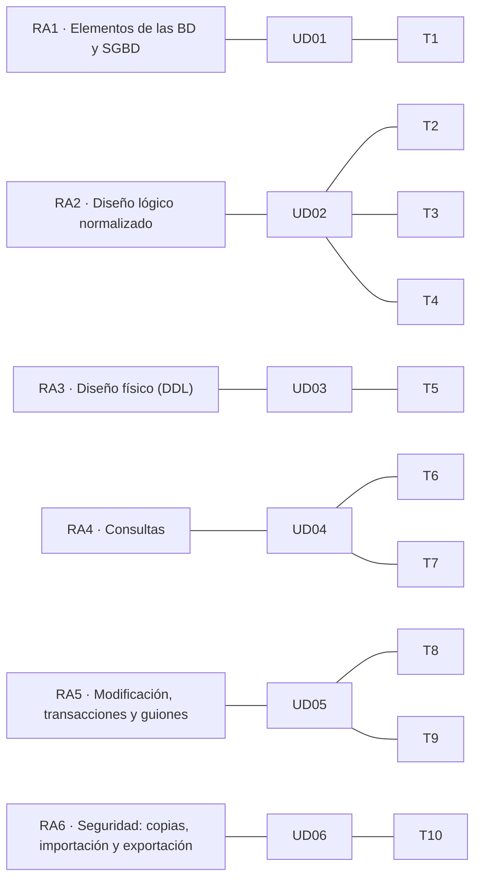

# Resultados de aprendizaje y criterios de evaluación

El módulo **0372. Gestión de bases de datos** (1º de Administración de Sistemas Informáticos en Red, ASIR) se rige por el **Real Decreto 1629/2009, de 30 de octubre**, que establece el título y sus enseñanzas mínimas. El módulo tiene **6 resultados de aprendizaje (RA)** con **47 criterios de evaluación (CE)**. Estos apuntes se imparten en **160 horas de aula** (5 por semana): el RD fija 105 horas como mínimo, y el currículo de la Comunitat Valenciana amplía el módulo hasta las 160.

> [!IMPORTANT]
> Un **resultado de aprendizaje** describe lo que sabrás hacer al terminar el módulo. Un **criterio de evaluación** es una evidencia concreta que demuestra que lo has conseguido. Cada unidad, práctica y ejercicio de estos apuntes indica qué CE trabaja.

## Horas y unidades por resultado de aprendizaje

Cada RA se corresponde con **una unidad didáctica** (UD01 a UD06), dividida en uno o varios *temas* numerados del 1 al 10. Así se puede evaluar un RA al terminar su unidad.

| RA | Resultado de aprendizaje | Unidad | Temas | Horas |
|---|---|---|---|:-:|
| **RA1** | Reconoce los elementos de las bases de datos analizando sus funciones y valorando la utilidad de los sistemas gestores. | [UD01](/ud01-introduccion) | T1 | 8 |
| **RA2** | Diseña modelos lógicos normalizados interpretando diagramas entidad/relación. | [UD02](/ud02-diseno-logico) | T2, T3, T4 | 32 |
| **RA3** | Realiza el diseño físico de bases de datos utilizando asistentes, herramientas gráficas y el lenguaje de definición de datos. | [UD03](/ud03-diseno-fisico) | T5 | 24 |
| **RA4** | Consulta la información almacenada manejando asistentes, herramientas gráficas y el lenguaje de manipulación de datos. | [UD04](/ud04-consultas) | T6, T7 | 26 |
| **RA5** | Modifica la información almacenada utilizando asistentes, herramientas gráficas y el lenguaje de manipulación de datos. | [UD05](/ud05-modificacion) | T8, T9 | 52 |
| **RA6** | Ejecuta tareas de aseguramiento de la información, analizándolas y aplicando mecanismos de salvaguarda y transferencia. | [UD06](/ud06-aseguramiento) | T10 | 9 |
| | *Pruebas de evaluación (3 × 3 h)* | | | 9 |
| | **Total** | | | **160** |

> [!NOTE]
> Las unidades siguen el orden de los RA (UD01 es el RA1, UD02 el RA2, y así hasta la UD06 y el RA6). Todo el contenido de las unidades se corresponde con los criterios de evaluación del RD 1629/2009; las prácticas y los proyectos no añaden contenidos ajenos a ellos.

## Criterios de evaluación por resultado de aprendizaje

Texto literal de las enseñanzas mínimas. La última columna indica en qué unidades se trabaja cada criterio.

## RA1. Reconoce los elementos de las bases de datos analizando sus funciones y valorando la utilidad de los sistemas gestores.

| CE | Criterio de evaluación | Temas |
|---|---|---|
| RA1.a | Se han analizado los distintos sistemas lógicos de almacenamiento y sus funciones. | [Tema 1](/ud01-introduccion/t01-teoria) |
| RA1.b | Se han identificado los distintos tipos de bases de datos según el modelo de datos utilizado. | [Tema 1](/ud01-introduccion/t01-teoria) |
| RA1.c | Se han identificado los distintos tipos de bases de datos en función de la ubicación de la información. | [Tema 1](/ud01-introduccion/t01-teoria) |
| RA1.d | Se ha reconocido la utilidad de un sistema gestor de bases de datos. | [Tema 1](/ud01-introduccion/t01-teoria) |
| RA1.e | Se ha descrito la función de cada uno de los elementos de un sistema gestor de bases de datos. | [Tema 1](/ud01-introduccion/t01-teoria) |
| RA1.f | Se han clasificado los sistemas gestores de bases de datos. | [Tema 1](/ud01-introduccion/t01-teoria) |

## RA2. Diseña modelos lógicos normalizados interpretando diagramas entidad/relación.

| CE | Criterio de evaluación | Temas |
|---|---|---|
| RA2.a | Se ha identificado el significado de la simbología propia de los diagramas entidad/relación. | [Tema 2](/ud02-diseno-logico/t02-teoria) |
| RA2.b | Se han utilizado herramientas gráficas para representar el diseño lógico. | [Tema 2](/ud02-diseno-logico/t02-teoria), [Tema 3](/ud02-diseno-logico/t03-teoria), [Tema 5](/ud03-diseno-fisico/t05-teoria) |
| RA2.c | Se han identificado las tablas del diseño lógico. | [Tema 3](/ud02-diseno-logico/t03-teoria), [Tema 4](/ud02-diseno-logico/t04-teoria) |
| RA2.d | Se han identificado los campos que forman parte de las tablas del diseño lógico. | [Tema 3](/ud02-diseno-logico/t03-teoria), [Tema 4](/ud02-diseno-logico/t04-teoria) |
| RA2.e | Se han identificado las relaciones entre las tablas del diseño lógico. | [Tema 2](/ud02-diseno-logico/t02-teoria), [Tema 3](/ud02-diseno-logico/t03-teoria) |
| RA2.f | Se han definido los campos clave. | [Tema 2](/ud02-diseno-logico/t02-teoria), [Tema 3](/ud02-diseno-logico/t03-teoria), [Tema 4](/ud02-diseno-logico/t04-teoria) |
| RA2.g | Se han aplicado las reglas de integridad. | [Tema 3](/ud02-diseno-logico/t03-teoria), [Tema 5](/ud03-diseno-fisico/t05-teoria), [Tema 8](/ud05-modificacion/t08-teoria) |
| RA2.h | Se han aplicado las reglas de normalización hasta un nivel adecuado. | [Tema 4](/ud02-diseno-logico/t04-teoria) |
| RA2.i | Se han identificado y documentado las restricciones que no pueden plasmarse en el diseño lógico. | [Tema 2](/ud02-diseno-logico/t02-teoria), [Tema 3](/ud02-diseno-logico/t03-teoria), [Tema 4](/ud02-diseno-logico/t04-teoria) |

## RA3. Realiza el diseño físico de bases de datos utilizando asistentes, herramientas gráficas y el lenguaje de definición de datos.

| CE | Criterio de evaluación | Temas |
|---|---|---|
| RA3.a | Se han definido las estructuras físicas de almacenamiento. | [Tema 5](/ud03-diseno-fisico/t05-teoria) |
| RA3.b | Se han creado tablas. | [Tema 5](/ud03-diseno-fisico/t05-teoria) |
| RA3.c | Se han seleccionado los tipos de datos adecuados. | [Tema 5](/ud03-diseno-fisico/t05-teoria) |
| RA3.d | Se han definido los campos clave en las tablas. | [Tema 5](/ud03-diseno-fisico/t05-teoria) |
| RA3.e | Se han implantado todas las restricciones reflejadas en el diseño lógico. | [Tema 3](/ud02-diseno-logico/t03-teoria), [Tema 5](/ud03-diseno-fisico/t05-teoria) |
| RA3.f | Se ha verificado mediante un conjunto de datos de prueba que la implementación se ajusta al modelo. | [Tema 5](/ud03-diseno-fisico/t05-teoria) |
| RA3.g | Se han utilizado asistentes y herramientas gráficas. | [Tema 5](/ud03-diseno-fisico/t05-teoria) |
| RA3.h | Se ha utilizado el lenguaje de definición de datos. | [Tema 5](/ud03-diseno-fisico/t05-teoria) |
| RA3.i | Se ha definido y documentado el diccionario de datos. | [Tema 5](/ud03-diseno-fisico/t05-teoria) |

## RA4. Consulta la información almacenada manejando asistentes, herramientas gráficas y el lenguaje de manipulación de datos.

| CE | Criterio de evaluación | Temas |
|---|---|---|
| RA4.a | Se han identificado las herramientas y sentencias para realizar consultas. | [Tema 6](/ud04-consultas/t06-teoria), [Tema 7](/ud04-consultas/t07-teoria) |
| RA4.b | Se han realizado consultas simples sobre una tabla. | [Tema 6](/ud04-consultas/t06-teoria) |
| RA4.c | Se han realizado consultas que generan valores de resumen. | [Tema 7](/ud04-consultas/t07-teoria) |
| RA4.d | Se han realizado consultas sobre el contenido de varias tablas mediante composiciones internas. | [Tema 7](/ud04-consultas/t07-teoria) |
| RA4.e | Se han realizado consultas sobre el contenido de varias tablas mediante composiciones externas. | [Tema 7](/ud04-consultas/t07-teoria) |
| RA4.f | Se han realizado consultas con subconsultas. | [Tema 7](/ud04-consultas/t07-teoria) |
| RA4.g | Se han valorado las ventajas e inconvenientes de las distintas opciones válidas para llevar a cabo una consulta determinada. | [Tema 7](/ud04-consultas/t07-teoria) |

## RA5. Modifica la información almacenada utilizando asistentes, herramientas gráficas y el lenguaje de manipulación de datos.

| CE | Criterio de evaluación | Temas |
|---|---|---|
| RA5.a | Se han identificado las herramientas y sentencias para modificar el contenido de la base de datos. | [Tema 8](/ud05-modificacion/t08-teoria) |
| RA5.b | Se han insertado, borrado y actualizado datos en las tablas. | [Tema 8](/ud05-modificacion/t08-teoria) |
| RA5.c | Se ha incluido en una tabla la información resultante de la ejecución de una consulta. | [Tema 8](/ud05-modificacion/t08-teoria) |
| RA5.d | Se han adoptado medidas para mantener la integridad y consistencia de la información. | [Tema 8](/ud05-modificacion/t08-teoria), [Tema 9](/ud05-modificacion/t09-teoria) |
| RA5.e | Se han diseñado guiones de sentencias para llevar a cabo tareas complejas. | [Tema 9](/ud05-modificacion/t09-teoria) |
| RA5.f | Se ha reconocido el funcionamiento de las transacciones. | [Tema 8](/ud05-modificacion/t08-teoria), [Tema 9](/ud05-modificacion/t09-teoria) |
| RA5.g | Se han anulado parcial o totalmente los cambios producidos por una transacción. | [Tema 8](/ud05-modificacion/t08-teoria), [Tema 9](/ud05-modificacion/t09-teoria) |
| RA5.h | Se han identificado los efectos de las distintas políticas de bloqueo de registros. | [Tema 8](/ud05-modificacion/t08-teoria) |

## RA6. Ejecuta tareas de aseguramiento de la información, analizándolas y aplicando mecanismos de salvaguarda y transferencia.

| CE | Criterio de evaluación | Temas |
|---|---|---|
| RA6.a | Se han identificado herramientas gráficas y en línea de comandos para la administración de copias de seguridad. | [Tema 10](/ud06-aseguramiento/t10-teoria) |
| RA6.b | Se han realizado copias de seguridad. | [Tema 10](/ud06-aseguramiento/t10-teoria) |
| RA6.c | Se han restaurado copias de seguridad. | [Tema 10](/ud06-aseguramiento/t10-teoria) |
| RA6.d | Se han identificado las herramientas para importar y exportar datos. | [Tema 10](/ud06-aseguramiento/t10-teoria) |
| RA6.e | Se han exportado datos a diversos formatos. | [Tema 10](/ud06-aseguramiento/t10-teoria) |
| RA6.f | Se han importado datos con distintos formatos. | [Tema 10](/ud06-aseguramiento/t10-teoria) |
| RA6.g | Se ha interpretado correctamente la información suministrada por los mensajes de error y los ficheros de registro. | [Tema 10](/ud06-aseguramiento/t10-teoria) |
| RA6.h | Se ha transferido información entre sistemas gestores. | [Tema 10](/ud06-aseguramiento/t10-teoria) |

## Evidencias de aprendizaje

Para cada criterio de evaluación se recogen evidencias de distintos tipos:

| Tipo de evidencia | Ejemplos | CE en los que se usa sobre todo |
|---|---|---|
| Cuestionarios y preguntas de razonamiento | Autoevaluaciones de cada unidad, preguntas de justificación | RA1 |
| Diagramas y documentos de diseño | Diagrama E/R, esquema relacional, informe de normalización | RA2 |
| Scripts SQL ejecutables | Scripts DDL, de consulta y de modificación | RA3, RA4, RA5 |
| Guiones PL/SQL con pruebas | Bloques con variables, control de flujo y excepciones con su batería de pruebas | RA5.e |
| Capturas y registros de ejecución | Planes de ejecución, sesiones concurrentes, ficheros `.log` de Data Pump y SQL*Loader | RA4.g, RA5.h, RA6.g |
| Entregas del proyecto EduGest | Una tarea de proyecto al final de cada unidad | Todos |

## Fuente

- [Real Decreto 1629/2009, de 30 de octubre, por el que se establece el título de Técnico Superior en Administración de Sistemas Informáticos en Red](https://www.boe.es/eli/es/rd/2009/10/30/1629).
