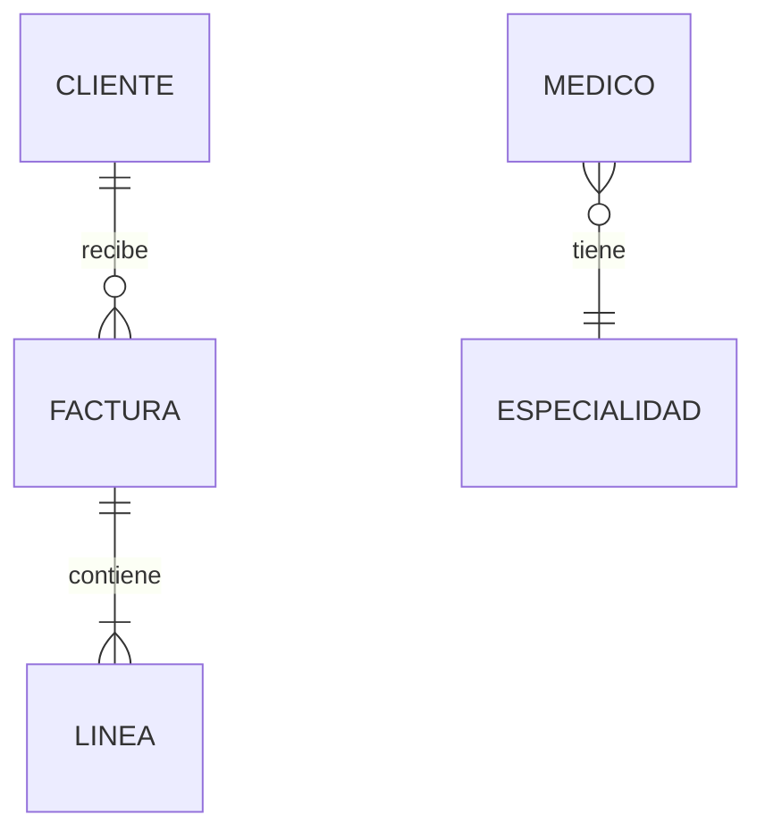

# Tema 2 · Prácticas: Modelo Entidad/Relación


| Práctica | Tipo | Nivel | CE principales |
|---|---|---|---|
| [2.1 Biblioteca municipal: del enunciado al diagrama](#práctica-21--biblioteca-municipal-del-enunciado-al-diagrama) | Guiada | ●○○ | RA2.b, RA2.e, RA2.f |
| [2.2 Leer y escribir cardinalidades](#práctica-22--leer-y-escribir-cardinalidades) | Guiada | ●○○ | RA2.e |
| [2.3 Plataforma de streaming](#práctica-23--plataforma-de-streaming) | Autónoma | ●●○ | RA2.b, RA2.e, RA2.f |
| [2.4 Clínica veterinaria con jerarquías](#práctica-24--clínica-veterinaria-con-jerarquías) | Autónoma | ●●○ | RA2.e, RA2.f, RA2.i |
| [Proyecto EduGest · Tema 2](#proyecto-edugest--tema-2-modelo-conceptual) | Proyecto | ●●○ | RA2.b, RA2.e, RA2.f, RA2.i |

> [!NOTE]
> **Cómo están organizadas estas páginas.** El enunciado se presenta como lo contaría una persona del negocio, no como una lista de entidades: **decidir qué es una entidad, un atributo o una relación forma parte del trabajo**. Las tareas, la comprobación y los errores habituales están plegados: despliégalos cuando los necesites, no antes de pensar.

> [!TIP]
> **Método para todos los ejercicios.** (1) Subraya sustantivos y verbos; (2) decide entidades e identificadores; (3) relaciones y cardinalidades en **los dos sentidos**; (4) atributos, incluidos los de las relaciones; (5) revisa redundancias y escribe los **supuestos** que hayas tenido que hacer.

---

## Práctica 2.1 · Biblioteca municipal: del enunciado al diagrama



#### Objetivo

Aplicar la metodología de cinco pasos para construir un diagrama E/R completo a partir de un relato de una persona del negocio.

#### Contexto

La biblioteca de un barrio quiere dejar el cuaderno y pasar a una base de datos. Su responsable te cuenta cómo trabaja.

#### Enunciado

> «Cuando llega un libro nuevo lo apunto con su ISBN, el título, la editorial y el año. Hay libros escritos por varias personas y autores con muchos libros en nuestro catálogo; de cada autor anoto cómo se llama y de dónde es, y a los que se repiten les pongo un código para no confundirlos.
>
> De cada libro suelo comprar varias copias. Las distingo con un número que les pego en el lomo (la 1, la 2, la 3...), y ese número empieza otra vez en cada libro. Apunto también si la copia está nueva, usada o deteriorada.
>
> Los vecinos se hacen socios con su DNI, su nombre y un teléfono, y les doy un número de carné. Cuando alguien se lleva una copia a casa, anoto el día que se la lleva, hasta cuándo puede tenerla y el día en que la devuelve de verdad. Hay libros que llevan meses prestados y otros que nunca han salido. A algunos socios los tengo que llamar muchas veces.»

#### Desarrollo

Sigue los cinco pasos y responde a las preguntas antes de abrir las respuestas.

{}

1. **Entidades.** Subraya sustantivos y verbos. ¿Cuáles tienen propiedades propias? ¿Hay algún «hecho» que parezca una entidad pero en realidad relacione otras dos cosas?

2. **Identificadores.** Para cada entidad, ¿qué dato la distingue de las demás? ¿Alguna se identifica con un número que se repite de unas a otras? ¿Qué dato candidato queda como alternativa?

3. **Relaciones y cardinalidades.** Para cada pareja, formula las dos preguntas, una en cada sentido, y decide el mínimo y el máximo. ¿Qué dice el relato sobre libros que «nunca han salido»?

4. **Atributos de las relaciones.** ¿A qué pertenecen las fechas? ¿Puede el mismo socio llevarse la misma copia en dos ocasiones? ¿Qué implica eso para identificar cada préstamo?

5. **Dibuja** el diagrama en draw.io con la notación de Chen (*Más formas* → *Entity Relation*) y compáralo con la solución.

{}





{}

{}
- [ ] Hay 4 entidades y `EJEMPLAR` está marcada como débil (doble rectángulo en Chen).
- [ ] Las dos relaciones N:M tienen la cardinalidad máxima N en los dos lados.
- [ ] Las fechas del préstamo están en la relación, no en `SOCIO` ni en `EJEMPLAR`.
- [ ] Has descartado la información que no genera datos.
- [ ] Has escrito al menos tres supuestos semánticos.
{}

{}

{}

> [!WARNING]
> - Relacionar `SOCIO` con `LIBRO` en lugar de con `EJEMPLAR`. Lo que se presta es una copia física, no la obra.
> - Poner `fecha_prestamo` como atributo de `SOCIO`. Un socio tiene muchos préstamos, así que ese atributo solo podría guardar uno.

{}

---

## Práctica 2.2 · Leer y escribir cardinalidades



#### Objetivo

Determinar las cardinalidades mínima y máxima de una relación a partir de frases del lenguaje natural, y al revés.

#### Desarrollo

Para cada frase, escribe la relación en notación (mín, máx) en los **dos sentidos** y el tipo de correspondencia (1:1, 1:N o N:M). Despliega la solución para comprobarla.

| # | Frase |
|---|---|
| a | Todo empleado trabaja en un único departamento; un departamento puede no tener empleados todavía. |
| b | Cada país tiene una capital; cada capital lo es de un único país. |
| c | Un pedido contiene al menos un producto; un producto puede no haberse pedido nunca o aparecer en muchos pedidos. |
| d | Un empleado puede supervisar a varios empleados; todo empleado salvo el director tiene un supervisor. |
| e | Un vehículo de empresa puede estar asignado a un empleado como máximo; un empleado puede no tener vehículo y nunca tiene más de uno. |



#### Segunda parte: del diagrama a la frase

Escribe en lenguaje natural lo que expresa cada diagrama:



---

## Práctica 2.3 · Plataforma de streaming



#### Contexto

Tres amigos preparan el lanzamiento de un servicio de vídeo bajo demanda y te piden el modelo conceptual. Este es el correo que te mandan.

#### Enunciado

> «Hola. Os cuento cómo queremos que funcione *Cinefilia*.
>
> La gente se registra con su NIF, su nombre y apellidos, un correo (no queremos dos cuentas con el mismo) y una dirección de facturación: calle, código postal y ciudad. Habrá tres tarifas —básica, estándar y premium— que se diferencian en lo que cuestan al mes y en cuántas pantallas se pueden usar a la vez. Cada cliente tiene contratada una.
>
> En el catálogo, cada película tiene su título, año y duración. La clasificamos por géneros porque la gente busca «comedia romántica» o «ciencia ficción», y también queremos que se pueda buscar por actor y que en la ficha se vea quién hace de quién.
>
> Necesitamos saber qué ve cada cliente y cuándo —a qué hora empezó y hasta qué minuto llegó— para ofrecer «continuar viendo». Sí, hay quien ve tres veces la misma peli. Y los clientes podrán puntuarlas de 1 a 5 estrellas, pero una sola vez por película, que si no se manipulan las medias.»

{}

1. Diagrama E/R completo en la notación que prefieras (indica cuál).
2. **Diccionario de datos**: tabla con entidad o relación, atributo, descripción, tipo de dato conceptual (texto, número, fecha...) y si es obligatorio.
3. Lista de **supuestos semánticos**.
4. Dos **restricciones** que el diagrama no pueda expresar.

{}

{}

{}
- [ ] `género` está modelado como **entidad** o como **atributo multivaluado**, y justificas la elección.
- [ ] `personaje` es un atributo de la relación actor–película.
- [ ] *Visualización* y *valoración* son relaciones **distintas**: una se repite y la otra no.
- [ ] La dirección aparece como atributo **compuesto**.
- [ ] La tarifa es una entidad con sus propios datos, no un texto en el cliente.
- [ ] Entre las restricciones textuales está «la puntuación está entre 1 y 5» u otra similar.
{}

{}

{}

Las dos relacionan `CLIENTE` y `PELICULA`, pero la visualización puede repetirse (se identifica también por la fecha y hora), mientras que la valoración es única por pareja cliente-película. Son dos hechos distintos: dos relaciones distintas.

{}

---

## Práctica 2.4 · Clínica veterinaria con jerarquías



#### Contexto

Una clínica veterinaria de tamaño medio estrena sistema de gestión. La gerente describe su día a día.

#### Enunciado

> «Aquí trabajamos once personas, y de todas guardo el DNI, el nombre, el teléfono y el día que empezaron. Los que pasan consulta son veterinarios, con su número de colegiado y su especialidad; los auxiliares tienen una titulación; y en el mostrador están los administrativos, de los que apunto los idiomas que hablan porque los extranjeros lo agradecen. Nadie hace dos cosas: o es una o es otra.
>
> A los clientes los conocemos por sus mascotas: chip, nombre, fecha de nacimiento y especie. Cada mascota es de un cliente, aunque un cliente puede traer varias. De los perros anoto la raza y si la ley los considera potencialmente peligrosos; de los gatos, si están esterilizados. Con el resto (conejos, tortugas...) no hace falta nada especial.
>
> Cada consulta la pasa un veterinario a una mascota un día concreto. Anoto el motivo, el diagnóstico y lo que receta, con la dosis de cada medicamento (nombre comercial y un código interno). A veces un auxiliar echa una mano.»

{}

1. Diagrama EER con todas las jerarquías.
2. Clasifica cada jerarquía como total/parcial y disyunta/solapada y **justifícalo con una frase del texto**.
3. Decide si `CONSULTA` es una entidad o una relación. Razona las dos opciones.
4. Escribe las restricciones que no puede recoger el diagrama (por ejemplo, sobre la dosis o sobre quién puede recetar).
5. Identifica qué información del texto **no** da lugar a ningún dato que haya que guardar.

{}

{}

{}
- [ ] La jerarquía de empleados es **total y disyunta**.
- [ ] La jerarquía de mascotas es **parcial y disyunta**.
- [ ] Los atributos comunes están en la superclase y solo los específicos en las subclases.
- [ ] El cliente aparece como entidad aunque el texto «lo conoce por sus mascotas».
- [ ] La dosis es un atributo de la relación consulta–medicamento.
{}

{}



---

## Proyecto EduGest · Tema 2: modelo conceptual



#### Objetivo

Construir el modelo conceptual completo del proyecto transversal.

#### Enunciado

Lee la [entrevista con la jefatura de estudios](/guia/proyecto-edugest#1-enunciado-entrevista-con-la-jefatura-de-estudios) como lo haría un analista: ahí no se enumeran las entidades y hay detalles que se mencionan de pasada. El [caso guiado de la teoría](/tema2-diseno-logico/er-teoria#8-caso-guiado-el-modelo-er-de-edugest) resuelve una parte.

{}

1. El **diagrama E/R** con todas las entidades, relaciones, cardinalidades, atributos e identificadores. Complétalo hasta cubrir todo lo que cuenta la entrevista.
2. El **diccionario de datos** (entidad, atributo, descripción, dominio, obligatorio, identificador).
3. Los **supuestos semánticos**.
4. Las **restricciones textuales**: al menos cinco reglas que el diagrama no puede representar.
5. Una lista de **preguntas que harías a la jefatura de estudios** porque la entrevista no las resuelve.

{}

{}

{}
- [ ] La relación *es jefe de* entre `PROFESOR` y `DEPARTAMENTO` es distinta de *pertenece a*.
- [ ] *Imparte* relaciona profesor, módulo y grupo, e incluye el curso académico. Justificas si es ternaria.
- [ ] Las faltas de asistencia dependen de la matrícula, no solo del alumno.
- [ ] Todas las decisiones dudosas están en la lista de supuestos.
{}

{}

> [!IMPORTANT]
> No consultes todavía la solución de referencia del proyecto. Tu diseño se revisará en clase y lo usarás en el tema 2. Las diferencias con la referencia se discutirán en el tema 2.

