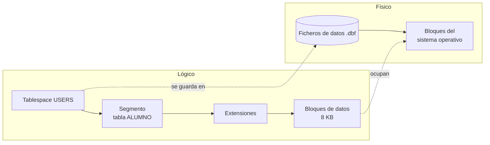

# Tema 5 · Definición de datos (DDL)

## Resumen del tema

Hasta ahora hemos **diseñado**. En esta unidad **implementamos**: convertimos el esquema relacional en tablas reales dentro de un SGBD. Para ello usamos el sublenguaje DDL de SQL:

- **DDL** (*Data Definition Language*): crea, modifica y elimina la estructura (tablas, restricciones, índices, secuencias).

Todos los ejemplos usan **Oracle AI Database 26ai Free**. Cuando una característica sea propia de Oracle o de una versión concreta, se indica.



### Temporalización

El tema ocupa **24 horas de aula** (11 de teoría y 13 de práctica).


items:
  - {h: 2, tipo: T, t: "SQL y Oracle. Almacenamiento de la información", ref: "§1 y §2"}
  - {h: 2, tipo: T, t: "Tipos de datos de Oracle", ref: "§3 · calculadora de NUMBER(p, s)"}
  - {h: 2, tipo: T, t: "CREATE TABLE y restricciones de integridad", ref: "§4 y §5 · constructor de CREATE TABLE"}
  - {h: 3, tipo: P, t: "Primeras tablas y restricciones en Oracle", ref: "Práctica 5.1"}
  - {h: 2, tipo: P, t: "Del diagrama de Chen al DDL", ref: "Práctica 5.2"}
  - {h: 1, tipo: T, t: "Modificar y eliminar la estructura (ALTER, DROP)", ref: "§6"}
  - {h: 1, tipo: P, t: "Evolución del esquema con ALTER", ref: "Práctica 5.5"}
  - {h: 2, tipo: T, t: "Secuencias, identidad e índices", ref: "§7 y §8"}
  - {h: 1, tipo: P, t: "Índices y secuencias en EduGest", ref: "Práctica 5.6"}
  - {h: 2, tipo: T, t: "Diccionario de datos y herramientas gráficas", ref: "§9 y §10"}
  - {h: 3, tipo: P, t: "Biblioteca: script completo y batería de pruebas", ref: "Práctica 5.3"}
  - {h: 3, tipo: P, t: "Implementación de EduGest", ref: "Proyecto EduGest-5"}
autonomo:
  - "Práctica 5.4 (seis casos para implementar)"
  - "Práctica 5.7 (depurar un script defectuoso)"
  - "Ejercicios resueltos y autoevaluación"


> [!IMPORTANT]
> En esta unidad pasas del papel al SGBD. **Ejecuta cada sentencia** mientras lees: un `CREATE TABLE` que no has probado es solo una hipótesis. Los widgets interactivos simulan el comportamiento de Oracle con fines didácticos, pero **no sustituyen** a un SGBD real.

### Objetivos de aprendizaje

Al terminar esta unidad serás capaz de:

- Explicar cómo almacena Oracle la información (bloques, segmentos, *tablespaces*).
- Elegir el tipo de datos adecuado para cada columna.
- Crear tablas con todas las restricciones del diseño lógico: claves primarias, ajenas y alternativas, `NOT NULL` y `CHECK`.
- Modificar y eliminar objetos de forma segura.
- Crear secuencias, columnas identidad e índices.
- Consultar el diccionario de datos para comprobar lo que has creado.
- Usar asistentes y herramientas gráficas sin depender de ellos.

---


{}
Antes de ser una empresa de bases de datos, Larry Ellison, Bob Miner y Ed Oates trabajaron en un proyecto para la CIA con el nombre en clave **Oracle**. Cuando fundaron su propia compañía en 1977 (entonces Software Development Laboratories) reutilizaron el nombre para el producto.
{}

SQL y Oracle. Almacenamiento de la información

## 1. SQL y Oracle

### 1.1 Sublenguajes de SQL

| Sublenguaje | Sentencias | Para qué | Unidad |
|---|---|---|---|
| **DDL** | `CREATE`, `ALTER`, `DROP`, `TRUNCATE`, `RENAME`, `COMMENT` | Definir la estructura | Tema 5 |
| **DML** | `SELECT`, `INSERT`, `UPDATE`, `DELETE`, `MERGE` | Consultar y modificar datos | Tema 6 a Tema 8 |
| **TCL** | `COMMIT`, `ROLLBACK`, `SAVEPOINT` | Controlar transacciones | Tema 8 |

> [!WARNING]
> En Oracle, **cada sentencia DDL ejecuta un `COMMIT` implícito** antes y después de ejecutarse. Si tenías cambios de datos pendientes y lanzas un `CREATE TABLE`, esos cambios quedan confirmados y ya no podrás deshacerlos con `ROLLBACK`.

### 1.2 SQL estándar frente a dialectos

SQL es un estándar ISO/IEC 9075, pero cada SGBD implementa una parte y añade **extensiones**. Por eso un script de MySQL no suele funcionar en Oracle sin cambios:


{}
```sql
CREATE TABLE producto (
    id_producto  NUMBER(6) GENERATED ALWAYS AS IDENTITY PRIMARY KEY,
    nombre       VARCHAR2(100) NOT NULL,
    precio       NUMBER(8,2) CHECK (precio >= 0),
    activo       BOOLEAN DEFAULT TRUE      -- BOOLEAN desde 23ai
);
```
{}
{}
```sql
CREATE TABLE producto (
    id_producto  INT AUTO_INCREMENT PRIMARY KEY,
    nombre       VARCHAR(100) NOT NULL,
    precio       DECIMAL(8,2) CHECK (precio >= 0),
    activo       BOOLEAN DEFAULT TRUE
) ENGINE = InnoDB;
```
{}
{}
```sql
CREATE TABLE producto (
    id_producto  INTEGER GENERATED ALWAYS AS IDENTITY PRIMARY KEY,
    nombre       VARCHAR(100) NOT NULL,
    precio       NUMERIC(8,2) CHECK (precio >= 0),
    activo       BOOLEAN DEFAULT TRUE
);
```
{}


### 1.3 Reglas de escritura en Oracle

- Las palabras reservadas y los identificadores **no distinguen mayúsculas**: `CREATE TABLE Alumno` crea la tabla `ALUMNO`. Oracle guarda los nombres en mayúsculas en el diccionario.
- Si escribes un identificador entre **comillas dobles** (`"Alumno"`), Oracle respeta mayúsculas y espacios, y tendrás que usar siempre las comillas. **Evítalo.**
- Los identificadores pueden tener hasta **128 bytes** (desde Oracle 12.2), empiezan por letra y pueden contener letras, números, `_`, `$` y `#`.
- Cada sentencia termina en `;`. Los bloques PL/SQL (Tema 9) terminan además con `/` en una línea.
- Comentarios: `-- hasta el final de la línea` y `/* de varias líneas */`.
- Las cadenas van entre **comillas simples**: `'DAM'`. Para incluir una comilla, se duplica: `'Sant Joan d''Alacant'`.

### 1.4 Usuario y esquema

En Oracle, un **esquema** es el conjunto de objetos (tablas, índices, secuencias...) que pertenecen a un usuario, y tiene su mismo nombre. Al conectarte como `EDUGEST` y crear la tabla `ALUMNO`, su nombre completo es `EDUGEST.ALUMNO`. Otro usuario con permiso la consultaría así:

```sql
SELECT * FROM edugest.alumno;
```

---

## 2. Formato de almacenamiento de la información

El criterio RA3.a pide analizar **cómo** se guarda la información. Oracle organiza el almacenamiento en dos niveles:



| Estructura | Qué es |
|---|---|
| **Bloque de datos** | La unidad mínima de lectura y escritura (normalmente 8 KB). Contiene varias filas |
| **Extensión** (*extent*) | Conjunto de bloques contiguos que se asigna de una vez |
| **Segmento** | Todo el espacio de un objeto: una tabla, un índice... |
| **Tablespace** | Contenedor lógico de segmentos. `USERS` es el de los datos de usuario; `SYSTEM` y `SYSAUX`, los del diccionario |
| **Fichero de datos** | Fichero físico del sistema operativo donde se guarda un tablespace |

Cada fila tiene una dirección física única, el **ROWID**, que indica el fichero, el bloque y la posición dentro del bloque. Es la forma más rápida de localizar una fila y la que usan internamente los índices.

```sql
SELECT ROWID, nombre FROM alumno FETCH FIRST 3 ROWS ONLY;
```

> [!NOTE]
> Una tabla normal de Oracle es una tabla **montón** (*heap*): las filas se guardan donde hay espacio libre, **sin ningún orden**. Por eso una consulta sin `ORDER BY` puede devolver las filas en cualquier orden, y ese orden puede cambiar.

---


{}
A diferencia del estándar SQL, Oracle trata `''` (cadena de longitud cero) como `NULL`. Por eso `WHERE nombre = ''` nunca devuelve filas y hay que escribir `WHERE nombre IS NULL`.
{}

Tipos de datos de Oracle

## 3. Tipos de datos

Elegir bien el tipo de cada columna (RA3.c) evita errores, ahorra espacio y permite que el SGBD valide los datos.

### 3.1 Tipos principales de Oracle

| Categoría | Tipo | Descripción | Ejemplo de uso |
|---|---|---|---|
| Texto | `VARCHAR2(n)` | Texto de longitud **variable**, hasta n bytes (máx. 4000; 32767 con `MAX_STRING_SIZE=EXTENDED`) | nombre, email |
| | `CHAR(n)` | Texto de longitud **fija**: se rellena con espacios | dni, códigos de longitud fija |
| | `NVARCHAR2(n)` | Texto Unicode en el juego de caracteres nacional | Raramente necesario con AL32UTF8 |
| | `CLOB` | Texto muy largo (gigabytes) | observaciones, documentos |
| Numérico | `NUMBER(p, s)` | Número exacto con `p` dígitos en total y `s` decimales | importes, notas, cantidades |
| | `NUMBER` | Sin precisión: cualquier número | evitarlo en columnas de negocio |
| | `INTEGER` | Sinónimo de `NUMBER(38)` | contadores |
| | `BINARY_DOUBLE` | Coma flotante IEEE 754 | cálculos científicos |
| Fecha y hora | `DATE` | Fecha **y hora** (hasta segundos) | fecha de nacimiento, de matrícula |
| | `TIMESTAMP(n)` | Fecha y hora con fracciones de segundo | registros de auditoría |
| | `TIMESTAMP WITH TIME ZONE` | Incluye la zona horaria | aplicaciones internacionales |
| | `INTERVAL DAY TO SECOND` | Duración | tiempo de una tarea |
| Lógico | `BOOLEAN` | `TRUE`, `FALSE` o `NULL` (**desde 23ai**) | activo, justificada |
| Binario | `BLOB`, `RAW(n)` | Datos binarios | fotografías, *hashes* |
| Otros | `JSON` | Documento JSON nativo (desde 21c) | datos semiestructurados |
| | `VECTOR` | Vectores para búsqueda por similitud (desde 23ai) | aplicaciones de IA |

### 3.2 Precisión y escala de NUMBER

`NUMBER(p, s)`: `p` es el número **total** de dígitos significativos y `s` cuántos de ellos van tras la coma.

| Declaración | Rango admitido | Valor insertado | Valor guardado |
|---|---|---|---|
| `NUMBER(4,2)` | -99,99 a 99,99 | 7.256 | 7,26 (redondea) |
| `NUMBER(4,2)` | | 123.5 | **Error** ORA-01438 |
| `NUMBER(5)` | -99999 a 99999 | 12.7 | 13 |
| `NUMBER(8,2)` | hasta 999 999,99 | 1520.5 | 1520,50 |

### 3.3 Criterios para elegir el tipo

1. **¿Se opera con él?** Si se suma o se compara numéricamente, es `NUMBER`. Si no (DNI, teléfono, código postal), es **texto**: `'03690'` perdería el cero inicial como número.
2. **¿Tiene longitud fija?** `CHAR` solo si **siempre** ocupa lo mismo (DNI: `CHAR(9)`). En el resto, `VARCHAR2`.
3. **¿Necesita decimales exactos?** El dinero se guarda siempre en `NUMBER(p, s)`, nunca en coma flotante.
4. **¿Es una fecha?** Usa `DATE` o `TIMESTAMP`, nunca texto: así puedes ordenar, comparar y calcular.
5. **Dimensiona con margen razonable**, sin exagerar: `VARCHAR2(4000)` para un nombre dificulta la validación y la lectura del diseño.

### 3.4 Equivalencias con otros SGBD

| Concepto | Oracle | MySQL / MariaDB | PostgreSQL | SQL Server |
|---|---|---|---|---|
| Texto variable | `VARCHAR2(n)` | `VARCHAR(n)` | `VARCHAR(n)` | `VARCHAR(n)` |
| Entero | `NUMBER(10)` | `INT` | `INTEGER` | `INT` |
| Decimal exacto | `NUMBER(p,s)` | `DECIMAL(p,s)` | `NUMERIC(p,s)` | `DECIMAL(p,s)` |
| Fecha sin hora | `DATE` (incluye hora) | `DATE` | `DATE` | `DATE` |
| Autoincremento | `IDENTITY` o secuencia | `AUTO_INCREMENT` | `IDENTITY` o `SERIAL` | `IDENTITY` |
| Lógico | `BOOLEAN` (23ai) | `BOOLEAN` (= `TINYINT(1)`) | `BOOLEAN` | `BIT` |

> [!CAUTION]
> **En Oracle la cadena vacía `''` es `NULL`.** `INSERT INTO alumno (..., email) VALUES (..., '')` guarda un `NULL`, y la condición `email = ''` nunca es verdadera. En MySQL y PostgreSQL la cadena vacía y `NULL` son cosas distintas. Es una de las diferencias que más errores provoca al migrar.

> [!WARNING]
> El tipo `DATE` de Oracle **siempre guarda la hora**. `SYSDATE` devuelve fecha y hora actuales. Si comparas `fecha_matricula = DATE '2025-09-15'` y la fila se insertó con `SYSDATE`, no coincidirá porque la hora no es 00:00:00. Lo trataremos en el tema 6.

#### Calculadora de `NUMBER(p, s)`

Prueba qué valores admite una columna y cómo los redondea Oracle. Observa lo que ocurre cuando la escala es negativa o cuando el valor excede la precisión.




- q: "¿Qué ocurre al insertar `123.456` en una columna `NUMBER(5,2)`?"
  options: ["Se guarda 123.456", "Se guarda 123.46 (se redondea a la escala)", "Error ORA-01438 (valor mayor que la precisión)", "Se guarda 123"]
  answer: 1
  explain: "`NUMBER(5,2)` permite 3 dígitos enteros y 2 decimales. Oracle **redondea** los decimales sobrantes. El error ORA-01438 aparecería con `1234.5`, que necesita 4 dígitos enteros."
- q: "Para guardar un importe en euros con céntimos, ¿qué tipo es más adecuado?"
  options: ["`FLOAT`, por la rapidez", "`NUMBER(10,2)`", "`VARCHAR2(10)`", "`NUMBER` sin precisión ni escala"]
  answer: 1
  explain: "Los importes exigen aritmética decimal exacta: `NUMBER(p,2)`. Los tipos en coma flotante acumulan errores de representación y el texto impide calcular."


---


CREATE TABLE y restricciones de integridad

## 4. Creación de tablas: `CREATE TABLE`

### 4.1 Finalidad y sintaxis

`CREATE TABLE` crea una tabla vacía con sus columnas y restricciones.

```text
CREATE TABLE [esquema.]nombre_tabla (
    columna tipo [DEFAULT valor] [restricciones_de_columna],
    columna tipo ...,
    [restricciones_de_tabla]
);
```

### 4.2 Ejemplo sencillo, elemento a elemento



```sql
CREATE TABLE ciclo (
    cod_ciclo      VARCHAR2(5)    CONSTRAINT pk_ciclo PRIMARY KEY,
    nombre         VARCHAR2(100)  NOT NULL,
    grado          VARCHAR2(8)    DEFAULT 'SUPERIOR' NOT NULL,
    horas_totales  NUMBER(4)
);
```

| Elemento | Significado |
|---|---|
| `CREATE TABLE ciclo` | Crea una tabla llamada `CICLO` en el esquema del usuario conectado |
| `cod_ciclo VARCHAR2(5)` | Columna de texto variable de hasta 5 bytes |
| `CONSTRAINT pk_ciclo PRIMARY KEY` | Restricción **con nombre** `PK_CICLO`: `cod_ciclo` es la clave primaria (única y no nula) |
| `NOT NULL` | La columna es obligatoria |
| `DEFAULT 'SUPERIOR'` | Valor que se usa si en el `INSERT` no se indica esta columna |
| `NUMBER(4)` | Número entero de hasta 4 dígitos. Sin `NOT NULL`, admite nulos |

Comprueba el resultado con la orden `DESC` del cliente:

```text
SQL> DESC ciclo
 Name           Null?    Type
 -------------- -------- -------------
 COD_CICLO      NOT NULL VARCHAR2(5)
 NOMBRE         NOT NULL VARCHAR2(100)
 GRADO          NOT NULL VARCHAR2(8)
 HORAS_TOTALES           NUMBER(4)
```

### 4.3 Restricciones de columna y de tabla

Una restricción puede escribirse **junto a la columna** o **al final**, como un elemento más de la tabla. Las restricciones que afectan a **varias columnas** (una clave primaria compuesta, un `UNIQUE` de dos columnas o un `CHECK` que compara dos columnas) solo pueden escribirse **al final**.

```sql
CREATE TABLE imparte (
    id_modulo        NUMBER(5),
    cod_grupo        VARCHAR2(10),
    curso_academico  CHAR(7),
    id_profesor      NUMBER(5)  NOT NULL,
    horas_semanales  NUMBER(2)  NOT NULL,
    -- restricciones de tabla
    CONSTRAINT pk_imparte PRIMARY KEY (id_modulo, cod_grupo, curso_academico),
    CONSTRAINT ck_imparte_horas CHECK (horas_semanales BETWEEN 1 AND 12)
);
```

### 4.4 Valores por defecto y columnas especiales

| Cláusula | Efecto | Ejemplo |
|---|---|---|
| `DEFAULT expr` | Se usa si la columna **no aparece** en el `INSERT` | `fecha_alta DATE DEFAULT SYSDATE` |
| `DEFAULT ON NULL expr` | Se usa también si se inserta **explícitamente** `NULL` | `convocatoria NUMBER(1) DEFAULT ON NULL 1` |
| `GENERATED ALWAYS AS IDENTITY` | Oracle genera el valor; no se puede insertar uno propio | `id NUMBER GENERATED ALWAYS AS IDENTITY` |
| `GENERATED BY DEFAULT ON NULL AS IDENTITY` | Oracle genera el valor si no se indica o si es `NULL` | Usado en `ALUMNO` de EduGest |
| `GENERATED ALWAYS AS (expr) VIRTUAL` | Columna **virtual**: se calcula, no se almacena | `total NUMBER GENERATED ALWAYS AS (cantidad * precio) VIRTUAL` |

---

## 5. Restricciones de integridad

Las restricciones implantan en la base de datos las reglas del diseño lógico (RA2.g, RA3.d, RA3.e). El SGBD **rechaza** cualquier operación que las incumpla, venga de la aplicación que venga.

### 5.1 Resumen de restricciones

| Restricción | Garantiza | Prefijo del nombre | Error si se incumple |
|---|---|---|---|
| `NOT NULL` | La columna tiene valor | `nn_` | ORA-01400 *cannot insert NULL* |
| `PRIMARY KEY` | Identificación única y no nula de cada fila | `pk_` | ORA-00001 *unique constraint violated* |
| `UNIQUE` | No hay valores repetidos (admite varios `NULL`) | `uq_` | ORA-00001 |
| `FOREIGN KEY` | El valor existe en la tabla referenciada | `fk_` | ORA-02291 *parent key not found* / ORA-02292 *child record found* |
| `CHECK` | Se cumple una condición sobre la fila | `ck_` | ORA-02290 *check constraint violated* |

> [!TIP]
> **Pon siempre nombre a las restricciones.** Si no lo haces, Oracle inventa uno como `SYS_C008123`. Cuando un usuario reciba el error `ORA-02290: check constraint (EDUGEST.CK_MATRICULA_NOTA) violated`, sabrá exactamente qué regla ha incumplido.

### 5.2 Clave primaria y claves alternativas

```sql
CREATE TABLE profesor (
    id_profesor  NUMBER(5)     CONSTRAINT pk_profesor PRIMARY KEY,
    dni          CHAR(9)       CONSTRAINT nn_profesor_dni NOT NULL,
    email        VARCHAR2(100) NOT NULL,
    ...
    CONSTRAINT uq_profesor_dni   UNIQUE (dni),
    CONSTRAINT uq_profesor_email UNIQUE (email)
);
```

Una clave **candidata** no elegida como primaria se implanta como `UNIQUE` + `NOT NULL`. Oracle crea automáticamente un **índice** para cada `PRIMARY KEY` y cada `UNIQUE`.

### 5.3 Claves ajenas

```sql
CONSTRAINT fk_matricula_alumno FOREIGN KEY (id_alumno)
    REFERENCES alumno (id_alumno)
    ON DELETE CASCADE
```

| Componente | Significado |
|---|---|
| `FOREIGN KEY (id_alumno)` | Columna (o columnas) de **esta** tabla |
| `REFERENCES alumno (id_alumno)` | Tabla y columna referenciadas: deben ser su `PRIMARY KEY` o un `UNIQUE` |
| `ON DELETE CASCADE` | Al borrar el alumno, se borran sus matrículas |
| `ON DELETE SET NULL` | Al borrar la fila padre, la columna se pone a `NULL` |
| *(nada)* | Se **rechaza** el borrado del padre si tiene hijos |

> [!IMPORTANT]
> - La tabla referenciada debe **existir antes**. Crea primero las tablas «padre» o añade la clave ajena después con `ALTER TABLE` (es lo que hace EduGest con el jefe de departamento, porque `DEPARTAMENTO` y `PROFESOR` se referencian mutuamente).
> - Una clave ajena **admite `NULL`** salvo que añadas `NOT NULL`. Una fila con la clave ajena a `NULL` no se comprueba.
> - Oracle **no** crea índices sobre las claves ajenas. Créalos tú (apartado 8).

### 5.4 Restricciones CHECK

Un `CHECK` es una condición que debe ser **verdadera o desconocida** (`NULL`) para cada fila:

```sql
CONSTRAINT ck_matricula_nota  CHECK (nota_final BETWEEN 0 AND 10),
CONSTRAINT ck_grupo_turno     CHECK (turno IN ('M', 'T')),
CONSTRAINT ck_falta_horas     CHECK (horas BETWEEN 1 AND 6),
CONSTRAINT ck_matricula_curso CHECK (REGEXP_LIKE(curso_academico, '^[0-9]{4}-[0-9]{2}$')),
CONSTRAINT ck_reserva_fechas  CHECK (fecha_salida > fecha_entrada)
```

> [!WARNING]
> Si `nota_final` es `NULL`, la condición `nota_final BETWEEN 0 AND 10` es **desconocida** y el `CHECK` **la acepta**. Si la columna debe tener valor, añade `NOT NULL`.
>
> Un `CHECK` **no** puede usar subconsultas, ni consultar otras tablas, ni llamar a `SYSDATE`. Las reglas que lo necesitan son restricciones no representables (Tema 3, apartado 6) y se comprueban con guiones de sentencias (Tema 9).

### 5.5 Consultar las restricciones en el diccionario

```sql
SELECT constraint_name, constraint_type, search_condition, r_constraint_name, delete_rule
FROM   user_constraints
WHERE  table_name = 'MATRICULA'
ORDER  BY constraint_type;

SELECT constraint_name, column_name, position
FROM   user_cons_columns
WHERE  table_name = 'MATRICULA'
ORDER  BY constraint_name, position;
```

`constraint_type`: **P** = clave primaria, **U** = única, **R** = referencial (clave ajena), **C** = `CHECK` (también `NOT NULL`).

#### Constructor de `CREATE TABLE`

Define columnas, tipos y restricciones y observa el script que genera. Las restricciones llevan **siempre nombre** (`pk_`, `fk_`, `uq_`, `ck_`, `nn_`), lo que facilita interpretar los errores de Oracle.



> [!TIP]
> Cambia al ejemplo **MATRICULA** y localiza la clave primaria compuesta y las dos claves ajenas. Después elimina una de ellas y razona qué integridad pierdes.


- q: "¿Qué hace Oracle con una cadena vacía `''` en una columna `VARCHAR2` con `NOT NULL`?"
  options: ["La acepta como cadena vacía", "La trata como `NULL` y rechaza la fila (ORA-01400)", "La convierte en un espacio", "Depende del `NLS_LANG`"]
  answer: 1
  explain: "En Oracle la cadena vacía **es** `NULL`. Es una diferencia con el estándar SQL y con otros SGBD, y una fuente clásica de errores."
- q: "¿Cuántas claves primarias puede tener una tabla y cuántas `UNIQUE`?"
  options: ["Una primaria y una `UNIQUE`", "Una primaria (puede ser compuesta) y tantas `UNIQUE` como se necesiten", "Varias primarias y una `UNIQUE`", "Ilimitadas de ambas"]
  answer: 1
  explain: "La clave primaria es única por tabla, aunque puede constar de varias columnas. Las claves alternativas se definen con `UNIQUE` y pueden ser varias."


#### De las reglas de transformación del tema 3 al DDL

En el tema 3 diseñaste el esquema relacional sin escribir SQL. Esta tabla traduce cada decisión de diseño a su sentencia en Oracle:

| Decisión de diseño (Tema 3) | Se implanta en Oracle como |
|---|---|
| Clave primaria (PK) | `PRIMARY KEY`; si es compuesta, restricción de tabla `PRIMARY KEY (col1, col2)` |
| Clave alternativa (UK) | `UNIQUE`, y `NOT NULL` si el atributo es obligatorio |
| Atributo obligatorio | `NOT NULL` |
| Regla de fila | `CHECK (condición sobre la propia fila)` |
| Clave ajena obligatoria (participación mínima 1) | `FOREIGN KEY` + columna `NOT NULL` |
| Relación 1:1 con clave ajena | `FOREIGN KEY` + `UNIQUE` sobre la clave ajena |
| Borrado en cascada | `ON DELETE CASCADE` |
| Puesta a nulos | `ON DELETE SET NULL` (la columna debe admitir `NULL`) |
| Borrado restringido | no se escribe nada: es el comportamiento por defecto de Oracle |
| Cambio de clave en cascada | **No existe** `ON UPDATE` en Oracle: por eso se usan claves primarias estables |

> [!TIP]
> Cuando traduzcas un esquema del tema 3, sigue este orden: primero las tablas sin claves ajenas, después las tablas hijas y, por último, las claves ajenas circulares con `ALTER TABLE`.


---


{}
En Oracle, cada sentencia DDL (`CREATE`, `ALTER`, `DROP`) hace un `COMMIT` implícito antes y después. No se puede deshacer con `ROLLBACK`: por eso se prueba primero en un esquema de pruebas.
{}

Modificar y eliminar la estructura (ALTER, DROP)

## 6. Modificar y eliminar la estructura

### 6.1 `ALTER TABLE`



```sql
-- Añadir columnas (en Oracle no se escribe la palabra COLUMN)
ALTER TABLE alumno ADD (fecha_alta DATE DEFAULT SYSDATE);

-- Cambiar el tipo, el tamaño o la obligatoriedad
ALTER TABLE alumno MODIFY (telefono VARCHAR2(20));
ALTER TABLE alumno MODIFY (localidad NOT NULL);   -- falla si hay filas con NULL

-- Renombrar y eliminar columnas
ALTER TABLE alumno RENAME COLUMN telefono TO telefono_movil;
ALTER TABLE alumno DROP COLUMN fecha_alta;

-- Añadir y eliminar restricciones
ALTER TABLE alumno ADD CONSTRAINT ck_alumno_email CHECK (email LIKE '%@%');
ALTER TABLE alumno DROP CONSTRAINT ck_alumno_email;

-- Desactivar temporalmente una restricción (por ejemplo, en una carga masiva)
ALTER TABLE matricula DISABLE CONSTRAINT fk_matricula_modulo;
ALTER TABLE matricula ENABLE CONSTRAINT fk_matricula_modulo;

-- Renombrar una tabla
RENAME alumno_tmp TO alumno_historico;
```

> [!TIP]
> Al **activar** una restricción, Oracle comprueba todas las filas existentes. Si alguna la incumple, el `ENABLE` falla. Con `ENABLE NOVALIDATE` solo se comprueban las filas nuevas, pero entonces la tabla puede contener datos incorrectos.

### 6.2 `DROP TABLE`, papelera y `TRUNCATE`

```sql
DROP TABLE matricula;                       -- va a la papelera de reciclaje
FLASHBACK TABLE matricula TO BEFORE DROP;   -- la recupera

DROP TABLE matricula PURGE;                 -- borrado definitivo
DROP TABLE alumno CASCADE CONSTRAINTS;      -- borra también las FK que apuntan a ALUMNO
DROP TABLE IF EXISTS alumno_tmp;            -- sin error si no existe (23ai y posteriores)

TRUNCATE TABLE falta_asistencia;            -- vacía la tabla; no se puede deshacer
```

| Sentencia | Borra | Estructura | ¿Se puede deshacer? |
|---|---|---|---|
| `DELETE FROM t` (DML, Tema 8) | Filas (todas o algunas) | Se mantiene | Sí, con `ROLLBACK` |
| `TRUNCATE TABLE t` | Todas las filas | Se mantiene | **No** (es DDL) |
| `DROP TABLE t` | Tabla y datos | Desaparece | Solo desde la papelera |
| `DROP TABLE t PURGE` | Tabla y datos | Desaparece | **No** |

> [!CAUTION]
> `TRUNCATE` y `DROP ... PURGE` no se pueden deshacer. En un servidor de producción, antes de ejecutarlos: comprueba **a qué base de datos** estás conectado, haz una **copia de seguridad** y, si es posible, que otra persona revise la orden.

### 6.3 Documentar el diseño con comentarios

```sql
COMMENT ON TABLE  matricula IS 'Matrícula de un alumno en un módulo para un curso académico';
COMMENT ON COLUMN matricula.nota_final IS 'NULL = sin calificar';

SELECT column_name, comments FROM user_col_comments WHERE table_name = 'MATRICULA';
```

---


Secuencias, identidad e índices

## 7. Secuencias y columnas identidad

Para generar identificadores artificiales (claves subrogadas) hay dos mecanismos:


{}
```sql
CREATE TABLE incidencia (
    id_incidencia NUMBER(8) GENERATED ALWAYS AS IDENTITY (START WITH 1 INCREMENT BY 1)
                  CONSTRAINT pk_incidencia PRIMARY KEY,
    descripcion   VARCHAR2(200) NOT NULL
);

INSERT INTO incidencia (descripcion) VALUES ('Proyector del aula 12 averiado');
```
Oracle crea internamente una secuencia asociada a la columna. Es la opción más sencilla desde Oracle 12c.
{}
{}
```sql
CREATE SEQUENCE seq_incidencia START WITH 1 INCREMENT BY 1 NOCACHE;

CREATE TABLE incidencia (
    id_incidencia NUMBER(8) DEFAULT seq_incidencia.NEXTVAL
                  CONSTRAINT pk_incidencia PRIMARY KEY,
    descripcion   VARCHAR2(200) NOT NULL
);

SELECT seq_incidencia.NEXTVAL FROM dual;   -- siguiente valor
SELECT seq_incidencia.CURRVAL FROM dual;   -- último valor obtenido en esta sesión
```
Una secuencia es un objeto independiente: puede compartirse entre varias tablas.
{}


> [!NOTE]
> Las secuencias **no garantizan valores consecutivos**: un `ROLLBACK`, la caché o un reinicio pueden dejar huecos. Un identificador artificial solo debe ser **único**, no correlativo. Si el negocio exige números de factura sin huecos, hay que implementarlo de otra forma.

---

## 8. Índices

Un **índice** es una estructura adicional, normalmente un **árbol B+**, que permite localizar filas sin recorrer toda la tabla, igual que el índice alfabético de un libro.

```sql
-- Índice simple sobre una clave ajena
CREATE INDEX ix_alumno_grupo ON alumno (cod_grupo);

-- Índice compuesto: útil para búsquedas por apellidos y nombre
CREATE INDEX ix_alumno_apellidos_nombre ON alumno (apellidos, nombre);

-- Índice único (equivale a la restricción UNIQUE, pero es preferible la restricción)
CREATE UNIQUE INDEX ux_modulo_codigo_ciclo ON modulo (codigo, cod_ciclo);

-- Índice basado en función: búsquedas sin distinguir mayúsculas
CREATE INDEX ix_alumno_email_upper ON alumno (UPPER(email));

DROP INDEX ix_alumno_apellidos_nombre;
```

| Conviene indexar | No conviene indexar |
|---|---|
| Claves ajenas (se usan en los `JOIN` y al borrar en la tabla padre) | Tablas muy pequeñas |
| Columnas muy usadas en `WHERE` con valores muy selectivos | Columnas con pocos valores distintos (`turno`: M/T) |
| Columnas usadas para ordenar resultados grandes | Columnas que se modifican constantemente |

> [!IMPORTANT]
> Un índice **acelera las lecturas** pero **ralentiza las escrituras**: cada `INSERT`, `UPDATE` o `DELETE` tiene que actualizar también todos los índices de la tabla, y además ocupa espacio. Indexar es una decisión de **diseño físico**: el tema 7 enseña a comprobar con el plan de ejecución si un índice se usa.

---

### Laboratorio: ¿cuánto ayuda un índice?

Mueve el deslizador para ver cuántos bloques lee una búsqueda con y sin índice.



Diccionario de datos y herramientas gráficas

## 9. Diccionario de datos

El diccionario es el catálogo del SGBD: describe todos los objetos. Es la forma de **comprobar** lo que se ha creado.

| Prefijo | Muestra | Ejemplo |
|---|---|---|
| `USER_` | Los objetos **de tu esquema** | `USER_TABLES` |
| `ALL_` | Los objetos a los que **tienes acceso** | `ALL_TABLES` |
| `DBA_` | **Todos** los objetos (requiere privilegios) | `DBA_TABLES` |

```sql
SELECT table_name FROM user_tables ORDER BY 1;
SELECT column_name, data_type, data_length, data_precision, data_scale, nullable
FROM   user_tab_columns WHERE table_name = 'ALUMNO' ORDER BY column_id;
SELECT index_name, index_type, uniqueness FROM user_indexes WHERE table_name = 'ALUMNO';
SELECT object_name, object_type, status FROM user_objects ORDER BY object_type;
```

---

## 10. Asistentes y herramientas gráficas

El criterio RA3.g y RA3.h piden usar **asistentes, herramientas gráficas y el lenguaje DDL**.

| Tarea | En SQL Developer | Lo que debes revisar |
|---|---|---|
| Crear una tabla | Clic derecho en *Tablas* → *Nueva tabla* (modo avanzado para restricciones) | Pestaña **DDL**: el código que se va a ejecutar |
| Ver la estructura | Doble clic sobre la tabla → pestañas *Columnas*, *Restricciones*, *Índices*, *DDL* | Nombres de las restricciones |
| Generar el esquema completo | *Data Modeler* → modelo relacional → *Generar DDL* | Orden de creación y nombres |

> [!TIP]
> Usa el asistente para **aprender** la sintaxis y para tareas puntuales, pero guarda siempre el **script SQL** que genera. Un script se versiona en Git, se revisa, se puede repetir en otro servidor y documenta exactamente qué se hizo. Un clic, no.

---

## 11. Errores frecuentes

| Error | Mensaje | Causa y solución |
|---|---|---|
| Crear una FK hacia una tabla que no existe | ORA-00942 *table or view does not exist* | Crea antes la tabla padre o añade la FK con `ALTER TABLE` |
| Clave ajena hacia una columna sin PK/UNIQUE | ORA-02270 *no matching unique or primary key* | La columna referenciada debe ser PK o UNIQUE |
| Tipos distintos entre FK y PK | Funciona, pero provoca conversiones y errores | Declara la FK con **el mismo tipo y tamaño** que la PK |
| Borrar una tabla referenciada | ORA-02449 *unique/primary keys referenced by foreign keys* | `DROP TABLE ... CASCADE CONSTRAINTS` o borra antes las hijas |
| Usar `ADD COLUMN` | ORA-00904 *invalid identifier* | En Oracle es `ALTER TABLE t ADD (col tipo)` |
| Nombre de restricción repetido | ORA-02264 *name already used by an existing constraint* | Los nombres de restricción son únicos en todo el esquema |
| Cadena vacía en una columna `NOT NULL` | ORA-01400 | En Oracle `''` es `NULL` |

---


- t: "DDL"
  d: "Lenguaje de definición de datos: CREATE, ALTER, DROP."
- t: "Clave primaria"
  d: "Restricción que identifica cada fila: única y no nula."
- t: "Clave ajena"
  d: "Restricción que obliga a que el valor exista en la tabla referenciada."
- t: "CHECK"
  d: "Restricción que valida una condición sobre los valores de la fila."


## 12. Resumen

- El DDL define la estructura. En Oracle, cada sentencia DDL confirma la transacción en curso.
- Oracle almacena las tablas en segmentos dentro de *tablespaces*, en bloques de datos; cada fila tiene un `ROWID`.
- Elige los tipos por su uso: `VARCHAR2`, `CHAR`, `NUMBER(p,s)`, `DATE`/`TIMESTAMP` y, desde 23ai, `BOOLEAN`. En Oracle, `''` es `NULL`.
- Implanta todas las restricciones del diseño **con nombre**: `PRIMARY KEY`, `UNIQUE`, `FOREIGN KEY`, `NOT NULL` y `CHECK`.
- `ALTER TABLE` modifica la estructura; `DROP` y `TRUNCATE` son destructivos.
- Las columnas identidad y las secuencias generan claves artificiales; los índices aceleran las búsquedas a cambio de escrituras más lentas.
- El diccionario de datos permite comprobar todo lo creado.

---

## 13. Autoevaluación


- q: "¿Qué tipo de datos es más adecuado para un código postal español como 03690?"
  options: ["NUMBER(5)", "CHAR(5)", "BINARY_DOUBLE", "DATE"]
  answer: 1
  explain: "No se opera con él y tiene longitud fija. Como número se perdería el **cero inicial**."
- q: "Se inserta el valor 123.456 en una columna NUMBER(5,2). ¿Qué ocurre?"
  options: ["Se guarda 123.46", "Se guarda 123", "Error: el valor es demasiado grande", "Se guarda 123.456"]
  answer: 0
  explain: "NUMBER(5,2) admite hasta 999,99. El valor cabe y se **redondea** a dos decimales: 123,46."
- q: "Tras ejecutar un INSERT sin confirmar, se ejecuta CREATE TABLE y después ROLLBACK. ¿Qué pasa con el INSERT?"
  options: ["Se deshace", "Queda confirmado por el COMMIT implícito del DDL", "Queda pendiente", "Provoca un error"]
  answer: 1
  explain: "En Oracle, cada sentencia DDL hace un **COMMIT implícito**. El INSERT ya no se puede deshacer."
- q: "¿Qué restricción permite varios valores NULL pero ningún valor repetido?"
  options: ["PRIMARY KEY", "UNIQUE", "NOT NULL", "FOREIGN KEY"]
  answer: 1
  explain: "UNIQUE impide repetir valores no nulos. Por eso `id_tutor` en GRUPO es UNIQUE: puede haber varios grupos sin tutor."
- q: "Un CHECK (nota BETWEEN 0 AND 10) y se inserta una fila con nota NULL. ¿Qué ocurre?"
  options: ["Error ORA-02290", "Se inserta: la condición es desconocida y el CHECK la acepta", "Se inserta con nota 0", "Error ORA-01400"]
  answer: 1
  explain: "Un CHECK solo rechaza las filas para las que la condición es **falsa**. Si debe ser obligatoria, hace falta NOT NULL."
- q: "¿Cuál es la sintaxis correcta en Oracle para añadir una columna?"
  options: ["ALTER TABLE alumno ADD COLUMN apodo VARCHAR2(30);", "ALTER TABLE alumno ADD (apodo VARCHAR2(30));", "UPDATE TABLE alumno ADD apodo;", "ALTER alumno INSERT apodo VARCHAR2(30);"]
  answer: 1
  explain: "Oracle no usa la palabra COLUMN en ADD. Los paréntesis permiten añadir varias columnas a la vez."
- q: "¿Por qué conviene crear un índice sobre una clave ajena en Oracle?"
  options: ["Porque Oracle no permite claves ajenas sin índice", "Porque Oracle no lo crea automáticamente y acelera los JOIN y los borrados en la tabla padre", "Porque convierte la clave ajena en única", "No conviene nunca"]
  answer: 1
  explain: "Oracle indexa automáticamente PK y UNIQUE, pero no las FK. Sin índice, cada borrado en la tabla padre recorre la tabla hija completa y bloquea más de lo necesario."


## Referencias

- [Oracle AI Database 26ai: SQL Language Reference](https://docs.oracle.com/en/database/oracle/oracle-database/26/sqlrf/).
- [Oracle AI Database 26ai: Database Concepts, *Logical Storage Structures*](https://docs.oracle.com/en/database/oracle/oracle-database/26/cncpt/).
- [Oracle AI Database 26ai: Security Guide](https://docs.oracle.com/en/database/oracle/oracle-database/26/dbseg/).
