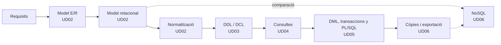

# Gestió de Bases de Dades · Mòdul 0372

Apunts del mòdul professional **0372. Gestió de bases de dades**, de **primer curs** del cicle formatiu de grau superior **Administració de Sistemes Informàtics en Xarxa (ASIX/ASIR)**. Curs **2026/27**.

| Característica | Valor |
|---|---|
| **Referència curricular** | Reial decret 1629/2009, de 30 d'octubre (títol d'ASIR i ensenyances mínimes) |
| **Durada** | 160 hores d'aula (5 per setmana; planificació provisional, pendent d'ajustar a l'horari de 1r ASIR) |
| **Resultats d'aprenentatge** | 6 (RA1 a RA6) amb 47 criteris d'avaluació |
| **SGBD relacional** | Oracle AI Database 26ai Free (23.26) |
| **SGBD no relacional** | MongoDB Community Server 8.0 |
| **Projecte comú** | [EduGest: gestió d'un centre educatiu](/guia/proyecto-edugest) |

> [!NOTE]
> Estos apunts **no són un manual de SQL**. Estan organitzats perquè assolisques els resultats d'aprenentatge oficials del mòdul. Recorren el cicle de vida complet d'una base de dades:
> **anàlisi → model conceptual → model lògic → normalització → disseny físic → implementació → consultes → modificació → programació → optimització → NoSQL.**

## El cicle de treball amb una base de dades

## Guia didàctica del curs 2026/27

La planificació preveu **160 hores d'aula** repartides entre el **9 de setembre de 2026** i el **24 de maig de 2027**. És una planificació **provisional**, que s'ha d'ajustar a l'horari real de 1r ASIR.

> [!NOTE]
> Tots els criteris d'avaluació del RD 1629/2009 es cobrixen en les unitats. El repartiment d'hores és orientatiu i es pot ajustar a cada grup.



### Repartiment d'hores per avaluació

| Avaluació | Unitat | Hores | Del | Al | RA principal |
|---|---|:-:|---|---|---|
| **1a** (- h) | UD01 · Sistemes d'emmagatzematge i SGBD | 8 | 09/09/2026 | 18/09/2026 | RA1 |
|  | UD02 · Disseny lògic: E/R, relacional i normalització | 40 | 21/09/2026 | 17/11/2026 | RA2 |
|  | UD03 · DDL i DCL (part 1) | 17 | 18/11/2026 | 11/12/2026 | RA3 |
| **2a** (- h) | UD03 · DDL i DCL (part 2) | 13 | 14/12/2026 | 15/01/2027 | RA3 |
|  | UD04 · Consultes (part 1) | 30 | 18/01/2027 | 26/02/2027 | RA4 |
| **3a** (
 h) | UD04 · Consultes (part 2) | 10 | 01/03/2027 | 12/03/2027 | RA4 |
|  | UD05 · Manipulació de dades, transaccions i PL/SQL | 24 | 15/03/2027 | 28/04/2027 | RA5 |
|  | UD06 · Assegurament de la informació i NoSQL | 18 | 29/04/2027 | 24/05/2027 | RA6 |
| | **Total** | **160** | | | |

### Criteris de la planificació

- **Hores del mòdul.** El currículum del mòdul fixa **160 hores** (5 per setmana a 1r ASIR). La planificació les reparteix en sis unitats, una per resultat d'aprenentatge, i les proves d'avaluació compten dins de la unitat que s'estiga impartint.
- **Prioritats.** El major pes està en el disseny lògic (UD02, 40 hores), les consultes (UD04, 40 hores) i el DDL (UD03, 30 hores). La modificació de dades, les transaccions i PL/SQL (UD05, 24 hores) i l'assegurament i NoSQL (UD06, 18 hores) es redueixen a l'essencial; els seus apunts es mantenen complets com a material d'estudi i d'ampliació.
- **Teoria i pràctica en la mateixa unitat.** Cada unitat indica a la seua pàgina de teoria una *temporalització* amb el repartiment de sessions entre teoria (T), pràctica (P) i proves d'avaluació (E). La suma d'hores de cada unitat coincideix amb la d'esta taula.
- **Pràctica guiada a l'aula, pràctica autònoma fora d'ella.** Les pràctiques guiades i la tasca del projecte EduGest es fan a classe. Les pràctiques autònomes, els reptes i les ampliacions són treball personal, i els dubtes es treballen a les sessions de pràctica.
- **Proves d'avaluació.** Cada avaluació reserva 3 hores a la prova i a la seua revisió, a la setmana indicada pel centre per als cicles de grau superior.
- **Un dia lectiu equival a una hora.** Els festius i els dies sense docència no compten. No hi ha setmana de reforç: els dies que es perguen per festes locals o activitats del centre es recuperen retallant les sessions de pràctica de l'última unitat impartida.

> [!CAUTION]
> **Planificació provisional.** Les dates s'han calculat amb el calendari escolar de la Comunitat Valenciana i 5 hores setmanals, i no s'han ajustat encara a l'horari real de 1r ASIR. Quan es fixe l'horari definitiu cal revisar l'arxiu `data/planificacion.json` i la *temporalització* de cada unitat; la taula i el calendari s'actualitzen sols i la compilació falla si les hores d'una unitat deixen de sumar.

## Unitats didàctiques

Cada unitat té pàgines de **teoria** (conceptes, exemples i autoavaluació) i de **pràctiques** (pràctiques guiades, autònomes, reptes i la tasca del projecte EduGest).

  
RA1<h3>UD01 · Sistemes d'emmagatzematge i SGBD</h3>
Fitxers enfront de bases de dades, arquitectura i funcions d'un SGBD, tipus de bases de dades, distribució, Big Data i protecció de dades.

<a href="ud01-introduccion/ud01-teoria/">Teoria</a> · <a href="ud01-introduccion/ud01-practicas/">Pràctiques</a>

  
RA2<h3>UD02 · Disseny lògic: E/R, relacional i normalització</h3>
De l'anàlisi de requisits al model Entitat/Relació, la seua transformació al model relacional i la normalització fins a 3FN i FNBC.

<a href="ud02-diseno-logico/ud02-teoria-er/">Teoria E/R</a> · <a href="ud02-diseno-logico/ud02-practicas-er/">Pràctiques E/R</a> · <a href="ud02-diseno-logico/ud02-teoria-relacional/">Teoria relacional</a> · <a href="ud02-diseno-logico/ud02-practicas-relacional/">Pràctiques relacional</a> · <a href="ud02-diseno-logico/ud02-teoria-normalizacion/">Teoria normalització</a> · <a href="ud02-diseno-logico/ud02-practicas-normalizacion/">Pràctiques normalització</a>

  
RA3<h3>UD03 · DDL i DCL: definició i control de dades</h3>
A Oracle: taules, tipus, restriccions, índexs, vistes i seqüències; i usuaris, rols i privilegis.

<a href="ud03-ddl-dcl/ud03-teoria/">Teoria</a> · <a href="ud03-ddl-dcl/ud03-practicas/">Pràctiques</a>

  
RA4<h3>UD04 · Consultes</h3>
SELECT, nuls, funcions, composicions, agrupaments, subconsultes i optimització. Dos parts: una taula i diverses taules.

<a href="ud04-consultas/ud04-teoria/">Teoria I</a> · <a href="ud04-consultas/ud04-practicas/">Pràctiques I</a> · <a href="ud04-consultas/ud04-teoria-avanzada/">Teoria II</a> · <a href="ud04-consultas/ud04-practicas-avanzadas/">Pràctiques II</a>

  
RA5<h3>UD05 · Manipulació de dades, transaccions i PL/SQL</h3>
INSERT, UPDATE, DELETE, MERGE, transaccions, concurrència i programació al servidor: procediments, funcions, cursors, excepcions i disparadors.

<a href="ud05-dml-plsql/ud05-teoria/">Teoria DML</a> · <a href="ud05-dml-plsql/ud05-practicas/">Pràctiques DML</a> · <a href="ud05-dml-plsql/ud05-teoria-plsql/">Teoria PL/SQL</a> · <a href="ud05-dml-plsql/ud05-practicas-plsql/">Pràctiques PL/SQL</a>

  
RA6<h3>UD06 · Assegurament de la informació i NoSQL</h3>
Còpies de seguretat, restauració, importació i exportació entre gestors, i bases de dades NoSQL amb MongoDB.

<a href="ud06-aseguramiento/ud06-teoria/">Teoria còpies</a> · <a href="ud06-aseguramiento/ud06-practicas/">Pràctiques còpies</a> · <a href="ud06-aseguramiento/ud06-teoria-nosql/">Teoria NoSQL</a> · <a href="ud06-aseguramiento/ud06-practicas-nosql/">Pràctiques NoSQL</a>

## Relació entre unitats i resultats d'aprenentatge

| Unitat | RA1 | RA2 | RA3 | RA4 | RA5 | RA6 |
|---|:-:|:-:|:-:|:-:|:-:|:-:|
| UD01 Sistemes d'emmagatzematge i SGBD | ● |  |  |  |  |  |
| UD02 Disseny lògic: E/R, relacional i normalització |  | ● | ○ |  |  |  |
| UD03 DDL i DCL |  | ○ | ● |  |  |  |
| UD04 Consultes |  |  |  | ● | ○ |  |
| UD05 Manipulació de dades, transaccions i PL/SQL |  | ○ |  |  | ● | ○ |
| UD06 Assegurament de la informació i NoSQL | ○ |  |  |  |  | ● |

● contribució principal · ○ contribució secundària. El detall per criteri d'avaluació està a [Resultats d'aprenentatge i criteris d'avaluació](/guia/ra-ce).

## Com llegir estos apunts

Els apunts usen quadres de colors per a destacar informació:

> [!TIP]
> **Consell.** Una forma més còmoda o professional de fer una cosa.

> [!WARNING]
> **Atenció.** Un error habitual o alguna cosa que pot donar problemes.

> [!IMPORTANT]
> **Clau.** Un concepte imprescindible per al resultat d'aprenentatge.

> [!CAUTION]
> **Perill.** Una operació que pot destruir o exposar dades.

{}
Les pistes i les **solucions** dels exercicis apareixen plegades. Intenta resoldre l'exercici abans d'obrir-les.
{}

Els fragments de codi indiquen sempre el gestor al qual corresponen, per exemple ,  o .

Consulta també la [guia del mòdul](/guia): el projecte EduGest, la instal·lació de l'entorn i les convencions de les pràctiques.

## Fonts

- [Reial decret 1629/2009, de 30 d'octubre](https://www.boe.es/eli/es/rd/2009/10/30/1629). Text consolidat en el BOE.
- [Documentació d'Oracle AI Database 26ai](https://docs.oracle.com/en/database/oracle/oracle-database/26/).
- [Manual de MongoDB](https://www.mongodb.com/docs/manual/).
