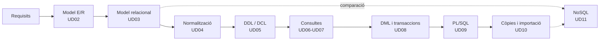

# Gestió de Bases de Dades · Mòdul 0372

Apunts del mòdul professional **0372. Gestió de bases de dades**, de **primer curs** del cicle formatiu de grau superior **Administració de Sistemes Informàtics en Xarxa (ASIR)**. Curs **2026/27**.

| Característica | Valor |
|---|---|
| **Referència curricular** | Reial decret 1629/2009, de 30 d'octubre (títol d'ASIR i ensenyaments mínims) |
| **Durada** | 160 hores d'aula (5 per setmana) · el RD fixa 105 hores com a mínim |
| **Resultats d'aprenentatge** | 6 (RA1 a RA6) amb 47 criteris d'avaluació |
| **SGBD relacional** | Oracle AI Database 26ai Free (23.26) |
| **SGBD no relacional** | MongoDB Community Server 8.0 (ampliació) |
| **Projecte comú** | [EduGest: gestió d'un centre educatiu](/guia/proyecto-edugest) |

> [!NOTE]
> Estos apunts **no són un manual de SQL**. Estan organitzats perquè assolisques els resultats d'aprenentatge oficials del mòdul. Recorren el cicle de vida complet d'una base de dades:
> **anàlisi → model conceptual → model lògic → normalització → disseny físic → consultes → modificació → programació → còpies de seguretat, importació i exportació.**

## El cicle de treball amb una base de dades

## Guia didàctica del curs 2026/27

El mòdul s'imparteix amb una càrrega de **160 hores d'aula** (5 hores setmanals, una per dia lectiu) entre el **9 de setembre de 2026** i el **24 de maig de 2027**. Cada **resultat d'aprenentatge (RA)** es correspon amb una unitat o amb un bloc d'unitats consecutives, de manera que les hores de cada RA es poden veure d'una ullada.

| RA | Resultat d'aprenentatge (resum) | Unitats | Hores |
|---|---|---|:-:|
| **RA1** | Elements de les bases de dades i utilitat dels sistemes gestors | UD01 | 10 |
| **RA2** | Disseny de models lògics normalitzats a partir de diagrames E/R | UD02 · UD03 · UD04 | 38 |
| **RA3** | Disseny físic amb assistents, ferramentes gràfiques i DDL | UD05 | 22 |
| **RA4** | Consulta de la informació amb SQL | UD06 · UD07 | 32 |
| **RA5** | Modificació de la informació, transaccions i guions | UD08 · UD09 | 31 |
| **RA6** | Assegurament de la informació: còpies, importació i exportació | UD10 | 12 |
| | *Ampliació: bases de dades NoSQL (sense RA)* | UD11 | 6 |
| | *Proves d'avaluació (3 × 3 h)* | EV1 · EV2 · EV3 | 9 |
| | **Total** | | **160** |

> [!NOTE]
> El RD 1629/2009 fixa **105 hores** com a ensenyaments mínims del mòdul; el currículum de la Comunitat Valenciana l'amplia fins a **160 hores** (5 per setmana en 1r ASIR). Tots els criteris d'avaluació es cobrixen en les unitats. El repartiment d'hores és orientatiu i es pot ajustar a cada grup.



### Repartiment d'hores per avaluació

| Avaluació | Unitat | Hores | Del | Al | RA |
|---|---|:-:|---|---|---|
| **1a** (65 h) | UD01 · Sistemes d'emmagatzematge i SGBD | 10 | 09/09/2026 | 22/09/2026 | RA1 |
|  | UD02 · Model Entitat/Relació | 16 | 23/09/2026 | 16/10/2026 | RA2 |
|  | UD03 · Model relacional | 12 | 19/10/2026 | 03/11/2026 | RA2 |
|  | UD04 · Normalització | 10 | 04/11/2026 | 17/11/2026 | RA2 |
|  | UD05 · Definició i control de dades | 22 | 18/11/2026 | 08/01/2027 | RA3 |
|  | Prova i revisió de la 1a avaluació | 3 | 09/12/2026 | 11/12/2026 | |
| **2a** (43 h) | UD06 · Consultes sobre una taula | 14 | 11/01/2027 | 28/01/2027 | RA4 |
|  | UD07 · Consultes avançades | 18 | 29/01/2027 | 23/02/2027 | RA4 |
|  | Prova i revisió de la 2a avaluació | 3 | 24/02/2027 | 26/02/2027 | |
| **3a** (52 h) | UD08 · DML, transaccions i concurrència | 16 | 01/03/2027 | 23/03/2027 | RA5 |
|  | UD09 · Programació amb PL/SQL | 15 | 24/03/2027 | 23/04/2027 | RA5 |
|  | Prova i revisió de la 3a avaluació i final | 3 | 26/04/2027 | 28/04/2027 | |
|  | UD10 · Seguretat de les dades: còpies, importació i exportació | 12 | 29/04/2027 | 14/05/2027 | RA6 |
|  | UD11 · Bases de dades NoSQL (ampliació) | 6 | 17/05/2027 | 24/05/2027 | Ampliació |
| | **Total** | **160** | | | |

### Criteris de la planificació

- **Un RA, un bloc d'unitats.** Cada resultat d'aprenentatge té la seua pròpia unitat (o grup d'unitats), de manera que cada RA pot avaluar-se en acabar el seu bloc. El pes de les hores seguix el del currículum: el disseny lògic (RA2), les consultes (RA4) i la modificació de dades (RA5) concentren la major part de la càrrega.
- **Avaluacions.** La 1a avaluació tanca el RA1 i el RA2 i avança el RA3; la 2a acaba el RA3 i el RA4; la 3a, el RA5. El RA6 (UD10) i l'ampliació NoSQL (UD11) s'imparteixen després de la prova de la 3a avaluació, fins al final de les classes del mòdul.
- **Teoria i pràctica en la mateixa unitat.** Cada unitat indica en la seua pàgina de teoria una *temporalització* amb el repartiment de sessions entre teoria (T) i pràctica (P). La suma d'hores de cada unitat coincidix amb la d'esta taula.
- **Pràctica guiada a l'aula, pràctica autònoma fora d'ella.** Les pràctiques guiades i la tasca del projecte EduGest es fan a classe. Les pràctiques autònomes, els reptes i les ampliacions són treball personal, i els dubtes es treballen en les sessions de pràctica.
- **Proves d'avaluació.** Cada avaluació reserva 3 hores a la prova i a la seua revisió.
- **Un dia lectiu equival a una hora.** Els festius i els dies sense docència no compten. Els dies que es perden per festes locals o activitats del centre es recuperen retallant les sessions de pràctica de l'última unitat impartida.

> [!CAUTION]
> **Planificació provisional.** Les dates procedixen del calendari escolar provisional 2026/27 i encara no s'han ajustat a l'horari real de 1r ASIR. Quan es fixe l'horari definitiu cal revisar l'arxiu `data/planificacion.json` i la *temporalització* de cada unitat; la taula i el calendari s'actualitzen sols i la compilació falla si les hores d'una unitat deixen de sumar.

## Unitats didàctiques

Cada unitat té dos pàgines: **teoria** (conceptes, exemples i autoavaluació) i **pràctiques** (pràctiques guiades, autònomes, reptes i la tasca del projecte EduGest).

  
RA1<h3>UD01 · Sistemes d'emmagatzematge i SGBD</h3>
Fitxers enfront de bases de dades, arquitectura i funcions d'un SGBD, tipus de bases de dades, distribució, Big Data i protecció de dades.

<a href="ud01-introduccion/ud01-teoria/">Teoria</a> · <a href="ud01-introduccion/ud01-practicas/">Pràctiques</a>

  
RA2<h3>UD02 · Model Entitat/Relació</h3>
Anàlisi de requisits, entitats, atributs, relacions, cardinalitats, entitats febles i extensions EER.

<a href="ud02-modelo-er/ud02-teoria/">Teoria</a> · <a href="ud02-modelo-er/ud02-practicas/">Pràctiques</a>

  
RA2<h3>UD03 · Model relacional</h3>
Relacions, claus, restriccions, integritat i transformació del model E/R al model relacional.

<a href="ud03-modelo-relacional/ud03-teoria/">Teoria</a> · <a href="ud03-modelo-relacional/ud03-practicas/">Pràctiques</a>

  
RA2<h3>UD04 · Normalització</h3>
Anomalies, dependències funcionals, 1FN, 2FN, 3FN i FNBC. Restriccions que el disseny lògic no pot expressar.

<a href="ud04-normalizacion/ud04-teoria/">Teoria</a> · <a href="ud04-normalizacion/ud04-practicas/">Pràctiques</a>

  
RA3<h3>UD05 · Definició i control de dades</h3>
DDL en Oracle: taules, tipus, restriccions, índexs, vistes i seqüències, diccionari de dades. DCL: usuaris, rols i privilegis.

<a href="ud05-ddl-dcl/ud05-teoria/">Teoria</a> · <a href="ud05-ddl-dcl/ud05-practicas/">Pràctiques</a>

  
RA4<h3>UD06 · Consultes sobre una taula</h3>
SELECT, projecció, selecció, ordenació, operadors, valors nuls i funcions de fila.

<a href="ud06-consultas-basicas/ud06-teoria/">Teoria</a> · <a href="ud06-consultas-basicas/ud06-practicas/">Pràctiques</a>

  
RA4<h3>UD07 · Consultes avançades</h3>
Agrupament, composicions internes i externes, subconsultes, operadors de conjunts i optimització.

<a href="ud07-consultas-avanzadas/ud07-teoria/">Teoria</a> · <a href="ud07-consultas-avanzadas/ud07-practicas/">Pràctiques</a>

  
RA5<h3>UD08 · DML, transaccions i concurrència</h3>
INSERT, UPDATE, DELETE, MERGE, transaccions, ACID, concurrència i bloquejos.

<a href="ud08-dml-transacciones/ud08-teoria/">Teoria</a> · <a href="ud08-dml-transacciones/ud08-practicas/">Pràctiques</a>

  
RA5<h3>UD09 · Programació amb PL/SQL</h3>
Guions: blocs PL/SQL, control de flux, procediments, funcions, cursors, excepcions, triggers i tasques programades.

<a href="ud09-plsql/ud09-teoria/">Teoria</a> · <a href="ud09-plsql/ud09-practicas/">Pràctiques</a>

  
RA6<h3>UD10 · Seguretat de les dades: còpies, importació i exportació</h3>
Còpies de seguretat i restauració, importació i exportació de dades, transferència entre gestors i registres d'error.

<a href="ud10-seguridad/ud10-teoria/">Teoria</a> · <a href="ud10-seguridad/ud10-practicas/">Pràctiques</a>

  
Ampliació<h3>UD11 · Bases de dades NoSQL (ampliació)</h3>
Ampliació: tipus de bases de dades no relacionals, modelatge documental i operacions CRUD i d'agregació amb MongoDB.

<a href="ud11-nosql/ud11-teoria/">Teoria</a> · <a href="ud11-nosql/ud11-practicas/">Pràctiques</a>

## Relació entre unitats i resultats d'aprenentatge

| Unitat | RA1 | RA2 | RA3 | RA4 | RA5 | RA6 |
|---|:-:|:-:|:-:|:-:|:-:|:-:|
| UD01 Sistemes d'emmagatzematge i SGBD | ● |  |  |  |  |  |
| UD02 Model Entitat/Relació |  | ● |  |  |  |  |
| UD03 Model relacional |  | ● |  |  |  |  |
| UD04 Normalització |  | ● |  |  |  |  |
| UD05 Definició i control de dades |  |  | ● |  |  |  |
| UD06 Consultes sobre una taula |  |  |  | ● |  |  |
| UD07 Consultes avançades |  |  |  | ● |  |  |
| UD08 DML, transaccions i concurrència |  |  |  |  | ● |  |
| UD09 Programació amb PL/SQL |  |  |  |  | ● |  |
| UD10 Seguretat de les dades: còpies, importació i exportació |  |  |  |  |  | ● |
| UD11 Bases de dades NoSQL (ampliació) | | | | | | |

● resultat d'aprenentatge que desenvolupa la unitat. El detall per criteri d'avaluació està en [Resultats d'aprenentatge i criteris d'avaluació](/guia/ra-ce).

## Com llegir estos apunts

Els apunts usen quadres de colors per a destacar informació:

> [!TIP]
> **Consell.** Una forma més còmoda o professional de fer una cosa.

> [!WARNING]
> **Atenció.** Un error habitual o alguna cosa que pot donar problemes.

> [!IMPORTANT]
> **Clau.** Un concepte imprescindible per al resultat d'aprenentatge.

> [!CAUTION]
> **Perill.** Una operació que pot destruir o exposar dades.

{}
Les pistes i les **solucions** dels exercicis apareixen plegades. Intenta resoldre l'exercici abans d'obrir-les.
{}

Els fragments de codi indiquen sempre el gestor al qual corresponen, per exemple ,  o .

Consulta també la [guia del mòdul](/guia): el projecte EduGest, la instal·lació de l'entorn i les convencions de les pràctiques.

## Fonts

- [Reial decret 1629/2009, de 30 d'octubre](https://www.boe.es/eli/es/rd/2009/10/30/1629), pel qual s'establix el títol de Tècnic Superior en Administració de Sistemes Informàtics en Xarxa.
- [Documentació d'Oracle AI Database 26ai](https://docs.oracle.com/en/database/oracle/oracle-database/26/).
- [Manual de MongoDB](https://www.mongodb.com/docs/manual/).
