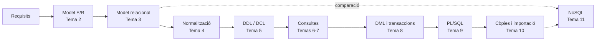

# Gestió de Bases de Dades · Mòdul 0372

Apunts del mòdul professional **0372. Gestió de bases de dades**, de **primer curs** del cicle formatiu de grau superior **Administració de Sistemes Informàtics en Xarxa (ASIR)**. Curs **2026/27**.

| Característica | Valor |
|---|---|
| **Referència curricular** | Reial decret 1629/2009, de 30 d'octubre (títol d'ASIR i ensenyaments mínims) |
| **Durada** | 160 hores d'aula (5 per setmana) · el RD fixa 105 hores com a mínim |
| **Resultats d'aprenentatge** | 6 (RA1 a RA6) amb 47 criteris d'avaluació |
| **SGBD relacional** | Oracle AI Database 26ai Free (23.26) |
| **SGBD no relacional** | MongoDB Community Server 8.0 (ampliació) |
| **Projecte comú** | [EduGest: gestió d'un centre educatiu](/guia/proyecto-edugest) |

> [!NOTE]
> Estos apunts **no són un manual de SQL**. Estan organitzats perquè assolisques els resultats d'aprenentatge oficials del mòdul. Recorren el cicle de vida complet d'una base de dades:
> **anàlisi → model conceptual → model lògic → normalització → disseny físic → consultes → modificació → programació → còpies de seguretat, importació i exportació.**

## El cicle de treball amb una base de dades

## Guia didàctica del curs 2026/27

El mòdul s'imparteix amb una càrrega de **160 hores d'aula** (5 hores setmanals, una per dia lectiu) entre el **9 de setembre de 2026** i el **24 de maig de 2027**. Cada **resultat d'aprenentatge (RA)** es correspon amb **una unitat didàctica** (UD01 a UD06), dividida en un o diversos *temes* numerats de l'1 a l'11.

| RA | Resultat d'aprenentatge (resum) | Unitats | Hores |
|---|---|---|:-:|
| **RA1** | Elements de les bases de dades i utilitat dels sistemes gestors | UD01 (tema 1) | 10 |
| **RA2** | Disseny de models lògics normalitzats a partir de diagrames E/R | UD02 (temas 2, 3 y 4) | 38 |
| **RA3** | Disseny físic amb assistents, ferramentes gràfiques i DDL | UD03 (tema 5) | 22 |
| **RA4** | Consulta de la informació amb SQL | UD04 (temas 6 y 7) | 32 |
| **RA5** | Modificació de la informació, transaccions i guions | UD05 (temas 8 y 9) | 31 |
| **RA6** | Assegurament de la informació: còpies, importació i exportació | UD06 (tema 10) | 12 |
| | *Ampliació: bases de dades NoSQL (sense RA)* | UD06 (tema 11) | 6 |
| | *Proves d'avaluació (3 × 3 h)* | EV1 · EV2 · EV3 | 9 |
| | **Total** | | **160** |

> [!NOTE]
> El RD 1629/2009 fixa **105 hores** com a ensenyaments mínims del mòdul; el currículum de la Comunitat Valenciana l'amplia fins a **160 hores** (5 per setmana en 1r ASIR). Tots els criteris d'avaluació es cobrixen en les unitats. El repartiment d'hores és orientatiu i es pot ajustar a cada grup.



### Repartiment d'hores per avaluació

| Avaluació | Unitat | Tema | Hores | Del | Al |
|---|---|---|:-:|---|---|
| **1a** (65 h) | **UD01** · Sistemes d'emmagatzematge i SGBD (RA1) | Tema 1 · Sistemes d'emmagatzematge i SGBD | 10 | 09/09/2026 | 22/09/2026 |
|  | **UD02** · Disseny lògic (RA2) | Tema 2 · Model Entitat/Relació | 16 | 23/09/2026 | 16/10/2026 |
|  |  | Tema 3 · Model relacional | 12 | 19/10/2026 | 03/11/2026 |
|  |  | Tema 4 · Normalització | 10 | 04/11/2026 | 17/11/2026 |
|  | **UD03** · Disseny físic (RA3) | Tema 5 · Definició i control de dades | 22 | 18/11/2026 | 08/01/2027 |
|  | | Prova i revisió de la 1a avaluació | 3 | 09/12/2026 | 11/12/2026 |
| **2a** (43 h) | **UD04** · Consultes (RA4) | Tema 6 · Consultes sobre una taula | 14 | 11/01/2027 | 28/01/2027 |
|  |  | Tema 7 · Consultes avançades | 18 | 29/01/2027 | 23/02/2027 |
|  | | Prova i revisió de la 2a avaluació | 3 | 24/02/2027 | 26/02/2027 |
| **3a** (52 h) | **UD05** · Modificació de la informació (RA5) | Tema 8 · DML, transaccions i concurrència | 16 | 01/03/2027 | 23/03/2027 |
|  |  | Tema 9 · Programació amb PL/SQL | 15 | 24/03/2027 | 23/04/2027 |
|  | | Prova i revisió de la 3a avaluació i final | 3 | 26/04/2027 | 28/04/2027 |
|  | **UD06** · Assegurament de la informació (RA6) | Tema 10 · Seguretat de les dades: còpies, importació i exportació | 12 | 29/04/2027 | 14/05/2027 |
|  |  | Tema 11 · Bases de dades NoSQL (ampliació) | 6 | 17/05/2027 | 24/05/2027 |
| | | **Total** | **160** | | |

### Criteris de la planificació

- **Una unitat per RA.** Cada resultat d'aprenentatge té la seua pròpia unitat, de manera que cada RA pot avaluar-se en acabar la seua unitat. El pes de les hores seguix el del currículum: el disseny lògic (RA2), les consultes (RA4) i la modificació de dades (RA5) concentren la major part de la càrrega.
- **Avaluacions.** La 1a avaluació tanca el RA1 i el RA2 i avança el RA3; la 2a acaba el RA3 i el RA4; la 3a, el RA5. El RA6 (UD06, tema 10) i l'ampliació NoSQL (tema 11) s'imparteixen després de la prova de la 3a avaluació, fins al final de les classes del mòdul.
- **Teoria i pràctica en la mateixa unitat.** Cada tema indica en la seua pàgina de teoria una *temporalització* amb el repartiment de sessions entre teoria (T) i pràctica (P). La suma d'hores de cada tema coincidix amb la d'esta taula.
- **Pràctica guiada a l'aula, pràctica autònoma fora d'ella.** Les pràctiques guiades i la tasca del projecte EduGest es fan a classe. Les pràctiques autònomes, els reptes i les ampliacions són treball personal, i els dubtes es treballen en les sessions de pràctica.
- **Proves d'avaluació.** Cada avaluació reserva 3 hores a la prova i a la seua revisió.
- **Un dia lectiu equival a una hora.** Els festius i els dies sense docència no compten. Els dies que es perden per festes locals o activitats del centre es recuperen retallant les sessions de pràctica de l'última unitat impartida.

> [!CAUTION]
> **Planificació provisional.** Les dates procedixen del calendari escolar provisional 2026/27 i encara no s'han ajustat a l'horari real de 1r ASIR. Quan es fixe l'horari definitiu cal revisar l'arxiu `data/planificacion.json` i la *temporalització* de cada tema; la taula i el calendari s'actualitzen sols i la compilació falla si les hores d'un tema deixen de sumar.

## Unitats didàctiques

Cada tema té dos pàgines: **teoria** (conceptes, exemples i autoavaluació) i **pràctiques** (pràctiques guiades, autònomes, reptes i la tasca del projecte EduGest).

  
RA1<h3>UD01 · Sistemes d'emmagatzematge i SGBD</h3>
Fitxers enfront de bases de dades, arquitectura i funcions d'un SGBD, tipus de bases de dades, distribució, Big Data i protecció de dades.

<a href="ud01-introduccion/">Veure la unitat</a>

  
RA2<h3>UD02 · Disseny lògic</h3>
Temes 2 a 4: model Entitat/Relació (EER), model relacional i normalització fins a FNBC.

<a href="ud02-diseno-logico/">Veure la unitat</a>

  
RA3<h3>UD03 · Disseny físic</h3>
Tema 5: DDL en Oracle (taules, tipus, restriccions, índexs, vistes, seqüències), diccionari de dades i DCL.

<a href="ud03-diseno-fisico/">Veure la unitat</a>

  
RA4<h3>UD04 · Consultes</h3>
Temes 6 i 7: SELECT, funcions, agrupament, composicions, subconsultes, operadors de conjunts i optimització.

<a href="ud04-consultas/">Veure la unitat</a>

  
RA5<h3>UD05 · Modificació de la informació</h3>
Temes 8 i 9: INSERT, UPDATE, DELETE, MERGE, transaccions, concurrència i guions PL/SQL (procediments, cursors, triggers).

<a href="ud05-modificacion/">Veure la unitat</a>

  
RA6<h3>UD06 · Assegurament de la informació</h3>
Tema 10: còpies de seguretat, importació i exportació. Tema 11 (ampliació): bases de dades NoSQL amb MongoDB.

<a href="ud06-aseguramiento/">Veure la unitat</a>

## Com llegir estos apunts

Els apunts usen quadres de colors per a destacar informació:

> [!TIP]
> **Consell.** Una forma més còmoda o professional de fer una cosa.

> [!WARNING]
> **Atenció.** Un error habitual o alguna cosa que pot donar problemes.

> [!IMPORTANT]
> **Clau.** Un concepte imprescindible per al resultat d'aprenentatge.

> [!CAUTION]
> **Perill.** Una operació que pot destruir o exposar dades.

{}
Les pistes i les **solucions** dels exercicis apareixen plegades. Intenta resoldre l'exercici abans d'obrir-les.
{}

Els fragments de codi indiquen sempre el gestor al qual corresponen, per exemple ,  o .

Consulta també la [guia del mòdul](/guia): el projecte EduGest, la instal·lació de l'entorn i les convencions de les pràctiques.

## Fonts

- [Reial decret 1629/2009, de 30 d'octubre](https://www.boe.es/eli/es/rd/2009/10/30/1629), pel qual s'establix el títol de Tècnic Superior en Administració de Sistemes Informàtics en Xarxa.
- [Documentació d'Oracle AI Database 26ai](https://docs.oracle.com/en/database/oracle/oracle-database/26/).
- [Manual de MongoDB](https://www.mongodb.com/docs/manual/).
