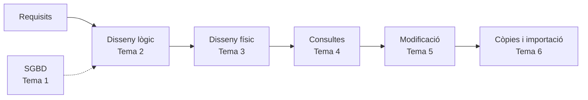

# Gestió de Bases de Dades · Mòdul 0372

Apunts del mòdul professional **0372. Gestió de bases de dades**, de **primer curs** del cicle formatiu de grau superior **Administració de Sistemes Informàtics en Xarxa (ASIR)**. Curs **2026/27**.

| Característica | Valor |
|---|---|
| **Referència curricular** | Reial decret 1629/2009, de 30 d'octubre (títol d'ASIR i ensenyaments mínims) |
| **Durada** | 160 hores d'aula (5 per setmana) · el RD fixa 105 hores com a mínim |
| **Resultats d'aprenentatge** | 6 (RA1 a RA6) amb 47 criteris d'avaluació |
| **SGBD relacional** | Oracle AI Database 26ai Free (23.26) |
| **Projecte comú** | [EduGest: gestió d'un centre educatiu](/guia/proyecto-edugest) |

> [!NOTE]
> Estos apunts **no són un manual de SQL**. Estan organitzats perquè assolisques els resultats d'aprenentatge oficials del mòdul. Recorren el cicle de vida complet d'una base de dades:
> **anàlisi → model conceptual → model lògic → normalització → disseny físic → consultes → modificació → guions → còpies de seguretat, importació i exportació.**

## El cicle de treball amb una base de dades

## Guia didàctica del curs 2026/27

El mòdul s'imparteix amb una càrrega de **160 hores d'aula** (5 hores setmanals, una per dia lectiu) entre el **9 de setembre de 2026** i el **24 de maig de 2027**. S'organitza en **6 temes, un per cada resultat d'aprenentatge (RA)**: el tema 1 desenvolupa el RA1, el tema 2 el RA2, i així fins al tema 6 i el RA6.

| Tema | RA | Resultat d'aprenentatge (resum) | Hores | Del | Al |
|---|---|---|:-:|---|---|
| [Tema 1](/tema1-introduccion) · Sistemes d'emmagatzematge i SGBD | **RA1** | Elements de les bases de dades i utilitat dels sistemes gestors | 19 | 09/09/2026 | 05/10/2026 |
| [Tema 2](/tema2-diseno-logico) · Disseny lògic de bases de dades | **RA2** | Disseny de models lògics normalitzats a partir de diagrames E/R | 29 | 06/10/2026 | 17/11/2026 |
| [Tema 3](/tema3-diseno-fisico) · Disseny físic (DDL) | **RA3** | Disseny físic amb assistents, ferramentes gràfiques i DDL | 29 | 18/11/2026 | 19/01/2027 |
| | | *Prova i revisió de la 1a avaluació* | 3 | 11/12/2026 | 15/12/2026 |
| [Tema 4](/tema4-consultas) · Consultes | **RA4** | Consulta de la informació amb SQL | 23 | 20/01/2027 | 24/02/2027 |
| | | *Prova i revisió de la 2a avaluació* | 3 | 08/02/2027 | 10/02/2027 |
| [Tema 5](/tema5-modificacion) · Modificació de la informació | **RA5** | Modificació de la informació, transaccions i guions | 26 | 25/02/2027 | 14/04/2027 |
| [Tema 6](/tema6-aseguramiento) · Assegurament de la informació | **RA6** | Còpies de seguretat, importació, exportació i transferència de dades | 25 | 15/04/2027 | 19/05/2027 |
| | | *Prova i revisió de la 3a avaluació i final* | 3 | 20/05/2027 | 24/05/2027 |
| | | **Total** | **160** | | |

> [!NOTE]
> El RD 1629/2009 fixa **105 hores** com a ensenyaments mínims del mòdul; el currículum de la Comunitat Valenciana l'amplia fins a **160 hores** (5 per setmana en 1r ASIR). Tots els criteris d'avaluació es cobrixen en els temes. El repartiment d'hores és orientatiu i es pot ajustar a cada grup.



### Criteris de la planificació

- **Un tema per RA.** Cada resultat d'aprenentatge té el seu propi tema, de manera que cada RA s'avalua en acabar el seu tema. Les hores de cada tema són proporcionals al nombre de criteris d'avaluació del seu RA (151 hores de classe per a 47 CE, unes 3,2 hores per criteri).
- **Avaluacions.** En arribar a la 1a avaluació s'han acabat els RA1 i RA2; en la 2a, RA3; en la 3a, RA4, RA5 i RA6. Cada RA s'avalua en acabar el seu tema.
- **Teoria i pràctica en el mateix tema.** Cada pàgina de teoria inclou una *temporalització* amb el repartiment de sessions entre teoria (T) i pràctica (P). En els temes amb diverses parts, la suma de les parts coincidix amb les hores del tema.
- **Pràctica guiada a l'aula, pràctica autònoma fora d'ella.** Les pràctiques guiades i la tasca del projecte EduGest es fan a classe. Les pràctiques autònomes i els reptes són treball personal, i els dubtes es treballen en les sessions de pràctica.
- **Proves d'avaluació.** Cada avaluació reserva 3 hores a la prova i a la seua revisió.
- **Un dia lectiu equival a una hora.** Els festius i els dies sense docència no compten. Els dies que es perden es recuperen retallant les sessions de pràctica de l'últim tema impartit.

> [!CAUTION]
> **Planificació provisional.** Les dates procedixen del calendari escolar provisional 2026/27 i encara no s'han ajustat a l'horari real de 1r ASIR. Quan es fixe l'horari definitiu cal revisar l'arxiu `data/planificacion.json` i la *temporalització* de cada tema; la taula i el calendari s'actualitzen sols i la compilació falla si les hores d'un tema deixen de sumar.

## Temes

Cada tema té pàgines de **teoria** (conceptes, exemples i autoavaluació) i de **pràctiques** (pràctiques guiades, autònomes, reptes i la tasca del projecte EduGest), numerades amb el número del tema (pràctica 4.3 = tema 4).

  
RA1<h3>Tema 1 · Sistemes d'emmagatzematge i SGBD</h3>
Fitxers enfront de bases de dades, arquitectura i funcions d'un SGBD, i classificació dels sistemes gestors.

<a href="tema1-introduccion/">Veure el tema</a>

  
RA2<h3>Tema 2 · Disseny lògic de bases de dades</h3>
Model Entitat/Relació, model relacional i normalització.

<a href="tema2-diseno-logico/">Veure el tema</a>

  
RA3<h3>Tema 3 · Disseny físic (DDL)</h3>
DDL en Oracle: taules, tipus, restriccions, seqüències, índexs i diccionari de dades.

<a href="tema3-diseno-fisico/">Veure el tema</a>

  
RA4<h3>Tema 4 · Consultes</h3>
SELECT, funcions de fila, agrupament, composicions, subconsultes i pla d'execució.

<a href="tema4-consultas/">Veure el tema</a>

  
RA5<h3>Tema 5 · Modificació de la informació</h3>
INSERT, UPDATE, DELETE, MERGE, transaccions, bloquejos, integritat i guions de sentències.

<a href="tema5-modificacion/">Veure el tema</a>

  
RA6<h3>Tema 6 · Assegurament de la informació</h3>
Còpies de seguretat, importació i exportació de dades i transferència entre gestors.

<a href="tema6-aseguramiento/">Veure el tema</a>

## Com llegir estos apunts

Els apunts usen quadres de colors per a destacar informació:

> [!TIP]
> **Consell.** Una forma més còmoda o professional de fer una cosa.

> [!WARNING]
> **Atenció.** Un error habitual o alguna cosa que pot donar problemes.

> [!IMPORTANT]
> **Clau.** Un concepte imprescindible per al resultat d'aprenentatge.

> [!CAUTION]
> **Perill.** Una operació que pot destruir o exposar dades.

{}
Les pistes i les **solucions** dels exercicis apareixen plegades. Intenta resoldre l'exercici abans d'obrir-les.
{}

Els fragments de codi indiquen sempre el gestor al qual corresponen, per exemple ,  o .

Consulta també la [guia del mòdul](/guia): el projecte EduGest, la instal·lació de l'entorn i les convencions de les pràctiques.

## Fonts

- [Reial decret 1629/2009, de 30 d'octubre](https://www.boe.es/eli/es/rd/2009/10/30/1629), pel qual s'establix el títol de Tècnic Superior en Administració de Sistemes Informàtics en Xarxa.
- [Documentació d'Oracle AI Database 26ai](https://docs.oracle.com/en/database/oracle/oracle-database/26/).
- [Documentació de PostgreSQL](https://www.postgresql.org/docs/).
