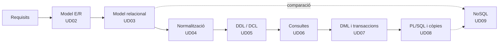

# Gestió de Bases de Dades · Mòdul 0372

Apunts del mòdul professional **0372. Gestió de bases de dades**, de **primer curs** del cicle formatiu de grau superior **Administració de Sistemes Informàtics en Xarxa (ASIX/ASIR)**. Curs **2026/27**.

| Característica | Valor |
|---|---|
| **Referència curricular** | Reial decret 1629/2009, de 30 d'octubre (títol d'ASIR i ensenyances mínimes) |
| **Durada** | 166 hores d'aula previstes (planificació provisional, pendent d'ajustar a l'horari de 1r ASIR) |
| **Resultats d'aprenentatge** | 6 (RA1 a RA6) amb 47 criteris d'avaluació |
| **SGBD relacional** | Oracle AI Database 26ai Free (23.26) |
| **SGBD no relacional** | MongoDB Community Server 8.0 |
| **Projecte comú** | [EduGest: gestió d'un centre educatiu](/guia/proyecto-edugest) |

> [!NOTE]
> Estos apunts **no són un manual de SQL**. Estan organitzats perquè assolisques els resultats d'aprenentatge oficials del mòdul. Recorren el cicle de vida complet d'una base de dades:
> **anàlisi → model conceptual → model lògic → normalització → disseny físic → implementació → consultes → modificació → programació → optimització → NoSQL.**

## El cicle de treball amb una base de dades

## Guia didàctica del curs 2026/27

La planificació preveu **166 hores d'aula** repartides entre el **9 de setembre de 2026** i juny de 2027. És una planificació **provisional**, heretada del mòdul de Bases de dades de DAM/DAW, que s'ha d'ajustar a l'horari real de 1r ASIR.

> [!NOTE]
> Tots els criteris d'avaluació del RD 1629/2009 es cobrixen en les unitats. El repartiment d'hores és orientatiu i es pot ajustar a cada grup. Les unitats de PL/SQL i NoSQL amplien el mínim oficial.



### Repartiment d'hores per avaluació

| Avaluació | Unitat | Hores | Del | Al | RA principal |
|---|---|:-:|---|---|---|
| **1a** (65 h) | UD01 · Emmagatzematge de la informació | 3 | 09/09/2026 | 11/09/2026 | RA1 |
|  | UD02 · Disseny conceptual (Entitat/Relació) | 26 | 14/09/2026 | 21/10/2026 | RA2 |
|  | UD03 · Model relacional | 20 | 22/10/2026 | 18/11/2026 | RA2 · RA3 |
|  | UD04 · Normalització | 2 | 19/11/2026 | 20/11/2026 | RA2 |
|  | UD05 · DDL: llenguatge de definició de dades (part 1) | 14 | 23/11/2026 | 11/12/2026 | RA3 |
| **2a** (43 h) | UD05 · DDL: llenguatge de definició de dades (part 2) | 21 | 14/12/2026 | 27/01/2027 | RA3 |
|  | UD06 · Consultes (DML) (part 1) | 22 | 28/01/2027 | 26/02/2027 | RA4 |
| **3a** (36 h) | UD06 · Consultes (DML) (part 2) | 18 | 01/03/2027 | 06/04/2027 | RA4 |
| | *Vacances de Pasqua* | | 25/03/2027 | 05/04/2027 | |
|  | UD07 · DML, transaccions i concurrència | 3 | 07/04/2027 | 09/04/2027 | RA5 |
|  | UD08 · Programació en PL/SQL (part 1) | 15 | 12/04/2027 | 30/04/2027 | RA5 · RA6 |
| **Juny** (22 h) | UD08 · Programació en PL/SQL (part 2) | 20 | 21/06/2027 | 30/06/2027 (per concretar) | RA5 · RA6 |
| | UD09 · Bases de dades no relacionals | 2 | | | RA6 |
| | **Total** | **166** | | | |

### Criteris de la planificació

- **Prioritats.** El temps del mòdul es concentra en el disseny conceptual (UD02), el model relacional (UD03), el DDL (UD05), les consultes i la manipulació de dades (UD06, 40 hores de aula) i PL/SQL (UD08). Normalització (UD04), transaccions (UD07) i NoSQL (UD09) es redueixen a l'essencial; els seus apunts es mantenen complets com a material d'estudi i d'ampliació. Les proves d'avaluació compten dins de les hores de la unitat que s'estiga impartint.
- **Teoria i pràctica en la mateixa unitat.** Cada unitat indica en la seua pàgina de teoria una *temporalització* amb el repartiment de sessions entre teoria (T) i pràctica (P). La suma d'hores de cada unitat coincidix amb la d'esta taula.
- **Pràctica guiada a l'aula, pràctica autònoma fora d'ella.** Les pràctiques guiades i la tasca del projecte EduGest es fan a classe. Les pràctiques autònomes, els reptes i les ampliacions són treball personal, i els dubtes es treballen en les sessions de pràctica.
- **Proves d'avaluació.** Cada avaluació reserva 3 hores a la prova i a la seua revisió, en la setmana indicada pel centre per als cicles de grau superior.
- **Un dia lectiu equival a una hora.** Els festius i els dies sense docència no compten. No hi ha setmana de reforç: els dies que es perguen per festes locals o activitats del centre es recuperen retallant les sessions de pràctica de l'última unitat impartida.

> [!CAUTION]
> **Planificació provisional.** Les dates i el repartiment d'hores procedixen de la planificació del mòdul 0484 i encara no s'han ajustat al calendari de 1r ASIR. Quan es fixe l'horari definitiu cal revisar l'arxiu `data/planificacion.json` i la *temporalització* de cada unitat; la taula i el calendari s'actualitzen sols i la compilació falla si les hores d'una unitat deixen de sumar.

## Unitats didàctiques

Cada unitat té dos pàgines: **teoria** (conceptes, exemples i autoavaluació) i **pràctiques** (pràctiques guiades, autònomes, reptes i la tasca del projecte EduGest).

  
RA1<h3>UD01 · Sistemes d'emmagatzematge i SGBD</h3>
Fitxers enfront de bases de dades, arquitectura i funcions d'un SGBD, tipus de bases de dades, distribució, Big Data i protecció de dades.

<a href="ud01-introduccion/ud01-teoria/">Teoria</a> · <a href="ud01-introduccion/ud01-practicas/">Pràctiques</a>

  
RA2<h3>UD02 · Model Entitat/Relació</h3>
Anàlisi de requisits, entitats, atributs, relacions, cardinalitats, entitats febles i extensions EER.

<a href="ud02-modelo-er/ud02-teoria/">Teoria</a> · <a href="ud02-modelo-er/ud02-practicas/">Pràctiques</a>

  
RA2 · RA3<h3>UD03 · Model relacional</h3>
Relacions, claus, restriccions, integritat i transformació del model E/R al model relacional.

<a href="ud03-modelo-relacional/ud03-teoria/">Teoria</a> · <a href="ud03-modelo-relacional/ud03-practicas/">Pràctiques</a>

  
RA2<h3>UD04 · Normalització</h3>
Anomalies, dependències funcionals, 1FN, 2FN, 3FN i FNBC. Restriccions que el disseny lògic no pot expressar.

<a href="ud04-normalizacion/ud04-teoria/">Teoria</a> · <a href="ud04-normalizacion/ud04-practicas/">Pràctiques</a>

  
RA3<h3>UD05 · DDL: definició de dades</h3>
DDL en Oracle: taules, tipus, restriccions, índexs, vistes i seqüències. DCL: usuaris, rols i privilegis.

<a href="ud05-ddl-dcl/ud05-teoria/">Teoria</a> · <a href="ud05-ddl-dcl/ud05-practicas/">Pràctiques</a>

  
RA4<h3>UD06 · Consultes (DML)</h3>
SELECT, valors nuls, funcions de fila, composicions, agrupaments, subconsultes i optimització. Dos parts: una taula i diverses taules.

<a href="ud06-consultas/ud06-teoria/">Teoria I</a> · <a href="ud06-consultas/ud06-practicas/">Pràctiques I</a> · <a href="ud06-consultas/ud06-teoria-avanzada/">Teoria II</a> · <a href="ud06-consultas/ud06-practicas-avanzadas/">Pràctiques II</a>

  
RA5<h3>UD07 · Manipulació de dades i transaccions</h3>
INSERT, UPDATE, DELETE, MERGE, transaccions, ACID, concurrència i bloquejos.

<a href="ud07-dml-transacciones/ud07-teoria/">Teoria</a> · <a href="ud07-dml-transacciones/ud07-practicas/">Pràctiques</a>

  
RA5 · RA6<h3>UD08 · Programació amb PL/SQL</h3>
Blocs, variables, control de flux, procediments, funcions, cursors, excepcions, triggers i tasques programades.

<a href="ud08-plsql/ud08-teoria/">Teoria</a> · <a href="ud08-plsql/ud08-practicas/">Pràctiques</a>

  
RA6<h3>UD09 · Bases de dades NoSQL</h3>
Tipus de bases de dades no relacionals, modelatge documental i operacions CRUD i d'agregació amb MongoDB.

<a href="ud09-nosql/ud09-teoria/">Teoria</a> · <a href="ud09-nosql/ud09-practicas/">Pràctiques</a>

## Relació entre unitats i resultats d'aprenentatge

| Unitat | RA1 | RA2 | RA3 | RA4 | RA5 | RA6 |
|---|:-:|:-:|:-:|:-:|:-:|:-:|
| UD01 Sistemes d'emmagatzematge i SGBD | ● | | | | | |
| UD02 Model Entitat/Relació | | ● | | | | |
| UD03 Model relacional | | ● | ○ | | | |
| UD04 Normalització | | ● | | | | |
| UD05 DDL: definició de dades | | ○ | ● | | | |
| UD06 Consultes (DML) | | | ○ | ● | ○ | |
| UD07 Manipulació i transaccions | | ○ | | | ● | |
| UD08 Programació PL/SQL i còpies de seguretat | | ○ | | | ○ | ● |
| UD09 Bases de dades NoSQL | ○ | | | | | ○ |

● contribució principal · ○ contribució secundària. El detall per criteri d'avaluació està en [Resultats d'aprenentatge i criteris d'avaluació](/guia/ra-ce).

## Com llegir estos apunts

Els apunts usen quadres de colors per a destacar informació:

> [!TIP]
> **Consell.** Una forma més còmoda o professional de fer una cosa.

> [!WARNING]
> **Atenció.** Un error habitual o alguna cosa que pot donar problemes.

> [!IMPORTANT]
> **Clau.** Un concepte imprescindible per al resultat d'aprenentatge.

> [!CAUTION]
> **Perill.** Una operació que pot destruir o exposar dades.

{}
Les pistes i les **solucions** dels exercicis apareixen plegades. Intenta resoldre l'exercici abans d'obrir-les.
{}

Els fragments de codi indiquen sempre el gestor al qual corresponen, per exemple ,  o .

Consulta també la [guia del mòdul](/guia): el projecte EduGest, la instal·lació de l'entorn i les convencions de les pràctiques.

## Fonts

- [Reial decret 1629/2009, de 30 d'octubre](https://www.boe.es/eli/es/rd/2009/10/30/1629). Text consolidat en el BOE.
- [Documentació d'Oracle AI Database 26ai](https://docs.oracle.com/en/database/oracle/oracle-database/26/).
- [Manual de MongoDB](https://www.mongodb.com/docs/manual/).
