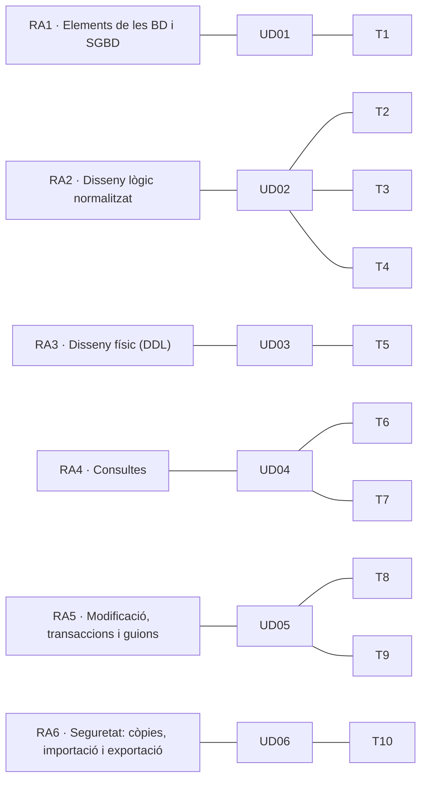

# Resultats d'aprenentatge i criteris d'avaluació

El mòdul **0372. Gestió de bases de dades** (1r d'Administració de Sistemes Informàtics en Xarxa, ASIR) es regix pel **Reial decret 1629/2009, de 30 d'octubre**, que establix el títol i els seus ensenyaments mínims. El mòdul té **6 resultats d'aprenentatge (RA)** amb **47 criteris d'avaluació (CE)**. Estos apunts s'impartixen en **160 hores d'aula** (5 per setmana): el RD fixa 105 hores com a mínim, i el currículum de la Comunitat Valenciana amplia el mòdul fins a les 160.

> [!IMPORTANT]
> Un **resultat d'aprenentatge** descriu el que sabràs fer en acabar el mòdul. Un **criteri d'avaluació** és una evidència concreta que demostra que ho has aconseguit. Cada unitat, pràctica i exercici d'estos apunts indica quins CE treballa.

## Hores i unitats per resultat d'aprenentatge

Cada RA es correspon amb **una unitat didàctica** (UD01 a UD06), dividida en un o diversos *temes* numerats de l'1 a l'11. Així es pot avaluar un RA en acabar la seua unitat.

| RA | Resultat d'aprenentatge | Unitat | Temes | Hores |
|---|---|---|---|:-:|
| **RA1** | Reconeix els elements de les bases de dades analitzant-ne les funcions i valorant la utilitat dels sistemes gestors. | [UD01](/ud01-introduccion) | T1 | 10 |
| **RA2** | Dissenya models lògics normalitzats interpretant diagrames entitat/relació. | [UD02](/ud02-diseno-logico) | T2, T3, T4 | 38 |
| **RA3** | Realitza el disseny físic de bases de dades utilitzant assistents, ferramentes gràfiques i el llenguatge de definició de dades. | [UD03](/ud03-diseno-fisico) | T5 | 22 |
| **RA4** | Consulta la informació emmagatzemada manejant assistents, ferramentes gràfiques i el llenguatge de manipulació de dades. | [UD04](/ud04-consultas) | T6, T7 | 32 |
| **RA5** | Modifica la informació emmagatzemada utilitzant assistents, ferramentes gràfiques i el llenguatge de manipulació de dades. | [UD05](/ud05-modificacion) | T8, T9 | 31 |
| **RA6** | Executa tasques d'assegurament de la informació, analitzant-les i aplicant mecanismes de salvaguarda i transferència. | [UD06](/ud06-aseguramiento) | T10 | 12 |
| | *Ampliació: bases de dades NoSQL* | [UD06](/ud06-aseguramiento) | T11 | 6 |
| | *Proves d'avaluació (3 × 3 h)* | | | 9 |
| | **Total** | | | **160** |

> [!NOTE]
> Les unitats seguixen l'ordre dels RA (UD01 és el RA1, UD02 el RA2, i així fins a la UD06 i el RA6). Els apunts sobre **bases de dades NoSQL** (tema 11, dins de la UD06) no corresponen a cap RA del mòdul: són una ampliació que s'imparteix al final del curs. També es marquen com a *Ampliació* les activitats sobre protecció de dades, bases de dades distribuïdes, Big Data i privilegis (DCL), el contingut dels quals no figura entre els CE del RD 1629/2009.

## Criteris d'avaluació per resultat d'aprenentatge

Text literal de les ensenyances mínimes. L'última columna indica en quines unitats es treballa cada criteri.

## RA1. Reconeix els elements de les bases de dades analitzant-ne les funcions i valorant la utilitat dels sistemes gestors.

| CE | Criteri d'avaluació | Temes |
|---|---|---|
| RA1.a | S'han analitzat els diferents sistemes lògics d'emmagatzematge i les seues funcions. | [Tema 1](/ud01-introduccion/t01-teoria) |
| RA1.b | S'han identificat els diferents tipus de bases de dades segons el model de dades utilitzat. | [Tema 1](/ud01-introduccion/t01-teoria), [Tema 11](/ud06-aseguramiento/t11-teoria) |
| RA1.c | S'han identificat els diferents tipus de bases de dades en funció de la ubicació de la informació. | [Tema 1](/ud01-introduccion/t01-teoria) |
| RA1.d | S'ha reconegut la utilitat d'un sistema gestor de bases de dades. | [Tema 1](/ud01-introduccion/t01-teoria) |
| RA1.e | S'ha descrit la funció de cada un dels elements d'un sistema gestor de bases de dades. | [Tema 1](/ud01-introduccion/t01-teoria) |
| RA1.f | S'han classificat els sistemes gestors de bases de dades. | [Tema 1](/ud01-introduccion/t01-teoria) |

## RA2. Dissenya models lògics normalitzats interpretant diagrames entitat/relació.

| CE | Criteri d'avaluació | Temes |
|---|---|---|
| RA2.a | S'ha identificat el significat de la simbologia pròpia dels diagrames entitat/relació. | [Tema 2](/ud02-diseno-logico/t02-teoria) |
| RA2.b | S'han utilitzat ferramentes gràfiques per a representar el disseny lògic. | [Tema 2](/ud02-diseno-logico/t02-teoria), [Tema 3](/ud02-diseno-logico/t03-teoria), [Tema 5](/ud03-diseno-fisico/t05-teoria) |
| RA2.c | S'han identificat les taules del disseny lògic. | [Tema 3](/ud02-diseno-logico/t03-teoria), [Tema 4](/ud02-diseno-logico/t04-teoria) |
| RA2.d | S'han identificat els camps que formen part de les taules del disseny lògic. | [Tema 3](/ud02-diseno-logico/t03-teoria), [Tema 4](/ud02-diseno-logico/t04-teoria) |
| RA2.e | S'han identificat les relacions entre les taules del disseny lògic. | [Tema 2](/ud02-diseno-logico/t02-teoria), [Tema 3](/ud02-diseno-logico/t03-teoria) |
| RA2.f | S'han definit els camps clau. | [Tema 2](/ud02-diseno-logico/t02-teoria), [Tema 3](/ud02-diseno-logico/t03-teoria), [Tema 4](/ud02-diseno-logico/t04-teoria) |
| RA2.g | S'han aplicat les regles d'integritat. | [Tema 3](/ud02-diseno-logico/t03-teoria), [Tema 5](/ud03-diseno-fisico/t05-teoria), [Tema 8](/ud05-modificacion/t08-teoria) |
| RA2.h | S'han aplicat les regles de normalització fins a un nivell adequat. | [Tema 4](/ud02-diseno-logico/t04-teoria) |
| RA2.i | S'han identificat i documentat les restriccions que no poden plasmar-se en el disseny lògic. | [Tema 1](/ud01-introduccion/t01-teoria), [Tema 2](/ud02-diseno-logico/t02-teoria), [Tema 3](/ud02-diseno-logico/t03-teoria), [Tema 4](/ud02-diseno-logico/t04-teoria), [Tema 9](/ud05-modificacion/t09-teoria) |

## RA3. Realitza el disseny físic de bases de dades utilitzant assistents, ferramentes gràfiques i el llenguatge de definició de dades.

| CE | Criteri d'avaluació | Temes |
|---|---|---|
| RA3.a | S'han definit les estructures físiques d'emmagatzematge. | [Tema 1](/ud01-introduccion/t01-teoria), [Tema 5](/ud03-diseno-fisico/t05-teoria) |
| RA3.b | S'han creat taules. | [Tema 5](/ud03-diseno-fisico/t05-teoria) |
| RA3.c | S'han seleccionat els tipus de dades adequats. | [Tema 5](/ud03-diseno-fisico/t05-teoria) |
| RA3.d | S'han definit els camps clau en les taules. | [Tema 5](/ud03-diseno-fisico/t05-teoria) |
| RA3.e | S'han implantat totes les restriccions reflectides en el disseny lògic. | [Tema 3](/ud02-diseno-logico/t03-teoria), [Tema 5](/ud03-diseno-fisico/t05-teoria) |
| RA3.f | S'ha verificat mitjançant un conjunt de dades de prova que la implementació s'ajusta al model. | [Tema 5](/ud03-diseno-fisico/t05-teoria) |
| RA3.g | S'han utilitzat assistents i ferramentes gràfiques. | [Tema 1](/ud01-introduccion/t01-teoria), [Tema 5](/ud03-diseno-fisico/t05-teoria) |
| RA3.h | S'ha utilitzat el llenguatge de definició de dades. | [Tema 1](/ud01-introduccion/t01-teoria), [Tema 5](/ud03-diseno-fisico/t05-teoria), [Tema 7](/ud04-consultas/t07-teoria) |
| RA3.i | S'ha definit i documentat el diccionari de dades. | [Tema 5](/ud03-diseno-fisico/t05-teoria) |

## RA4. Consulta la informació emmagatzemada manejant assistents, ferramentes gràfiques i el llenguatge de manipulació de dades.

| CE | Criteri d'avaluació | Temes |
|---|---|---|
| RA4.a | S'han identificat les ferramentes i sentències per a realitzar consultes. | [Tema 6](/ud04-consultas/t06-teoria), [Tema 7](/ud04-consultas/t07-teoria) |
| RA4.b | S'han realitzat consultes simples sobre una taula. | [Tema 6](/ud04-consultas/t06-teoria), [Tema 7](/ud04-consultas/t07-teoria) |
| RA4.c | S'han realitzat consultes que generen valors de resum. | [Tema 7](/ud04-consultas/t07-teoria) |
| RA4.d | S'han realitzat consultes sobre el contingut de diverses taules mitjançant composicions internes. | [Tema 7](/ud04-consultas/t07-teoria) |
| RA4.e | S'han realitzat consultes sobre el contingut de diverses taules mitjançant composicions externes. | [Tema 7](/ud04-consultas/t07-teoria) |
| RA4.f | S'han realitzat consultes amb subconsultes. | [Tema 7](/ud04-consultas/t07-teoria) |
| RA4.g | S'han valorat els avantatges i inconvenients de les diferents opcions vàlides per a dur a terme una consulta determinada. | [Tema 7](/ud04-consultas/t07-teoria) |

## RA5. Modifica la informació emmagatzemada utilitzant assistents, ferramentes gràfiques i el llenguatge de manipulació de dades.

| CE | Criteri d'avaluació | Temes |
|---|---|---|
| RA5.a | S'han identificat les ferramentes i sentències per a modificar el contingut de la base de dades. | [Tema 8](/ud05-modificacion/t08-teoria) |
| RA5.b | S'han inserit, esborrat i actualitzat dades en les taules. | [Tema 8](/ud05-modificacion/t08-teoria) |
| RA5.c | S'ha inclòs en una taula la informació resultant de l'execució d'una consulta. | [Tema 8](/ud05-modificacion/t08-teoria) |
| RA5.d | S'han adoptat mesures per a mantindre la integritat i consistència de la informació. | [Tema 8](/ud05-modificacion/t08-teoria), [Tema 9](/ud05-modificacion/t09-teoria) |
| RA5.e | S'han dissenyat guions de sentències per a dur a terme tasques complexes. | [Tema 6](/ud04-consultas/t06-teoria), [Tema 8](/ud05-modificacion/t08-teoria), [Tema 9](/ud05-modificacion/t09-teoria) |
| RA5.f | S'ha reconegut el funcionament de les transaccions. | [Tema 8](/ud05-modificacion/t08-teoria) |
| RA5.g | S'han anul·lat parcial o totalment els canvis produïts per una transacció. | [Tema 8](/ud05-modificacion/t08-teoria) |
| RA5.h | S'han identificat els efectes de les diferents polítiques de bloqueig de registres. | [Tema 8](/ud05-modificacion/t08-teoria) |

## RA6. Executa tasques d'assegurament de la informació, analitzant-les i aplicant mecanismes de salvaguarda i transferència.

| CE | Criteri d'avaluació | Temes |
|---|---|---|
| RA6.a | S'han identificat ferramentes gràfiques i en línia d'ordres per a l'administració de còpies de seguretat. | [Tema 10](/ud06-aseguramiento/t10-teoria) |
| RA6.b | S'han realitzat còpies de seguretat. | [Tema 10](/ud06-aseguramiento/t10-teoria) |
| RA6.c | S'han restaurat còpies de seguretat. | [Tema 10](/ud06-aseguramiento/t10-teoria) |
| RA6.d | S'han identificat les ferramentes per a importar i exportar dades. | [Tema 10](/ud06-aseguramiento/t10-teoria) |
| RA6.e | S'han exportat dades a diversos formats. | [Tema 10](/ud06-aseguramiento/t10-teoria) |
| RA6.f | S'han importat dades amb diferents formats. | [Tema 10](/ud06-aseguramiento/t10-teoria) |
| RA6.g | S'ha interpretat correctament la informació subministrada pels missatges d'error i els fitxers de registre. | [Tema 10](/ud06-aseguramiento/t10-teoria) |
| RA6.h | S'ha transferit informació entre sistemes gestors. | [Tema 10](/ud06-aseguramiento/t10-teoria) |

## Evidències d'aprenentatge

Per a cada criteri d'avaluació es recullen evidències de diferents tipus:

| Tipus d'evidència | Exemples | CE en els quals s'usa sobretot |
|---|---|---|
| Qüestionaris i preguntes de raonament | Autoavaluacions de cada unitat, preguntes de justificació | RA1 |
| Diagrames i documents de disseny | Diagrama E/R, esquema relacional, informe de normalització | RA2 |
| Scripts SQL executables | Scripts DDL i DCL, de consulta i de modificació | RA3, RA4, RA5 |
| Codi PL/SQL amb proves | Procediments, funcions i triggers amb la seua bateria de proves | RA5.e |
| Captures i registres d'execució | Plans d'execució, sessions concurrents, fitxers `.log` de Data Pump i SQL*Loader | RA4.g, RA5.h, RA6.g |
| Lliuraments del projecte EduGest | Una tasca de projecte al final de cada unitat | Tots |

## Font

- [Reial decret 1629/2009, de 30 d'octubre, pel qual s'establix el títol de Tècnic Superior en Administració de Sistemes Informàtics en Xarxa](https://www.boe.es/eli/es/rd/2009/10/30/1629).
