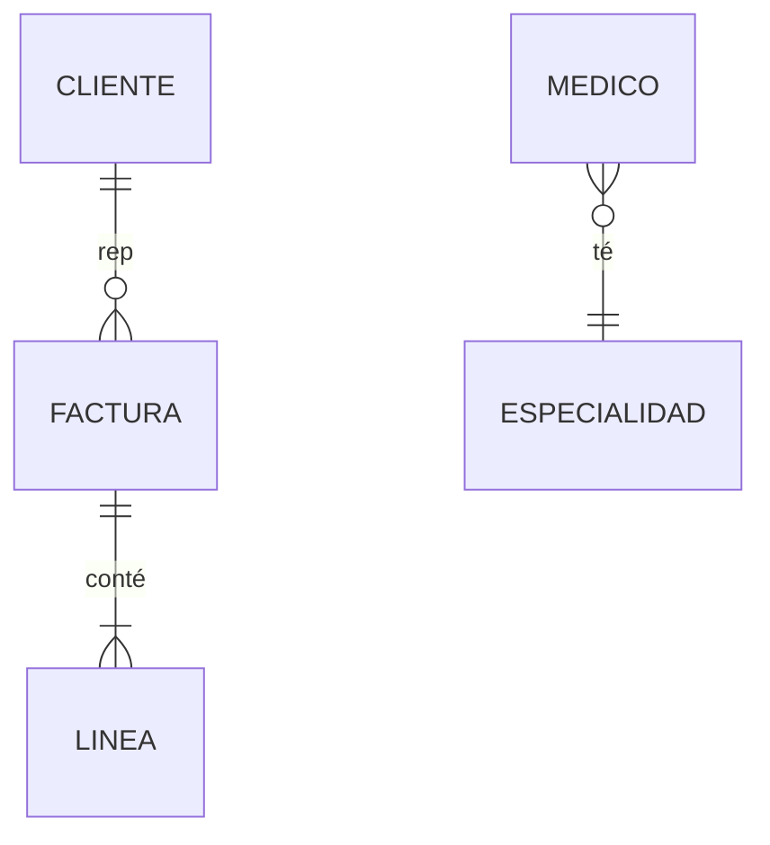

# Tema 2 · Pràctiques: Model Entitat/Relació


| Pràctica | Tipus | Nivell | CE principals |
|---|---|---|---|
| [2.1 Biblioteca municipal: de l'enunciat al diagrama](#pràctica-21--biblioteca-municipal-de-lenunciat-al-diagrama) | Guiada | ●○○ | RA2.b, RA2.e, RA2.f |
| [2.2 Llegir i escriure cardinalitats](#pràctica-22--llegir-i-escriure-cardinalitats) | Guiada | ●○○ | RA2.e |
| [2.3 Plataforma de streaming](#pràctica-23--plataforma-de-streaming) | Autònoma | ●●○ | RA2.b, RA2.e, RA2.f |
| [2.4 Clínica veterinària amb jerarquies](#pràctica-24--clínica-veterinària-amb-jerarquies) | Autònoma | ●●○ | RA2.e, RA2.f, RA2.i |
| [Projecte EduGest · Tema 2](#projecte-edugest--tema-2-model-conceptual) | Projecte | ●●○ | RA2.b, RA2.e, RA2.f, RA2.i |

> [!NOTE]
> **Com estan organitzades estes pàgines.** L'enunciat es presenta com el contaria una persona del negoci, no com una llista d'entitats: **decidir què és una entitat, un atribut o una relació forma part del treball**. Les tasques, la comprovació i els errors habituals estan plegats: desplega'ls quan els necessites, no abans de pensar.

> [!TIP]
> **Mètode per a tots els exercicis.** (1) Subratlla substantius i verbs; (2) decidix entitats i identificadors; (3) relacions i cardinalitats en **els dos sentits**; (4) atributs, inclosos els de les relacions; (5) revisa redundàncies i escriu els **supòsits** que hages hagut de fer.

---

## Pràctica 2.1 · Biblioteca municipal: de l'enunciat al diagrama



#### Objectiu

Aplicar la metodologia de cinc passos per a construir un diagrama E/R complet a partir d'un relat d'una persona del negoci.

#### Context

La biblioteca d'un barri vol deixar el quadern i passar a una base de dades. El seu responsable et conta com treballa.

#### Enunciat

> «Quan arriba un llibre nou l'apunte amb el seu ISBN, el títol, l'editorial i l'any. Hi ha llibres escrits per diverses persones i autors amb molts llibres en el nostre catàleg; de cada autor anote com es diu i d'on és, i als que es repetixen els pose un codi per a no confondre'ls.
>
> De cada llibre sol comprar diverses còpies. Les distinguisc amb un número que els apegue al llom (la 1, la 2, la 3...), i eixe número comença una altra vegada en cada llibre. Apunte també si la còpia està nova, usada o deteriorada.
>
> Els veïns es fan socis amb el seu DNI, el seu nom i un telèfon, i els done un número de carnet. Quan algú s'emporta una còpia a casa, anote el dia que se l'emporta, fins quan pot tindre-la i el dia en què la torna de veritat. Hi ha llibres que porten mesos prestats i altres que mai no han eixit. A alguns socis els he de cridar moltes vegades.»

#### Desenvolupament

Seguix els cinc passos i respon a les preguntes abans d'obrir les respostes.

{}

1. **Entitats.** Subratlla substantius i verbs. Quines tenen propietats pròpies? Hi ha algun «fet» que semble una entitat però en realitat relacione dos altres coses?

2. **Identificadors.** Per a cada entitat, quina dada la distingix de les altres? Alguna s'identifica amb un número que es repetix d'unes a altres? Quina dada candidata queda com a alternativa?

3. **Relacions i cardinalitats.** Per a cada parella, formula les dos preguntes, una en cada sentit, i decidix el mínim i el màxim. Què diu el relat sobre llibres que «mai no han eixit»?

4. **Atributs de les relacions.** A què pertanyen les dates? Pot el mateix soci emportar-se la mateixa còpia en dos ocasions? Què implica això per a identificar cada préstec?

5. **Dibuixa** el diagrama en draw.io amb la notació de Chen (*Més formes* → *Entity Relation*) i compara'l amb la solució.

{}





{}

{}
- [ ] Hi ha 4 entitats i `EJEMPLAR` està marcada com a feble (doble rectangle en Chen).
- [ ] Les dues relacions N:M tenen la cardinalitat màxima N en els dos costats.
- [ ] Les dates del préstec estan en la relació, no en `SOCIO` ni en `EJEMPLAR`.
- [ ] Has descartat la informació que no genera dades.
- [ ] Has escrit almenys tres supòsits semàntics.
{}

{}

{}

> [!WARNING]
> - Relacionar `SOCIO` amb `LIBRO` en lloc d'amb `EJEMPLAR`. El que es presta és una còpia física, no l'obra.
> - Posar `fecha_prestamo` com a atribut de `SOCIO`. Un soci té molts préstecs, així que eixe atribut només podria guardar-ne un.

{}

---

## Pràctica 2.2 · Llegir i escriure cardinalitats



#### Objectiu

Determinar les cardinalitats mínima i màxima d'una relació a partir de frases del llenguatge natural, i a l'inrevés.

#### Desenvolupament

Per a cada frase, escriu la relació en notació (mín, màx) en els **dos sentits** i el tipus de correspondència (1:1, 1:N o N:M). Desplega la solució per a comprovar-la.

| # | Frase |
|---|---|
| a | Tot empleat treballa en un únic departament; un departament pot no tindre empleats encara. |
| b | Cada país té una capital; cada capital ho és d'un únic país. |
| c | Una comanda conté almenys un producte; un producte pot no haver-se demanat mai o aparéixer en moltes comandes. |
| d | Un empleat pot supervisar diversos empleats; tot empleat llevat del director té un supervisor. |
| e | Un vehicle d'empresa pot estar assignat a un empleat com a màxim; un empleat pot no tindre vehicle i mai no en té més d'un. |



#### Segona part: del diagrama a la frase

Escriu en llenguatge natural el que expressa cada diagrama:



---

## Pràctica 2.3 · Plataforma de streaming



#### Context

Tres amics preparen el llançament d'un servei de vídeo sota demanda i et demanen el model conceptual. Este és el correu que t'envien.

#### Enunciat

> «Hola. Us contem com volem que funcione *Cinefilia*.
>
> La gent es registra amb el seu NIF, el seu nom i cognoms, un correu (no volem dos comptes amb el mateix) i una adreça de facturació: carrer, codi postal i ciutat. Hi haurà tres tarifes —bàsica, estàndard i premium— que es diferencien en el que costen al mes i en quantes pantalles es poden usar alhora. Cada client en té contractada una.
>
> En el catàleg, cada pel·lícula té el seu títol, any i durada. La classifiquem per gèneres perquè la gent busca «comèdia romàntica» o «ciència-ficció», i també volem que es puga buscar per actor i que en la fitxa es veja qui fa de qui.
>
> Necessitem saber què veu cada client i quan —a quina hora va començar i fins a quin minut va arribar— per a oferir «continuar veient». Sí, hi ha qui veu tres vegades la mateixa pel·li. I els clients podran puntuar-les d'1 a 5 estreles, però una sola vegada per pel·lícula, que si no es manipulen les mitjanes.»

{}

1. Diagrama E/R complet en la notació que preferisques (indica quina).
2. **Diccionari de dades**: taula amb entitat o relació, atribut, descripció, tipus de dada conceptual (text, número, data...) i si és obligatori.
3. Llista de **supòsits semàntics**.
4. Dos **restriccions** que el diagrama no puga expressar.

{}

{}

{}
- [ ] `género` està modelat com a **entitat** o com a **atribut multivaluat**, i justifiques l'elecció.
- [ ] `personaje` és un atribut de la relació actor–pel·lícula.
- [ ] *Visualització* i *valoració* són relacions **distintes**: una es repetix i l'altra no.
- [ ] L'adreça apareix com a atribut **compost**.
- [ ] La tarifa és una entitat amb les seues pròpies dades, no un text en el client.
- [ ] Entre les restriccions textuals està «la puntuació està entre 1 i 5» o una altra semblant.
{}

{}

{}

Les dos relacionen `CLIENTE` i `PELICULA`, però la visualització pot repetir-se (s'identifica també per la data i hora), mentre que la valoració és única per parella client-pel·lícula. Són dos fets distints: dues relacions distintes.

{}

---

## Pràctica 2.4 · Clínica veterinària amb jerarquies



#### Context

Una clínica veterinària de grandària mitjana estrena sistema de gestió. La gerent descriu el seu dia a dia.

#### Enunciat

> «Ací treballem onze persones, i de totes guarde el DNI, el nom, el telèfon i el dia que van començar. Els que passen consulta són veterinaris, amb el seu número de col·legiat i la seua especialitat; els auxiliars tenen una titulació; i en el taulell estan els administratius, dels quals apunte els idiomes que parlen perquè els estrangers ho agraïxen. Ningú no fa dos coses: o és una o és l'altra.
>
> Als clients els coneixem per les seues mascotes: xip, nom, data de naixement i espècie. Cada mascota és d'un client, encara que un client pot portar-ne diverses. Dels gossos anote la raça i si la llei els considera potencialment perillosos; dels gats, si estan esterilitzats. Amb la resta (conills, tortugues...) no cal res especial.
>
> Cada consulta la passa un veterinari a una mascota un dia concret. Anote el motiu, el diagnòstic i el que recepta, amb la dosi de cada medicament (nom comercial i un codi intern). De vegades un auxiliar fa una mà.»

{}

1. Diagrama EER amb totes les jerarquies.
2. Classifica cada jerarquia com a total/parcial i disjunta/solapada i **justifica-ho amb una frase del text**.
3. Decidix si `CONSULTA` és una entitat o una relació. Raona les dues opcions.
4. Escriu les restriccions que no pot arreplegar el diagrama (per exemple, sobre la dosi o sobre qui pot receptar).
5. Identifica quina informació del text **no** dona lloc a cap dada que calga guardar.

{}

{}

{}
- [ ] La jerarquia d'empleats és **total i disjunta**.
- [ ] La jerarquia de mascotes és **parcial i disjunta**.
- [ ] Els atributs comuns estan en la superclasse i només els específics en les subclasses.
- [ ] El client apareix com a entitat encara que el text «el coneix per les seues mascotes».
- [ ] La dosi és un atribut de la relació consulta–medicament.
{}

{}



---

## Projecte EduGest · Tema 2: model conceptual



#### Objectiu

Construir el model conceptual complet del projecte transversal.

#### Enunciat

Llig l'[entrevista amb la direcció d'estudis](/guia/proyecto-edugest#1-enunciat-entrevista-amb-la-direcció-destudis) com ho faria un analista: ací no s'enumeren les entitats i hi ha detalls que es mencionen de passada. El [cas guiat de la teoria](/tema2-diseno-logico/er-teoria#8-cas-guiat-el-model-er-dedugest) en resol una part.

{}

1. El **diagrama E/R** amb totes les entitats, relacions, cardinalitats, atributs i identificadors. Completa'l fins a cobrir tot el que conta l'entrevista.
2. El **diccionari de dades** (entitat, atribut, descripció, domini, obligatori, identificador).
3. Els **supòsits semàntics**.
4. Les **restriccions textuals**: almenys cinc regles que el diagrama no pot representar.
5. Una llista de **preguntes que faries a la direcció d'estudis** perquè l'entrevista no les resol.

{}

{}

{}
- [ ] La relació *és cap de* entre `PROFESOR` i `DEPARTAMENTO` és distinta de *pertany a*.
- [ ] *Imparteix* relaciona professor, mòdul i grup, i inclou el curs acadèmic. Justifiques si és ternària.
- [ ] Les faltes d'assistència depenen de la matrícula, no només de l'alumne.
- [ ] Totes les decisions dubtoses estan en la llista de supòsits.
{}

{}

> [!IMPORTANT]
> No consultes encara la solució de referència del projecte. El teu disseny es revisarà a classe i l'usaràs en el tema 2. Les diferències amb la referència es discutiran en el tema 2.

